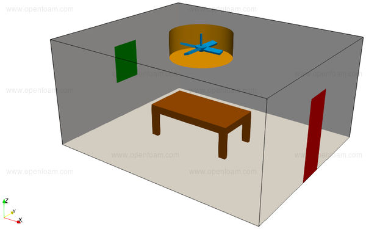
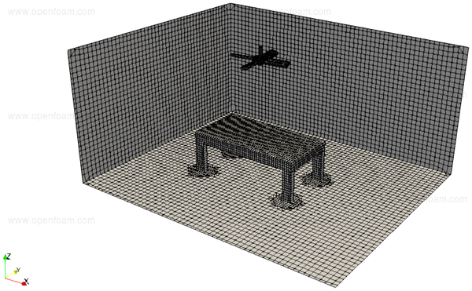
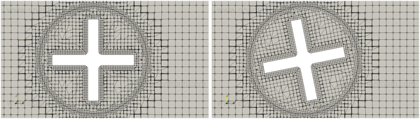
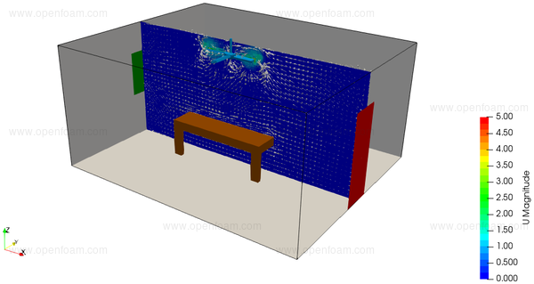
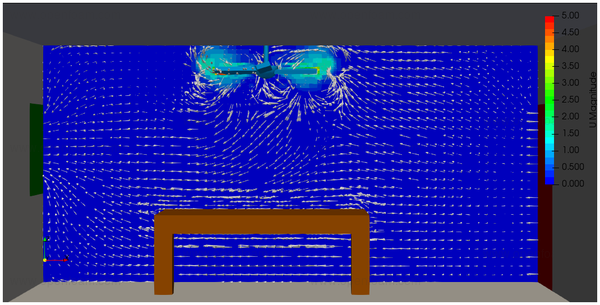

<!-- https://doc.openfoam.com/2606/examples/tutorials/incompressible/pimpleFoam/ami-rotating-fan -->

# Rotating mesh

## Overview

* Solver: [pimpleFoam](../../../../tools/processing/solvers/rtm/incompressible/pimpleFoam/index.md)
* Goals: Learn how to set up
	+ [geometry](ami-rotating-fan.md#geometry)
	+ [mesh](ami-rotating-fan.md#mesh)
	+ case
* [Simulation](ami-rotating-fan.md#simulation) with rotating mesh
	+ example: rotating fan in a room

Case files can be found here:

* [rotatingFanInRoom](https://gitlab.com/openfoam/core/openfoam/-/tree/OpenFOAM-v2606/tutorials/incompressible/pimpleFoam/RAS/rotatingFanInRoom)

## Geometry

The geometry for this tutorial consists of

* room with
	+ door
	+ window (outlet)
* desk
* rotating fan
* cylinder defining
	+ rotating cells
	+ the interpolation surfaces between rotating and non\-rotating cells



## Mesh

The mesh is created with [snappyHexMesh](../../../../tools/pre-processing/mesh/generation/snappyhexmesh.md) using
STL surfaces located in the `constant/triSurface` directory.

```
surfaceFeatureExtract

```

The process begins by extracting features from the STL files (dictionary can
be found in *system/surfaceFeatureExtractDict*).

```
blockMesh

```

This command creates an initial block structured mesh with our starting mesh
resolution (dictionary can be found in *system/blockMeshDict*).

```
snappyHexMesh -overwrite

```

This command refines the initial mesh at the STL surfaces as well as the
extruded features (dictionary can be found in *system/snappyHexMeshDict*).
Layer addition is not utilized in this tutorial for simplicity purposes.
Usual `snappyHexMesh` settings are utilized for a coarse mesh here. One important
entry can be found in the `refinementSurfaces` sub\-dictionary:

```
AMI
{
    level     (2 2);
    faceType  boundary;
    cellZone  rotatingZone;
    faceZone  rotatingZone;
    cellZoneInside inside;
}

```

This defines a cellZone called *rotatingZone*, which will later define the
rotating cells. Additionally we define a boundary, which will be later used to
define the interpolation faces between rotating and non\-rotating regions.

```
renumberMesh -overwrite

```

This commands restructures the mesh for better calculation performance.

```
createPatch -overwrite

```

This command converts the boundary *AMI* to an arbitrary mesh interface (hence
AMI), where during the simulation the interpolation of fields between rotating
and non\-rotating cells will take place (dictionary can be found in
*system/createPatchDict*).

After these steps you can visualize your mesh in ParaView:



* Use higher refinement on AMI and fan for better mesh resolution.
* Use refinement region defined by AMI for uniform mesh resolution within
rotating zone.
* This will however increase your calculation time.

Here you can see the rotating and non\-rotating regions of the mesh:



## Simulation

Now we move from the folder *mesh* to the folder *case*.

### Boundary conditions

* Boundaries in the folder *0* are defined the following way:

	+ door: inlet
	+ outlet (window): outlet
	+ room: wall
	+ desk: wall
	+ fan: moving wall
* velocity **U**

	+ door: [fixedValue](../../../../tools/processing/boundary-conditions/rtm/derived/general/fixedValue/index.md) with \-0\.1 m/s
	+ outlet (window): [pressureInletOutletVelocity](../../../../tools/processing/boundary-conditions/rtm/derived/outlet/pressureInletOutletVelocity/index.md)
	+ room: [noSlip](../../../../tools/processing/boundary-conditions/rtm/derived/wall/noSlip/index.md)
	+ desk: [noSlip](../../../../tools/processing/boundary-conditions/rtm/derived/wall/noSlip/index.md)
	+ fan: [movingWallVelocity](../../../../tools/processing/boundary-conditions/rtm/derived/wall/movingWallVelocity/index.md)
* kinematic pressure **p**

	+ door: `fixedFluxPressure`
	+ outlet (window): [fixedValue](../../../../tools/processing/boundary-conditions/rtm/derived/general/fixedValue/index.md) with atmospheric pressure

```
at 0 Pa

```

* room: `fixedFluxPressure`
* desk: `fixedFluxPressure`
* fan: `fixedFluxPressure`
* turbulent kinetic energy **k**

	+ door: `turbulentIntensityKineticEnergyInlet` with 5% turbulence intensity
	+ outlet (window): [zeroGradient](../../../../tools/processing/boundary-conditions/rtm/derived/general/zeroGradient/index.md)

```
(alternative: [inletOutlet](https://doc.openfoam.com/2606/tools/processing/boundary-conditions/rtm/derived/inletOutlet/inletOutlet/)

```

* room: `kqRWallFunction`
* desk: `kqRWallFunction`
* fan: `kqRWallFunction`
* turbulent dissipation rate **omega**

	+ door: `turbulentMixingLengthFrequencyInlet` with 1\.2m mixing length
	+ outlet (window): [zeroGradient](../../../../tools/processing/boundary-conditions/rtm/derived/general/zeroGradient/index.md)

```
(alternative: [inletOutlet](https://doc.openfoam.com/2606/tools/processing/boundary-conditions/rtm/derived/inletOutlet/inletOutlet/))

```

* room: `omegaWallFunction`
* desk: `omegaWallFunction`
* fan: `omegaWallFunction`
* turbulent kinematic viscosity **nut**

	+ door: [zeroGradient](../../../../tools/processing/boundary-conditions/rtm/derived/general/zeroGradient/index.md)
	+ outlet (window): [zeroGradient](../../../../tools/processing/boundary-conditions/rtm/derived/general/zeroGradient/index.md)

```
(alternative: [inletOutlet](https://doc.openfoam.com/2606/tools/processing/boundary-conditions/rtm/derived/inletOutlet/inletOutlet/))

```

* room: `nutkWallFunction`
* desk: `nutkWallFunction`
* fan: `nutkWallFunction`

### Definition of mesh movement

* Dictionary **dynamicMeshDict** can be found in constant.
* Important entries:
	+ `cellZone rotatingZone;` \- This was defined in *snappyHexMeshDict* to

```
define the rotating cells.

```

* `solidBodyMotionFunction rotatingMotion;` \- rotating mesh movement
* `origin (-3 2 2.6);` \- origin of the axis of rotation of cells (can

```
be anywhere on the rotation axis of the fan)

```

* `axis (0 0 1);` \- direction of the rotation axis (here: z\-direction)
* `omega 10;` \- angular velocity of rotation in rad/s\=

```
(corresponds to ~95.5 rpm)

```

* For a realistic fan movement use `omega 20;`

### Additional dictionaries in constant

* **g** \- gravitational acceleration
* **transportProperties** \- definition of kinematic viscosity
* **turbulenceProperties** \- definition of turbulence model (here: [kOmegaSST](../../../../tools/processing/models/turbulence/ras/linear-evm/rtm/kOmegaSST/index.md))

### Simulation settings

* **controlDict** \- runtime settings
	+ endTime: 1 s (approx. 0\.64 s per revolution)
	+ writeInterval: 0\.1 s
	+ maxCo: 1
* **decomposeParDict** \- parallel setting
* **fvSchemes** \- various discretisation schemes
* **fvSolution** \- numeric settings (matrix solvers, tolerances, correctors)

### Running the simulation

The simulation employs the *pimpleFoam* application, in parallel.

```
decomposePar

```

With this command you divide your mesh and your fields onto multiple processors.

```
mpirun -np 4 pimpleFoam -parallel > log.pimpleFoam &

```

With this command you start your simulation on four cores. If you want to
use a different number of cores you have to change the number (here: 4\) to
you choice. Also don't forget to change the settings in
*system/decomposeParDict*!

## Results

Here you see the flow after *t* \= 0\.64 s.

Velocity magnitude and vectors on a y\-normal plane:



Close\-up of velocity magnitude and vectors on a y\-normal plane:



* For a more developed flow pattern run the simulation until 10\-20s.
