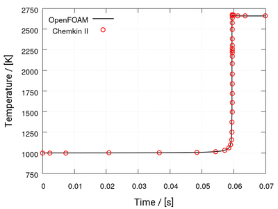
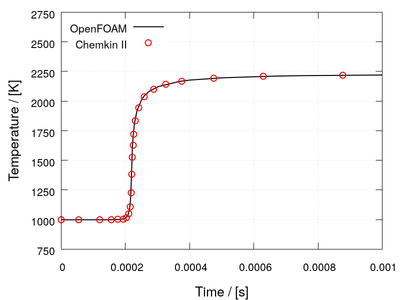
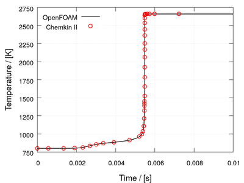
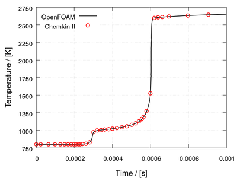

<!-- https://doc.openfoam.com/2606/examples/verification-validation/chemistry/chemFoam/reactions -->

# Reactions

## Overview

* Solver: [chemFoam](../../../../tools/processing/solvers/rtm/combustion/chemFoam/index.md)

## Results

* [gri](https://gitlab.com/openfoam/core/openfoam/-/tree/OpenFOAM-v2606/tutorials/combustion/chemFoam/gri)

* [h2](https://gitlab.com/openfoam/core/openfoam/-/tree/OpenFOAM-v2606/tutorials/combustion/chemFoam/h2)

* [ic8h18](https://gitlab.com/openfoam/core/openfoam/-/tree/OpenFOAM-v2606/tutorials/combustion/chemFoam/ic8h18)

* [nc7h16](https://gitlab.com/openfoam/core/openfoam/-/tree/OpenFOAM-v2606/tutorials/combustion/chemFoam/nc7h16)

