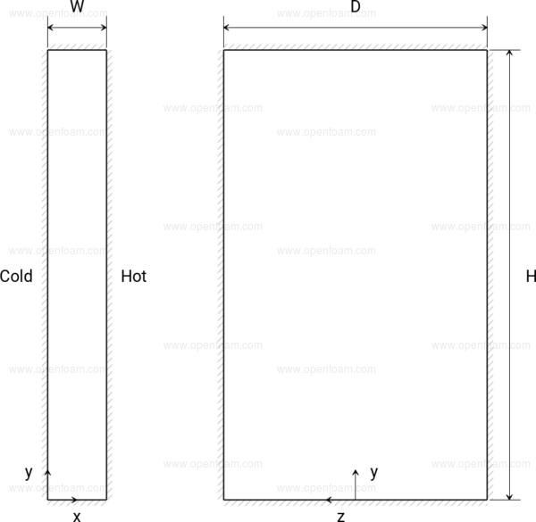

<!-- https://doc.openfoam.com/2606/examples/verification-validation/heat-transfer/buoyant-cavity -->

# Buoyant cavity

## Overview

* Solver: [buoyantSimpleFoam](../../../tools/processing/solvers/rtm/heat-transfer/buoyantSimpleFoam/index.md)
* Investigation into natural convection in a heat cavity
* Experimental case described by Betts and Bokhari
[6](../../../references.md#betts_experiments_2000)
* [buoyantCavity](https://gitlab.com/openfoam/core/openfoam/-/tree/OpenFOAM-v2606/tutorials/heatTransfer/buoyantSimpleFoam/buoyantCavity)

The case is described in the following figure

A temperature difference of 19\.6K is maintained between the hot and cold;
the remaining patches are treated as adiabatic.

## Mesh

* 3D structured mesh created using [blockMesh](../../../tools/pre-processing/mesh/generation/blockMesh/index.md)

## Results

Results are presented for a selection of y/H locations

### Velocity distributions

### Temperature distributions

