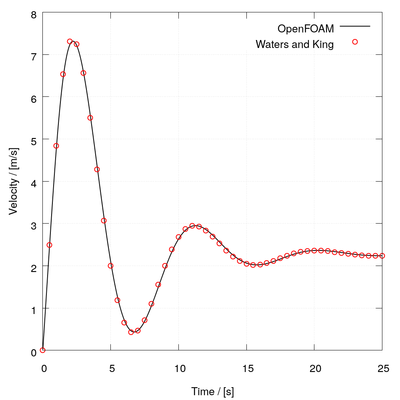

<!-- https://doc.openfoam.com/2606/examples/verification-validation/laminar/planar-poiseuille -->

# Planar Poiseuille non\-Newtonian flow

## Overview

* Solver: [pimpleFoam](../../../tools/processing/solvers/rtm/incompressible/pimpleFoam/index.md)
* Experimental case described by Amoreira and Olivera [3](../../../references.md#amoreira_comparison_2010)
* Start\-up planar Poiseuille flow of a non\-Newtonian fluid
* Modelled using the Maxwell viscoelastic laminar stress model
* Initially at rest
* Constant pressure gradient applied from time zero
* [planarPoiseuille](https://gitlab.com/openfoam/core/openfoam/-/tree/OpenFOAM-v2606/tutorials/incompressible/pimpleFoam/laminar/planarPoiseuille)

## Mesh

* 1D structured mesh created using [blockMesh](../../../tools/pre-processing/mesh/generation/blockMesh/index.md)

## Results

The predictions are compared against the analytical solution for velocity given
by Waters and King [87](../../../references.md#waters_unsteady_1970)

u(y,t)\=32(1−y2)\+∑k\=1∞Ak(t)Bk(t), u(y,t) \= \\frac{3}{2}(1 \- y^2\) \+ \\sum\\limits\_{k\=1}^\\infty A\_k(t)B\_k(t),u(y,t)\=23​(1−y2)\+k\=1∑∞​Ak​(t)Bk​(t),
Ak(t)\=e−bkt{bk−ak2cksinh⁡ckt\+cosh⁡ckt,if bk≥ak,bk−ak2cksin⁡ckt\+cos⁡ckt,if bk\<ak, A\_k(t) \= e^{\-b\_k t}
 \\begin{cases}
 \\frac{b\_k\-a\_k^2}{c\_k}\\sinh c\_k t
 \+ \\cosh c\_k t, \& \\text{if } b\_k \\geq a\_k, \\\\
 \\frac{b\_k\-a\_k^2}{c\_k}\\sin c\_k t
 \+ \\cos c\_k t, \& \\text{if } b\_k \\lt a\_k,
 \\end{cases}Ak​(t)\=e−bk​t{ck​bk​−ak2​​sinhck​t\+coshck​t,ck​bk​−ak2​​sinck​t\+cosck​t,​if bk​≥ak​,if bk​\<ak​,​
Bk(y)\=48(−1)k(2k−1)3π3cos⁡2k−12πy, B\_k(y) \= \\frac{48(\-1\)^k}{(2k \-1\)^3\\pi^3} \\cos \\frac{2k \- 1}{2}\\pi y,Bk​(y)\=(2k−1)3π348(−1)k​cos22k−1​πy,
where

ak\=2k−12πE,  bk\=1\+βak22,  ck\=∣bk2−ak2∣. a\_k \= \\frac{2k \- 1}{2}\\pi \\sqrt{E},\\;
 b\_k \= \\frac{1\+\\beta a\_k^2}{2},\\;
 c\_k \= \\sqrt{\|b\_k^2 \- a\_k^2\|}.ak​\=22k−1​πE​,bk​\=21\+βak2​​,ck​\=∣bk2​−ak2​∣​.

