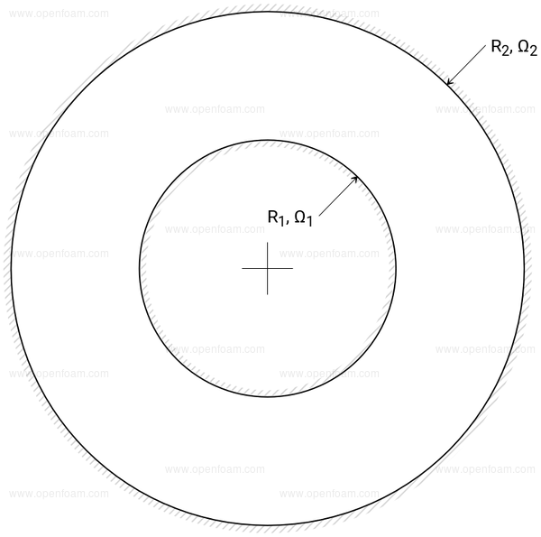
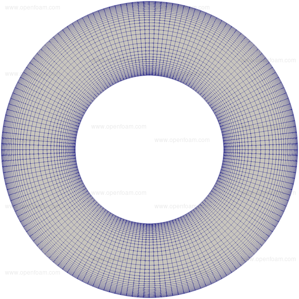

<!-- https://doc.openfoam.com/2606/examples/verification-validation/laminar/rotating-cylinders-2d -->

# Rotating cylinders

## Overview

* Solver: [simpleFoam](../../../tools/processing/solvers/rtm/incompressible/simpleFoam/index.md)
* Incompressible
* Steady
* Laminar
* Multiple Reference Frame (MRF)
* TODO: tutorial path

The case comprises two cylinders, with inner radius R1R\_1R1​ rotating with
angular velocity Ω1\\Omega\_1Ω1​, and outer radius R2R\_2R2​ rotating with
angular velocity Ω2\\Omega\_2Ω2​.

The laminar case corresponds to a Reynolds number of 100\. where the Reynolds
number os defined as:

Re\=∣u0∣dνRe \= \\frac{\|\\u\_0\| d}{\\nu}Re\=ν∣u0​∣d​

Where u0\\u\_0u0​ is the angular velocity of the inner cylinder, i.e.

u0\=Ω1R1\\u\_0 \= \\Omega\_1 R\_1u0​\=Ω1​R1​

and ddd is the distance between the cylinders, i.e. R2−R1R\_2 \- R\_1R2​−R1​.
Using an inner and outer radii of 1 and 2, respectively, and setting the
kinematic viscosity to 111, the angular velocity of the inner cylinder
is 100 rad/s.

## Analytical solution

Taylor [77](../../../references.md#taylor_stability_1922) shows that the velocity,
uθ\\u\_{\\theta} uθ​ is described by:

uθ\=Ar\+Br \\u\_{\\theta} \= A r \+ \\frac{B}{r}uθ​\=Ar\+rB​
where AAA and BBB are constants defined as:

A\=Ω1(1−μR22R12)1−R22R12 A \= \\frac{\\Omega\_1 \\left( 1 \- \\mu \\frac{R\_2^2}{R\_1^2} \\right)}{1 \- \\frac{R\_2^2}{R\_1^2}}A\=1−R12​R22​​Ω1​(1−μR12​R22​​)​
B\=R12Ω1(1−μ)1−R12R22 B \= \\frac{R\_1^2 \\Omega\_1 (1 \- \\mu)}{1 \- \\frac{R\_1^2}{R\_2^2}}B\=1−R22​R12​​R12​Ω1​(1−μ)​
Here, Ω1\\Omega\_1Ω1​ and Ω2\\Omega\_2Ω2​ are the rotational speeds of the
inner and outer cylinders, and

μ\=Ω2Ω1 \\mu \= \\frac{\\Omega\_2}{\\Omega\_1}μ\=Ω1​Ω2​​
The steady flow equations for this case, in cylindrical co\-ordinates reduces to

1ρ∂p∂r−uθ2r\=0 \\frac{1}{\\rho}\\frac{\\partial p}{\\partial r} \- \\frac{\\u\_{\\theta}^2}{r} \= 0ρ1​∂r∂p​−ruθ2​​\=0
On integrating with respect to radius an expression for the pressure is
recovered:

p\=A2r22\+2ABln⁡(r)\+B22r2\+C p \= \\frac{A^2 r^2}{2} \+ 2 A B \\ln (r) \+ \\frac{B^2}{2 r^2} \+ Cp\=2A2r2​\+2ABln(r)\+2r2B2​\+C
## Mesh

* 2D structured mesh created using [blockMesh](../../../tools/pre-processing/mesh/generation/blockMesh/index.md)

## Boundary conditions

* Outer cylinder fixed
* Inner cylinder rotates at a fixed angular velocity

## Results

The rotational velocity, uθ\\u\_\\thetauθ​ can be directly reported during the
calculation using a [fieldCoordinateSystemTransform](../../../tools/post-processing/function-objects/field/fieldCoordinateSystemTransform.md)
function object.

