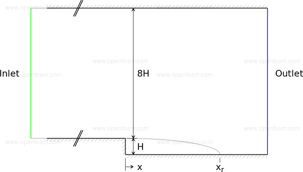
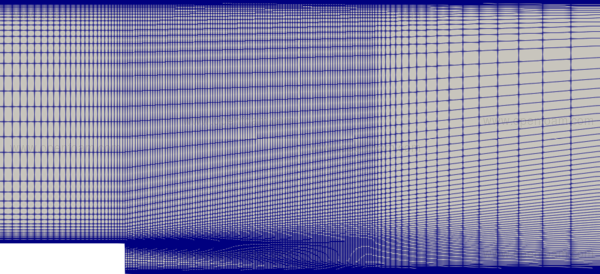
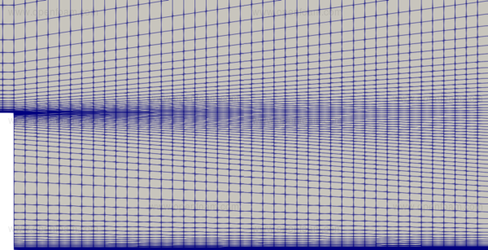

<!-- https://doc.openfoam.com/2606/examples/verification-validation/turbulent/backward-facing-step -->

# Backward facing step

## Overview

* Solver: [simpleFoam](../../../tools/processing/solvers/rtm/incompressible/simpleFoam/index.md)
* Experimental case described by Driver and Seegmiller
[14](../../../references.md#driver_features_1985)
* CFD case based on <https://turbmodels.larc.nasa.gov/backstep_val.html>
* Reynolds number based on the step height of RehRe\_hReh​ 36000
* Reattachment at 6\.26\+\-0\.1 x/h
* [backwardFacingStep2D](https://gitlab.com/openfoam/core/openfoam/-/tree/OpenFOAM-v2606/tutorials/incompressible/simpleFoam/backwardFacingStep2D)

## Mesh

* 2D structured mesh created using [blockMesh](../../../tools/pre-processing/mesh/generation/blockMesh/index.md)

## Boundary conditions

* UUU 44\.2 m/s
* hhh 1\.27 cm

### Common fields

Velocity: `U`

| Patch | Condition | Value |
| --- | --- | --- |
| Inlet | [fixedValue](../../../tools/processing/boundary-conditions/rtm/derived/general/fixedValue/index.md) | 44\.2 m/s in x |
| Outlet | [zeroGradient](../../../tools/processing/boundary-conditions/rtm/derived/general/zeroGradient/index.md) |  |
| Walls | [noSlip](../../../tools/processing/boundary-conditions/rtm/derived/wall/noSlip/index.md) |  |

Pressure: `p`

| Patch | Condition | Value |
| --- | --- | --- |
| Inlet | [zeroGradient](../../../tools/processing/boundary-conditions/rtm/derived/general/zeroGradient/index.md) |  |
| Outlet | [fixedValue](../../../tools/processing/boundary-conditions/rtm/derived/general/fixedValue/index.md) | 0 Pa (static) |
| Walls | [zeroGradient](../../../tools/processing/boundary-conditions/rtm/derived/general/zeroGradient/index.md) |  |

### Turbulence fields

* turbulence model: [kOmegaSST](../../../tools/processing/models/turbulence/ras/linear-evm/rtm/kOmegaSST/index.md)

Turbulence viscosity: `nut`

| Patch | Condition | Value |
| --- | --- | --- |
| Inlet | `calculated` |  |
| Outlet | `calculated` |  |
| Walls | `nutUSpaldingWallFunction` |  |

#### kOmega SST

Turbulence kinetic energy: `k`

| Patch | Condition | Value |
| --- | --- | --- |
| Inlet | [fixedValue](../../../tools/processing/boundary-conditions/rtm/derived/general/fixedValue/index.md) | based on 0\.061% intensity |
| Outlet | [zeroGradient](../../../tools/processing/boundary-conditions/rtm/derived/general/zeroGradient/index.md) |  |
| Walls | `kqRWallFunction` |  |

Turbulence specific dissipation rate: `omega`

| Patch | Condition | Value |
| --- | --- | --- |
| Inlet | [fixedValue](../../../tools/processing/boundary-conditions/rtm/derived/general/fixedValue/index.md) | based on nut/nu \= 0\.009 |
| Outlet | [zeroGradient](../../../tools/processing/boundary-conditions/rtm/derived/general/zeroGradient/index.md) |  |
| Walls | `omegaWallFunction` |  |

## Results

Predictions are compared against the measurements by Driver and Seegmiller
[14](../../../references.md#driver_features_1985) below

