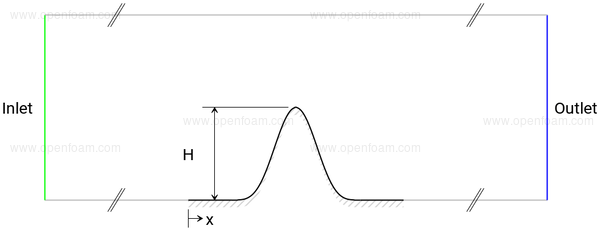
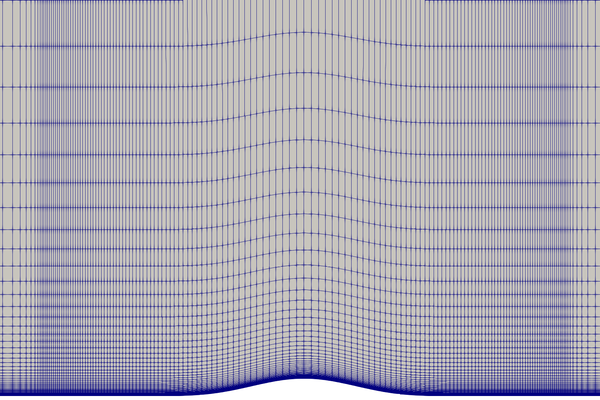

<!-- https://doc.openfoam.com/2606/examples/verification-validation/turbulent/bump-2d -->

# Bump (2D)

## Overview

* Solver: [simpleFoam](../../../tools/processing/solvers/rtm/incompressible/simpleFoam/index.md)
* 2D flow over a bump at a Reynolds number of 3×1063 \\times 10^63×106 (L\=1m)
* Based on the description provided by the
[NASA Turbulence Modelling Resource](https://turbmodels.larc.nasa.gov/bump.html)
* [bump2D](https://gitlab.com/openfoam/core/openfoam/-/tree/OpenFOAM-v2606/tutorials/incompressible/simpleFoam/bump2D)

## Mesh

* 2D structured mesh created using [blockMesh](../../../tools/pre-processing/mesh/generation/blockMesh/index.md)
* bump described

y(x)\={0\.05\[sin⁡(πx0\.9−π3)]4,0\.3≤x≤1\.2,0,0≤x\<0\.3 and 1\.2\<x≤1\.5\. y(x) \=
 \\begin{cases}
 0\.05 \[\\sin(\\pi \\frac{x}{0\.9}\-\\frac{\\pi}{3})]^4, \& 0\.3 \\le x \\le 1\.2, \\\\
 0 , \& 0 \\le x \\lt 0\.3 \\, \\text{and} \\, 1\.2 \\lt x \\le 1\.5\.
 \\end{cases}y(x)\={0\.05\[sin(π0\.9x​−3π​)]4,0,​0\.3≤x≤1\.2,0≤x\<0\.3and1\.2\<x≤1\.5\.​
* this has been set in the `blockMeshDict` using a `codeStream`

## Boundary conditions

* UUU based on a Mach number of 0\.2\. Mach number, MaMaMa, is defined
as:

Ma\=γRT Ma \= \\sqrt{\\gamma R T}Ma\=γRT​
where γ\\gammaγ is the ratio of specific heats, RRR the gas
constant and TTT the temperature. Using values for air at 300K, the
inflow velocity is given as:

U\=0\.2Ma\=0\.21\.4×287×300\=69\.44m/s U \= 0\.2 Ma \= 0\.2 \\sqrt{1\.4 \\times 287 \\times 300} \= 69\.44 m/sU\=0\.2Ma\=0\.21\.4×287×300​\=69\.44m/s
* The laminar viscosity is derived from the Reynolds number, i.e.

ν∞\=∣u∣LRe\=69\.44×13×106\=2\.31×10−5m2/s \\nu\_\\infty \= \\frac{\|\\u\| L}{Re} \= \\frac{69\.44 \\times 1}{3 \\times 10^6} \= 2\.31 \\times 10^{\-5} m^2/sν∞​\=Re∣u∣L​\=3×10669\.44×1​\=2\.31×10−5m2/s

### Common fields

Velocity: `U`

| Patch | Condition | Value |
| --- | --- | --- |
| Inlet | [fixedValue](../../../tools/processing/boundary-conditions/rtm/derived/general/fixedValue/index.md) | 69\.44 m/s in x |
| Outlet | [zeroGradient](../../../tools/processing/boundary-conditions/rtm/derived/general/zeroGradient/index.md) |  |
| Bump | [noSlip](../../../tools/processing/boundary-conditions/rtm/derived/wall/noSlip/index.md) |  |
| Walls | [symmetryPlane](../../../tools/processing/boundary-conditions/rtm/constraint/symmetryPlane/index.md) |  |

Pressure: `p`

| Patch | Condition | Value |
| --- | --- | --- |
| Inlet | [zeroGradient](../../../tools/processing/boundary-conditions/rtm/derived/general/zeroGradient/index.md) |  |
| Outlet | [fixedValue](../../../tools/processing/boundary-conditions/rtm/derived/general/fixedValue/index.md) | 0 Pa (static) |
| Bump | [zeroGradient](../../../tools/processing/boundary-conditions/rtm/derived/general/zeroGradient/index.md) |  |
| Walls | [symmetryPlane](../../../tools/processing/boundary-conditions/rtm/constraint/symmetryPlane/index.md) |  |

### Turbulence fields

* turbulence model: [Spalart Allmaras](../../../tools/processing/models/turbulence/ras/linear-evm/rtm/SpalartAllmaras/index.md)

Turbulence viscosity: `nut`

| Patch | Condition | Value |
| --- | --- | --- |
| Inlet | `calculated` |  |
| Outlet | `calculated` |  |
| Bump | `nutUSpaldingWallFunction` |  |
| Walls | `symmetryPlane` |  |

#### Spalart\-Allmaras

Modified turbulence viscosity: `nuTilda`

| Patch | Condition | Value |
| --- | --- | --- |
| Inlet | [fixedValue](../../../tools/processing/boundary-conditions/rtm/derived/general/fixedValue/index.md) | based on 3ν∞ 3 \\nu\_\\infty3ν∞​ |
| Outlet | [zeroGradient](../../../tools/processing/boundary-conditions/rtm/derived/general/zeroGradient/index.md) |  |
| Bump | [fixedValue](../../../tools/processing/boundary-conditions/rtm/derived/general/fixedValue/index.md) | 0 |
| Walls | [symmetryPlane](../../../tools/processing/boundary-conditions/rtm/constraint/symmetryPlane/index.md) |  |

## Results

The [NASA Turbulence Modelling Resource](https://turbmodels.larc.nasa.gov/bump.html)
employs a code comparison to show that the FUN3D and CFL3D codes produce
equivalent results for this case. OpenFOAM and CFL3D results are presented in
the following series of images, showing that OpenFOAM results compare very
favourably.

