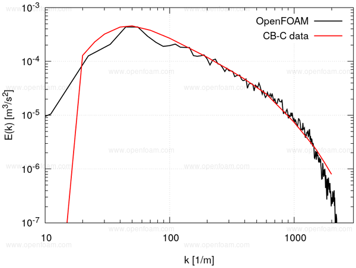

<!-- https://doc.openfoam.com/2606/examples/verification-validation/turbulent/decay-homogeneous-isotropic-turbulence -->

# Decay of homogeneous incompressible isotropic turbulence

## Overview

* Solver: [pimpleFoam](../../../tools/processing/solvers/rtm/incompressible/pimpleFoam/index.md)
* 3D decay of homogeneous incompressible isotropic turbulence (HIIT) based on
the reference [10](../../../references.md#comte-bellot_simple_1971)
* Mesh and initial velocity field created using the `createBoxTurb` utility
* Energy spectrum calculated using the `energySpectrum` function object
* [decayIsoTurb](https://gitlab.com/openfoam/core/openfoam/-/tree/OpenFOAM-v2606/tutorials/incompressible/pimpleFoam/LES/decayIsoTurb)

The domain comprises a 3D cube with a side length is
L\=0\.09×2πL \= 0\.09 \\times 2 \\piL\=0\.09×2π m:

Cyclic conditions are applied to all patches.

Measurements were performed at a Reynolds number of 34000, based on a length
scale of 5\.08 cm and velocity of 10 m/s. This suggests a laminar viscosity of

ν\=∣u0∣LRe\=10×0\.050834000\=1\.5×10−5m2/s \\nu \= \\frac{\|\\u\_0\| L}{\\mathrm{Re}}
 \= \\frac{10 \\times 0\.0508}{34000}
 \= 1\.5 \\times 10^{\-5} m^2/sν\=Re∣u0​∣L​\=3400010×0\.0508​\=1\.5×10−5m2/s
Turbulence quantities were measured at non\-dimensional times of:

t∗\=t∣u0∣L\=42,98,171, t^\* \= \\frac{t \|\\u\_0\|}{L} \= 42, 98, 171,t∗\=Lt∣u0​∣​\=42,98,171,
equating to dimensional times of 0\.213, 0\.498 and 0\.869 seconds. By basing the
initial condition on the 0\.213s data, the comparisons can be performed at
0\.285s and 0\.656s.

## Mesh

The block mesh is created using the `createBoxTurb` utility, with the
`-createBlockMesh` option

## Boundary conditions

Cyclic conditions are applied to all patches

## Initial conditions

An initial velocity field was created using the `createBoxTurb` utility.
This is based on the procedure described by Saad et. al.
[61](../../../references.md#saad_scalable_2017), using the turbulence energy spectra at
t∗\=42t^\*\= 42t∗\=42.

## Results

These are initial results and further details will be available shortly

An animation for a 256x256x256 box showing the velocity field, and turbulence
structures using the Q criterion shows the decay of the complex flow field.

An example of the decay profiles for the WALE LES model shows good agreement.

The grey region represents the wave numbers above the Nyquist limit for this
mesh.
