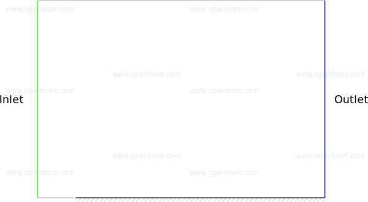
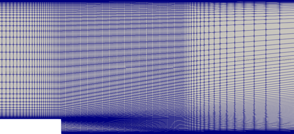
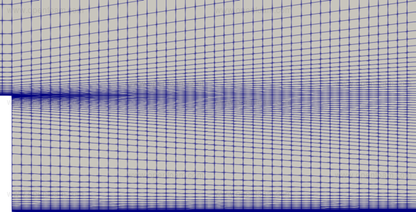
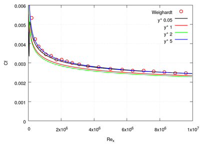
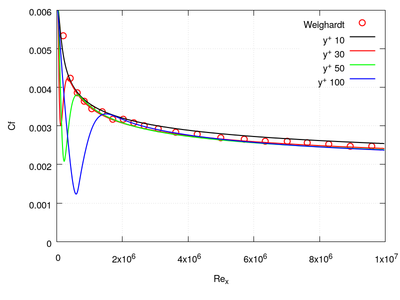

<!-- https://doc.openfoam.com/2606/examples/verification-validation/turbulent/flat-plate-zpg -->

# Turbulent flat plate

## Overview

* Solver: [simpleFoam](../../../tools/processing/solvers/rtm/incompressible/simpleFoam/index.md)
* 2D flat plate test case based on the reference <https://turbmodels.larc.nasa.gov/flatplate.html>
* Zero pressure gradient
* Reynolds number based on the plate length of ReL\=5×106 Re\_L \= 5 \\times 10^6ReL​\=5×106
* Turbulence is modelled using the [kOmegaSST](../../../tools/processing/models/turbulence/ras/linear-evm/rtm/kOmegaSST/index.md)
* [turbulentFlatPlate](https://gitlab.com/openfoam/core/openfoam/-/tree/OpenFOAM-v2606/tutorials/incompressible/simpleFoam/turbulentFlatPlate)

The domain comprises a 2D rectangular slab as shown below:

## Mesh

Several meshes are employed to highlight the sensitivity of the computed
skin friction coefficient to the near wall y\+y^\+y\+ over the range
0\.05\<y\+\<1000\.05 \< y^\+ \< 1000\.05\<y\+\<100. All meshes are generated using
[blockMesh](../../../tools/pre-processing/mesh/generation/blockMesh/index.md) and employ the same number of cells
whereby the first cell height is varied by changing the expansion ratio from
the wall patch.

## Boundary conditions

### Common fields

Velocity: `U`

| Patch | Condition | Value |
| --- | --- | --- |
| Inlet | [fixedValue](../../../tools/processing/boundary-conditions/rtm/derived/general/fixedValue/index.md) | 69\.4 m/s in x |
| Outlet | [zeroGradient](../../../tools/processing/boundary-conditions/rtm/derived/general/zeroGradient/index.md) |  |
| Walls | [noSlip](../../../tools/processing/boundary-conditions/rtm/derived/wall/noSlip/index.md) |  |

Pressure: `p`

| Patch | Condition | Value |
| --- | --- | --- |
| Inlet | [zeroGradient](../../../tools/processing/boundary-conditions/rtm/derived/general/zeroGradient/index.md) |  |
| Outlet | [fixedValue](../../../tools/processing/boundary-conditions/rtm/derived/general/fixedValue/index.md) | 0 Pa (static) |
| Walls | [zeroGradient](../../../tools/processing/boundary-conditions/rtm/derived/general/zeroGradient/index.md) |  |

Turbulence viscosity: `nut`

| Patch | Condition | Value |
| --- | --- | --- |
| Inlet | `calculated` |  |
| Outlet | `calculated` |  |
| Walls | `nutUSpaldingWallFunction` |  |

### Turbulence fields

Inlet conditions are based on an inlet turbulence intensity of 0\.0039%, and
turbulence viscosity ratio of 0\.009\.

Turbulence kinetic energy: `k`

| Patch | Condition | Value |
| --- | --- | --- |
| Inlet | [fixedValue](../../../tools/processing/boundary-conditions/rtm/derived/general/fixedValue/index.md) | based on 0\.039% intensity |
| Outlet | [zeroGradient](../../../tools/processing/boundary-conditions/rtm/derived/general/zeroGradient/index.md) |  |
| Walls | `kqRWallFunction` |  |

Turbulence specific dissipation rate: `omega`

| Patch | Condition | Value |
| --- | --- | --- |
| Inlet | [fixedValue](../../../tools/processing/boundary-conditions/rtm/derived/general/fixedValue/index.md) | based on nut/nu \= 0\.009 |
| Outlet | [zeroGradient](../../../tools/processing/boundary-conditions/rtm/derived/general/zeroGradient/index.md) |  |
| Walls | `omegaWallFunction` |  |

## Results

The following figures show the predicted skin friction coefficient as a
function of Reynolds number, compared against the experimental data from
Weighardt [88](../../../references.md#wieghardt_turbulent_1951)

