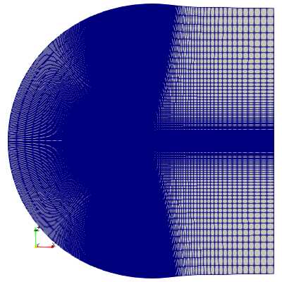
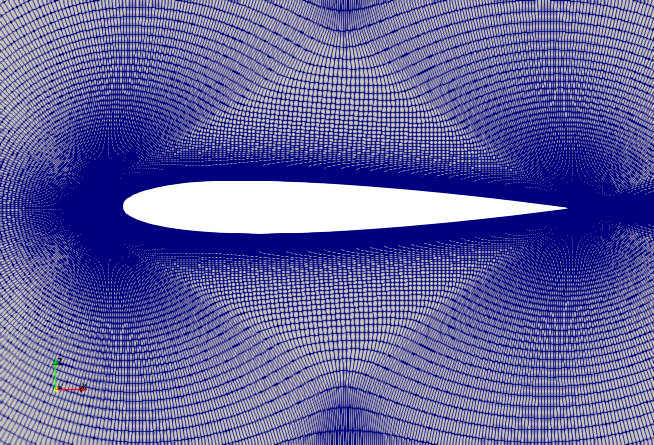

<!-- https://doc.openfoam.com/2606/examples/verification-validation/turbulent/naca0012 -->

# Turbulent flow over NACA0012 airfoil (2D)

## Overview

* Based on <https://turbmodels.larc.nasa.gov/naca0012_val.html> [53](../../../references.md#nasa_naca0012_2018)
* References: Gregory\-O'Reilly (1970\) [21](../../../references.md#gregory_naca0012_1970),
McCroskey (1987\) [47](../../../references.md#mccroskey_critical_1987),
Ladson (1988\) [32](../../../references.md#ladson_effects_1988),
Spalart\-Allmaras (1994\) [69](../../../references.md#spalart_one-equation_1994), and
Krist et al. (1997\) [29](../../../references.md#krist_cfl3d_1997)
* See the [resources](naca0012.md#resources) section for additional data files

**Flow physics:**

* External flow
* Steady
* High Reynolds number
* Low Mach number, subsonic
* Newtonian, single\-phase, incompressible, non\-reacting

**Solver:**

* [simpleFoam](../../../tools/processing/solvers/rtm/incompressible/simpleFoam/index.md)

**Tutorial case:**

* [airFoil2D](https://gitlab.com/openfoam/core/openfoam/-/tree/OpenFOAM-v2606/tutorials/incompressible/simpleFoam/airFoil2D)

## Physics and Numerics

**Physical domain:**

* The case is a two\-dimensional airfoil located around the centre of a
computational domain whose dimensions are considerably larger than the
chord\-length of the airfoil.
	+ xxx: Longitudinal direction (mean flow direction)
	+ yyy: Spanwise direction (statistically homogeneous direction)
	+ zzz: Vertical direction (wall\-normal direction)
	+ OOO: Origin at the leading edge of the airfoil

**Physical modelling:**

* Reynolds number based on local chord length:
Rec\=Ux c ν−1≈6×106\\text{Re}\_c \= U\_x \\, c \\, \\nu^{\-1} \\approx 6\\times10^6Rec​\=Ux​cν−1≈6×106
	+ Streamwise far\-field flow speed: Ux\=51\.4815U\_x \= 51\.4815Ux​\=51\.4815 \[m⋅s\<sup\>\-1\</sup\>]
	+ Characteristic length (Local chord length of the airfoil):
	c\=1\.0c \= 1\.0c\=1\.0 \[m]
	+ Kinematic viscosity of fluid: νfluid\=8\.58×10−6\\nu\_\\text{fluid} \= 8\.58 \\times 10^{\-6}νfluid​\=8\.58×10−6

```
\[m<sup>2</sup>⋅s<sup>-1</sup>\]

```

* Mach number: Ma\=Ux/Us≈0\.15\\text{Ma} \= U\_x / U\_s \\approx 0\.15Ma\=Ux​/Us​≈0\.15
	+ Speed of sound: Us\=343\.21U\_s \= 343\.21Us​\=343\.21 \[m⋅s\<sup\>\-1\</sup\>]
* Turbulence model: [Spalart Allmaras](../../../tools/processing/models/turbulence/ras/linear-evm/rtm/SpalartAllmaras/index.md)

**Numerical domain modelling:**

* Shape: extruded C\-grid
* Dimensions: (x,y,z)≈(985\.5,1\.0,1015\.6)(x, y, z) \\approx (985\.5, 1\.0, 1015\.6\)(x,y,z)≈(985\.5,1\.0,1015\.6) \[m]
* Sketch (View direction to yyy\-positive):



**Spatial domain discretisation:**

* Mesh type: hexahedral cells in *plot3d* format
* Mesh converter: [plot3dToFoam](https://api.openfoam.com/2606/plot3dToFoam.html)
* Number of cells, NNN : (Nx,Ny,Nz)\=(257,1,897)(N\_x, N\_y, N\_z) \= (257, 1, 897\)(Nx​,Ny​,Nz​)\=(257,1,897)
* First wall\-normal cell centre height: Δy\+\<1\\Delta\_y^\+ \< 1Δy\+​\<1
* Mesh detail (View direction to yyy\-positive):



**Equation discretisation:**

Spatial derivatives and variables:

* Gradient: [Gauss linear](../../../tools/processing/numerics/schemes/divergence/rtm/linear/index.md)
* Divergence:
	+ `default`: [Gauss](../../../tools/processing/numerics/schemes/gauss-theorem.md) `linear`
	+ `div(phi,U)`: `bounded Gauss`

```
[linearUpwind](https://doc.openfoam.com/2606/tools/processing/numerics/schemes/divergence/rtm/linearUpwind/) `grad(U)`

```

* `div(phi,nuTilda)`: `bounded Gauss linearUpwind grad(nuTilda)`
* Laplacian: `Gaussian linear corrected`
* Surface\-normal gradient: [corrected](../../../tools/processing/numerics/schemes/sngrad/rtm/corrected/index.md)

Temporal derivatives and variables:

* `ddtSchemes`: [steadyState](../../../tools/processing/numerics/schemes/time/rtm/steadyState/index.md)

**Numerical boundary conditions:**

* Velocity, U\\mathbf{U}U

| Patch | Condition | Value \[m⋅s\<sup\>\-1\</sup\>] |
| --- | --- | --- |
| Inlet | freestreamVelocity | Uα\\mathbf{U}\_\\alphaUα​ |
| Outlet | freestreamVelocity | Uα\\mathbf{U}\_\\alphaUα​ |
| Sides (y\\text{(}y (y\-dir) | empty | \- |
| Aerofoil | fixedValue | (0\.0, 0\.0, 0\.0\) |

| \<b\> α \</b\> | \<b\> U \</b\>\<sub\>α\</sub\> |
| --- | --- |
| α\=0o\\alpha \= 0^oα\=0o | (51\.4815, 0\.00, 0\.0000\) |
| α\=10o\\alpha \= 10^oα\=10o | (50\.6994, 0\.00, 8\.9397\) |
| α\=15o\\alpha \= 15^oα\=15o | (49\.7273, 0\.00, 13\.3244\) |

* Kinematic pressure, `p`

| Patch | Condition | Value \[m\<sup\>2\</sup\>⋅s\<sup\>\-2\</sup\>] |
| --- | --- | --- |
| Inlet | freestreamPressure | 0\.0 |
| Outlet | freestreamPressure | 0\.0 |
| Sides (y\\text{(}y (y\-dir) | empty | \- |
| Aerofoil | zeroGradient | \- |

* Turbulent kinematic viscosity, `nut` (i.e. νt\\nu\_tνt​)

| Patch | Condition | Value \[m\<sup\>2\</sup\>⋅s\<sup\>\-1\</sup\>] |
| --- | --- | --- |
| Inlet | freestream | 8\.58e−6≈νfluid8\.58e^{\-6} \\approx \\nu\_\\text{fluid}8\.58e−6≈νfluid​ [54](../../../references.md#nasa_spalart-allmaras_2018) |
| Outlet | freestream | 8\.58e−6≈νfluid8\.58e^{\-6}\\approx \\nu\_\\text{fluid}8\.58e−6≈νfluid​ [54](../../../references.md#nasa_spalart-allmaras_2018) |
| Sides (y\\text{(}y (y\-dir) | empty | \- |
| Aerofoil | fixedValue | 0\.0 [54](../../../references.md#nasa_spalart-allmaras_2018) |

* Spalart\-Allmaras model modified viscosity, `nuTilda` (i.e. ν\~\\tilde{\\nu}ν\~)

| Patch | Condition | Value \[m\<sup\>2\</sup\>⋅s\<sup\>\-1\</sup\>] |
| --- | --- | --- |
| Inlet | freestream | 3\.432e−5≈4νfluid3\.432e^{\-5} \\approx 4 \\nu\_\\text{fluid}3\.432e−5≈4νfluid​ [54](../../../references.md#nasa_spalart-allmaras_2018) |
| Outlet | freestream | 3\.432e−5≈4νfluid3\.432e^{\-5}\\approx 4 \\nu\_\\text{fluid}3\.432e−5≈4νfluid​ [54](../../../references.md#nasa_spalart-allmaras_2018) |
| Sides (y\\text{(}y (y\-dir) | empty | \- |
| Aerofoil | fixedValue | 0\.0 [54](../../../references.md#nasa_spalart-allmaras_2018) |

**Solution algorithms and solvers:**

* Pressure\-velocity: [SIMPLE](../../../tools/processing/solvers/pressure-velocity/simple.md)
* Parallel decomposition of spatial domain and fields: Not applicable

* Linear solvers:

| Field | Linear Solver | Smoother | Tolerance (rel) |
| --- | --- | --- | --- |
| `U` | [smooth](../../../tools/processing/numerics/solvers/smooth.md) | [GaussSeidel](../../../tools/processing/numerics/solvers/smooth/rtm/gaussSeidel/index.md) | 0\.01 |
| `p` | [GAMG](../../../tools/processing/numerics/solvers/multigrid/rtm/GAMG/index.md) | [GaussSeidel](../../../tools/processing/numerics/solvers/smooth/rtm/gaussSeidel/index.md) | 0\.01 |
| `nuTilda` | [smooth](../../../tools/processing/numerics/solvers/smooth.md) | [GaussSeidel](../../../tools/processing/numerics/solvers/smooth/rtm/gaussSeidel/index.md) | 0\.01 |

## Results

**List of metrics:**

* Lift coefficient CL\\mathrm{C}\_\\mathrm{L}CL​ vs. Angle of attack α\\alphaα
* Drag coefficient CD\\mathrm{C}\_\\mathrm{D}CD​ vs. Angle of attack α\\alphaα
* Drag coefficient CD\\mathrm{C}\_\\mathrm{D}CD​ vs. Lift coefficient CL\\mathrm{C}\_\\mathrm{L}CL​
* Surface pressure coefficient Cp\\mathrm{C}\_pCp​ vs. Normalised chord length x/cx/cx/c
* Surface skin friction coefficient Cf\\mathrm{C}\_fCf​ vs. Normalised chord length x/cx/cx/c
* ⋅‾{\\overline{\\cdot}}⋅ is the time\-averaging operator

![Surface pressure coefficient vs. Normalised chord length at α=0 [degree]](/img/examples/verification-validation/turbulent/naca0012/CP-xc-Alpha-0.png)![Surface pressure coefficient vs. Normalised chord length at α=10 [degree]](/img/examples/verification-validation/turbulent/naca0012/CP-xc-Alpha-10.png)![Surface pressure coefficient vs. Normalised chord length at α=15 [degree]](/img/examples/verification-validation/turbulent/naca0012/CP-xc-Alpha-15.png)![Surface skin friction coefficient vs. Normalised chord length at α=0 [degree]](/img/examples/verification-validation/turbulent/naca0012/CF-xc-Alpha-0.png)![Surface skin friction coefficient vs. Normalised chord length at α=10 [degree]](/img/examples/verification-validation/turbulent/naca0012/CF-xc-Alpha-10.png)![Surface skin friction coefficient vs. Normalised chord length at α=15 [degree]](/img/examples/verification-validation/turbulent/naca0012/CF-xc-Alpha-15.png)
## Resources

Note: Links will take you to the NASA website

### Mesh

* [Mesh description](https://turbmodels.larc.nasa.gov/naca0012_grids.html)
* [Mesh: (3\-D) 2 x 897 x 257 with 2 x 513 points on airfoil surface (gzipped, 5\.1 MB)](https://turbmodels.larc.nasa.gov/NACA0012_grids/n0012_897-257.p3dfmt.gz)

### Datasets for verifications (plain text)

Lift and drag coefficients vs angle of attack

* [Experiment](https://turbmodels.larc.nasa.gov/NACA0012_validation/CLCD_Ladson_expdata.dat) [32](../../../references.md#ladson_effects_1988)
* [Numerical (CFL3D software)](https://turbmodels.larc.nasa.gov/NACA0012_validation/n0012clcd_cfl3d_sa.dat) [29](../../../references.md#krist_cfl3d_1997)

Pressure distribution vs local chord length

* [Experiment](https://turbmodels.larc.nasa.gov/NACA0012_validation/CP_Gregory_expdata.dat) [32](../../../references.md#ladson_effects_1988)
* [Numerical (CFL3D software)](https://turbmodels.larc.nasa.gov/NACA0012_validation/n0012cp_cfl3d_sa.dat) [29](../../../references.md#krist_cfl3d_1997)

Lift coefficient vs angle of attack

* [Theoretical](https://turbmodels.larc.nasa.gov/NACA0012_validation/0012.mccroskeydata.cl.dat) [47](../../../references.md#mccroskey_critical_1987)

Skin friction coefficient vs local chord length

* [Numerical (CFL3D software)](https://turbmodels.larc.nasa.gov/NACA0012_validation/n0012cf_cfl3d_sa.dat) [29](../../../references.md#krist_cfl3d_1997)
