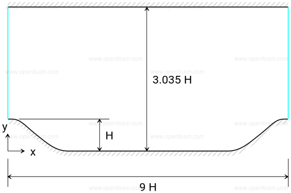
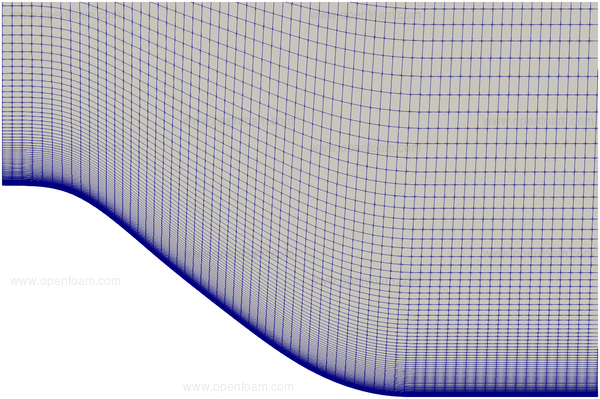
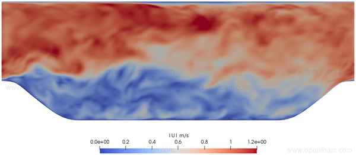
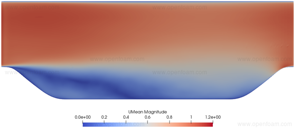
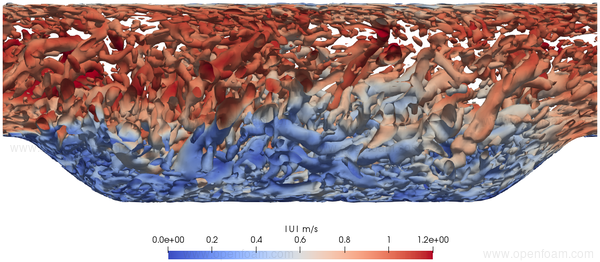

<!-- https://doc.openfoam.com/2606/examples/verification-validation/turbulent/periodic-hill -->

# Periodic hill

## Overview

* 3D flow over a bump at a Reynolds number of 105651056510565 (L\=0\.028m)
* Steady case used to initialise the transient case
	+ Steady case: [simpleFoam](../../../tools/processing/solvers/rtm/incompressible/simpleFoam/index.md)
	+ Transient case: [pimpleFoam](../../../tools/processing/solvers/rtm/incompressible/pimpleFoam/index.md)
* Flow driven using a [mean velocity force](../../../tools/processing/numerics/fvoptions/sources/rtm/meanVelocityForce/index.md)
[fvOption](../../../tools/processing/numerics/fvoptions.md)
* [periodicHill](https://gitlab.com/openfoam/core/openfoam/-/tree/OpenFOAM-v2606/tutorials/incompressible/pimpleFoam/LES/periodicHill)

## Mesh

* 3D structured mesh created using [blockMesh](../../../tools/pre-processing/mesh/generation/blockMesh/index.md)
* hills described by the function

y(x)\={min⁡(1,a1\+b1x\+c1x2\+d1x3)0≤x\<9,a2\+b2x\+c2x2\+d2x39≤x\<14,a3\+b3x\+c3x2\+d3x314≤x\<20,a4\+b4x\+c4x2\+d4x320≤x\<30,a5\+b5x\+c5x2\+d5x330≤x\<40,max⁡(0,a6\+b6x\+c6x2\+d6x3)40≤x\<54\. y(x) \=
 \\begin{cases}
 \\min(1, a\_1 \+ b\_1 x \+ c\_1 x^2 \+ d\_1 x^3\) \& 0 \\le x \\lt 9, \\\\
 a\_2 \+ b\_2 x \+ c\_2 x^2 \+ d\_2 x^3 \& 9 \\le x \\lt 14, \\\\
 a\_3 \+ b\_3 x \+ c\_3 x^2 \+ d\_3 x^3 \& 14 \\le x \\lt 20, \\\\
 a\_4 \+ b\_4 x \+ c\_4 x^2 \+ d\_4 x^3 \& 20 \\le x \\lt 30, \\\\
 a\_5 \+ b\_5 x \+ c\_5 x^2 \+ d\_5 x^3 \& 30 \\le x \\lt 40, \\\\
 \\max(0, a\_6 \+ b\_6 x \+ c\_6 x^2 \+ d\_6 x^3\) \& 40 \\le x \\lt 54\. \\\\
 \\end{cases}y(x)\=⎩⎨⎧​min(1,a1​\+b1​x\+c1​x2\+d1​x3)a2​\+b2​x\+c2​x2\+d2​x3a3​\+b3​x\+c3​x2\+d3​x3a4​\+b4​x\+c4​x2\+d4​x3a5​\+b5​x\+c5​x2\+d5​x3max(0,a6​\+b6​x\+c6​x2\+d6​x3)​0≤x\<9,9≤x\<14,14≤x\<20,20≤x\<30,30≤x\<40,40≤x\<54\.​

|  | a | b | c | d |
| --- | --- | --- | --- | --- |
| 1 | 282828 | 000 | 6\.775070969851×10−36\.775070969851 \\times 10^{\-3}6\.775070969851×10−3 | −2\.124527775800×10−3\- 2\.124527775800 \\times 10^{\-3}−2\.124527775800×10−3 |
| 2 | 25\.07355893131×100 25\.07355893131 \\times 10^025\.07355893131×100 | 0\.9754803562315×1000\.9754803562315 \\times 10^{0}0\.9754803562315×100 | −1\.016116352781×10−1\- 1\.016116352781 \\times 10^{\-1}−1\.016116352781×10−1 | 1\.889794677828×10−31\.889794677828 \\times 10^{\-3}1\.889794677828×10−3 |
| 3 | 2\.579601052357×1012\.579601052357 \\times 10^12\.579601052357×101 | 8\.206693007457×10−1 8\.206693007457 \\times 10^{\-1}8\.206693007457×10−1 | −9\.055370274339×10−2\- 9\.055370274339 \\times 10^{\-2}−9\.055370274339×10−2 | 1\.626510569859×10−31\.626510569859 \\times 10^{\-3}1\.626510569859×10−3 |
| 4 | 4\.046435022819×1014\.046435022819 \\times 10^14\.046435022819×101 | −1\.379581654948×100\-1\.379581654948 \\times 10^{0}−1\.379581654948×100 | 1\.945884504128×10−21\.945884504128 \\times 10^{\-2}1\.945884504128×10−2 | −2\.070318932190×10−4 \- 2\.070318932190 \\times 10^{\-4}−2\.070318932190×10−4 |
| 5 | 1\.792461334664×1011\.792461334664 \\times 10^11\.792461334664×101 | 8\.743920332081×10−1 8\.743920332081 \\times 10^{\-1}8\.743920332081×10−1 | −5\.567361123058×10−2\- 5\.567361123058 \\times 10^{\-2}−5\.567361123058×10−2 | 6\.277731764683×10−4 6\.277731764683 \\times 10^{\-4}6\.277731764683×10−4 |
| 6 | 5\.639011190988×1015\.639011190988 \\times 10^15\.639011190988×101 | −2\.010520359035×100\-2\.010520359035 \\times 10^{0}−2\.010520359035×100 | 1\.644919857549×10−21\.644919857549 \\times 10^{\-2}1\.644919857549×10−2 | 2\.674976141766×10−5 2\.674976141766 \\times 10^{\-5}2\.674976141766×10−5 |

* this has been set in the `blockMeshDict` using a `codeStream`

## Boundary conditions

* The mean bulk velocity ub\\u\_bub​ at the inlet patch is defined as:

ub\=12\.0355H∫H3\.035Hux(y)dy \\u\_b \= \\frac{1}{2\.0355H}\\int\\limits\_{H}^{3\.035H} \\u\_x (y) dyub​\=2\.0355H1​H∫3\.035H​ux​(y)dy
* This is set to 1 m/s, and maintained using a
[mean velocity force](../../../tools/processing/numerics/fvoptions/sources/rtm/meanVelocityForce/index.md)
[fvOption](../../../tools/processing/numerics/fvoptions.md)
* The laminar viscosity is set to achieve the target Reynolds numbers, where
the reference length scale is given by the hill height
* The laminar viscosity is derived from the Reynolds number, i.e.

ν∞\=∣ub∣HRe\=1×0\.02810565\=2\.65×10−6m2/s \\nu\_\\infty
 \= \\frac{\|\\u\_b\| H}{Re}
 \= \\frac{1 \\times 0\.028}{10565}
 \= 2\.65 \\times 10^{\-6} m^2/sν∞​\=Re∣ub​∣H​\=105651×0\.028​\=2\.65×10−6m2/s

### Common fields

Velocity: `U`

| Patch | Condition | Value |
| --- | --- | --- |
| Inlet | [cyclic](../../../tools/processing/boundary-conditions/rtm/derived/coupled/cyclic/index.md) |  |
| Outlet | [cyclic](../../../tools/processing/boundary-conditions/rtm/derived/coupled/cyclic/index.md) |  |
| Hills | [noSlip](../../../tools/processing/boundary-conditions/rtm/derived/wall/noSlip/index.md) |  |
| Walls | [noSlip](../../../tools/processing/boundary-conditions/rtm/derived/wall/noSlip/index.md) |  |

Pressure: `p`

| Patch | Condition | Value |
| --- | --- | --- |
| Inlet | [cyclic](../../../tools/processing/boundary-conditions/rtm/derived/coupled/cyclic/index.md) |  |
| Outlet | [cyclic](../../../tools/processing/boundary-conditions/rtm/derived/coupled/cyclic/index.md) |  |
| Hills | [zeroGradient](../../../tools/processing/boundary-conditions/rtm/derived/general/zeroGradient/index.md) |  |
| Walls | [zeroGradient](../../../tools/processing/boundary-conditions/rtm/derived/general/zeroGradient/index.md) |  |

### Turbulence fields

* turbulence model: [SA\-IDDES](../../../tools/processing/models/turbulence/des/rtm/SpalartAllmarasIDDES/index.md)

Turbulence viscosity: `nut`

| Patch | Condition | Value |
| --- | --- | --- |
| Inlet | [cyclic](../../../tools/processing/boundary-conditions/rtm/derived/coupled/cyclic/index.md) |  |
| Outlet | [cyclic](../../../tools/processing/boundary-conditions/rtm/derived/coupled/cyclic/index.md) |  |
| Hills | `nutUSpaldingWallFunction` |  |
| Walls | `nutUSpaldingWallFunction` |  |

#### Spalart\-Allmaras IDDES

Modified turbulence viscosity: `nuTilda`

| Patch | Condition | Value |
| --- | --- | --- |
| Inlet | [cyclic](../../../tools/processing/boundary-conditions/rtm/derived/coupled/cyclic/index.md) |  |
| Outlet | [cyclic](../../../tools/processing/boundary-conditions/rtm/derived/coupled/cyclic/index.md) |  |
| Hills | [fixedValue](../../../tools/processing/boundary-conditions/rtm/derived/general/fixedValue/index.md) | 0 |
| Walls | [fixedValue](../../../tools/processing/boundary-conditions/rtm/derived/general/fixedValue/index.md) | 0 |

## Results

The precursor steady computation is used to initialise the transient
calculation. After evolving the transient case for XXX flow\-throughs a fully
turbulent flow is established, as shown by the instantaneous velocity:

The average velocity prediction shows differences compared to the velocity
derived from the precursor steady calculation:

Turbulent structures are clearly evident in the instantaneous Q criterion
prediction:

The following series of images provide a quantitative comparison between
OpenFOAM predictions and both measured data and results from another CFD code
at various streamwise locations.

### Profiles

Average velocity profiles:

Average normal stresses: uu

Average normal stresses: vv

Average shear stress: uv

