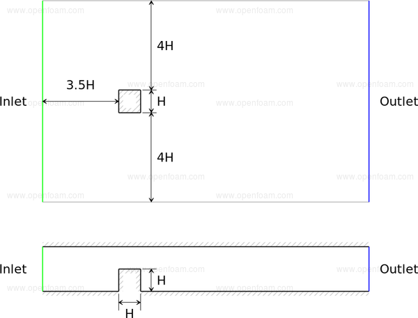

<!-- https://doc.openfoam.com/2606/examples/verification-validation/turbulent/surface-mounted-cube -->

# Surface mounted cube

## Overview

* Solver: [pimpleFoam](../../../tools/processing/solvers/rtm/incompressible/pimpleFoam/index.md)
* Experimental case described by Martinuzzi and Tropea [46](../../../references.md#martinuzzi_flow_1993)
* Reynolds number based on the cube height of RehRe\_hReh​ 40000
* Turbulence is modelled using the [SA\-IDDES](../../../tools/processing/models/turbulence/des/rtm/SpalartAllmarasIDDES/index.md) model
* [surfaceMountedCube](https://gitlab.com/openfoam/core/openfoam/-/tree/OpenFOAM-v2606/tutorials/incompressible/pimpleFoam/LES/surfaceMountedCube)

## Mesh

* 3D structured mesh created using [blockMesh](../../../tools/pre-processing/mesh/generation/blockMesh/index.md)

## Boundary conditions

A precursor `boundaryFoam` calculation is used to set the inlet flow conditions
onto which turbulent content is superimposed using the `turbulentDFSEMInlet`
velocity condition.

### Common fields

* UUU 1 m/s
* hhh 1 m
* ν\\nuν 2\.5e\-5 m2/s

Velocity: `U`

| Patch | Condition | Value |
| --- | --- | --- |
| Inlet | `turbulentDFSEMInlet` |  |
| Outlet | [zeroGradient](../../../tools/processing/boundary-conditions/rtm/derived/general/zeroGradient/index.md) |  |
| Walls | [noSlip](../../../tools/processing/boundary-conditions/rtm/derived/wall/noSlip/index.md) |  |

Pressure: `p`

| Patch | Condition | Value |
| --- | --- | --- |
| Inlet | [zeroGradient](../../../tools/processing/boundary-conditions/rtm/derived/general/zeroGradient/index.md) |  |
| Outlet | [fixedValue](../../../tools/processing/boundary-conditions/rtm/derived/general/fixedValue/index.md) | 0 Pa (static) |
| Walls | [zeroGradient](../../../tools/processing/boundary-conditions/rtm/derived/general/zeroGradient/index.md) |  |

### Turbulence fields

Turbulence viscosity: `nut`

| Patch | Condition | Value |
| --- | --- | --- |
| Inlet | `calculated` |  |
| Outlet | `calculated` |  |
| Walls | `nutUSpaldingWallFunction` |  |

#### Spalart\-Allmaras

Modified viscosity: `nuTilda`

| Patch | Condition | Value |
| --- | --- | --- |
| Inlet | [mappedFixedValue](../../../tools/processing/boundary-conditions/rtm/derived/general/fixedValue/index.md) |  |
| Outlet | [zeroGradient](../../../tools/processing/boundary-conditions/rtm/derived/general/zeroGradient/index.md) |  |
| Walls | [zeroGradient](../../../tools/processing/boundary-conditions/rtm/derived/general/zeroGradient/index.md) |  |

## Results

The following images show examples of the instantaneous\- and mean\-velocity
predictions

Profiles at a series of x/h positions are presented in the following images,
where the predictions are compared against the experimental data of
Martinuzzi and Tropea [46](../../../references.md#martinuzzi_flow_1993)

