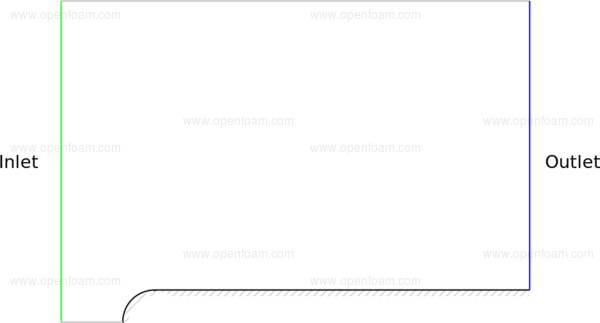
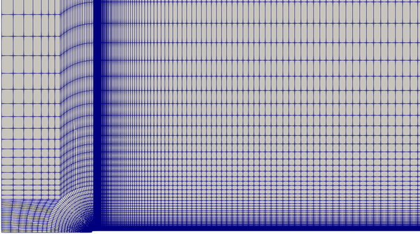
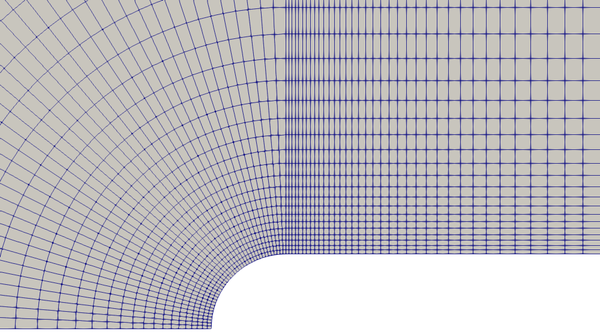

<!-- https://doc.openfoam.com/2606/examples/verification-validation/turbulent/t3a -->

# Turbulence transition T3A

## Overview

* Solver: [simpleFoam](../../../tools/processing/solvers/rtm/incompressible/simpleFoam/index.md)
* Incompressible
* Steady
* Turbulence transition modelled using the [kOmegaSST\-LM](../../../tools/processing/models/turbulence/ras/linear-evm/rtm/kOmegaSSTLM/index.md) model
* [T3A](https://gitlab.com/openfoam/core/openfoam/-/tree/OpenFOAM-v2606/tutorials/incompressible/simpleFoam/T3A)

## Mesh

* 2D structured mesh created using [blockMesh](../../../tools/pre-processing/mesh/generation/blockMesh/index.md)

## Boundary conditions

* Ux: 5\.4 m/s
* Isotropic turbulence: 3\.3 %
* Viscosity ratio: 12

Fluid properties

* Kinematic viscosity: 1\.5e\-5 m2/s

## Results

