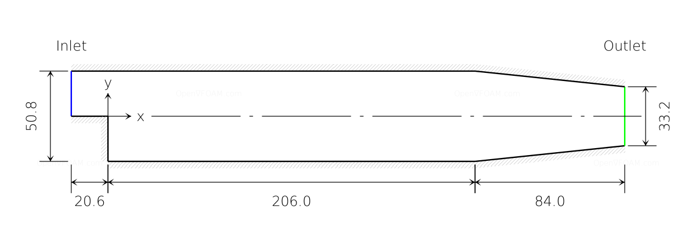
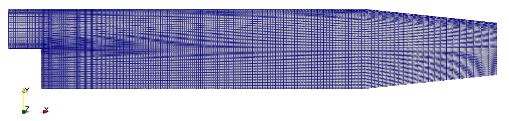
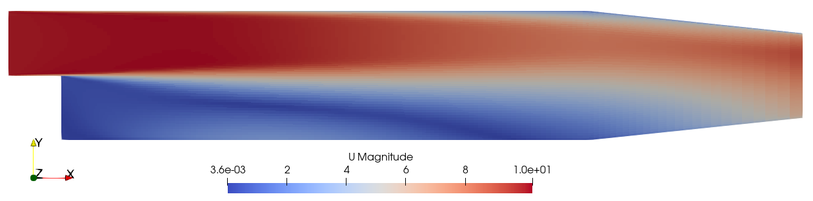

<!-- https://doc.openfoam.com/2606/quickstart -->

# Quickstart

Welcome to the OpenFOAM® quickstart guide!

This guide provides a simplified step\-by\-step overview to help you quickly
get started with the installation, setup, and basic usage of OpenFOAM®,
a powerful free/open\-source computational fluid dynamics (CFD) software.

## OpenFOAM® Installation

OpenFOAM® is easily accessible on a wide range of operating systems,
including Linux distributions, Microsoft Windows, and macOS. You can
conveniently obtain OpenFOAM® in the form of
[precompiled packages](https://gitlab.com/openfoam/core/openfoam/-/wikis/precompiled)
or as [source code](https://gitlab.com/openfoam/core/openfoam/-/wikis/building)
that you can build yourself.

In this guide, we will install the precompiled package of the latest OpenFOAM®
version on Microsoft Windows 10 Enterprise operating system.

Download the package of the latest OpenFOAM® version by simply clicking
the link below (Please ensure that you have at least 300MB of available storage
space on your hard disk):

[Link to OpenFOAM\-windows\-mingw.exe](https://dl.openfoam.com/source/latest/OpenFOAM-windows-mingw.exe)

The package is an executable. Run this executable to open the installation
wizard, and simply follow the wizard's installation instructions specific to
your system. A typical view of the wizard is shown below
(Please ensure that you have enough available storage
space on your hard disk):


You may also need to install Microsoft MPI (MS\-MPI). Similary, download
the following package (i.e. `msmpisetup.exe`), and follow its installation
wizard:

[Link to Microsoft MPI v10\.0](https://www.microsoft.com/en-us/download/details.aspx?id=57467)

Upon completion of the above steps, an icon will be created on your desktop.
Double\-click this icon to launch a terminal window. Running this icon will load
the OpenFOAM® environment. Verify the contents of OpenFOAM® in a
terminal as follows (`$` is the command prompt, indicating that the
[terminal](https://opensource.com/article/21/8/linux-terminal) is ready to
accept a command.):

```
$ ls -p
OpenFOAM/

$ cd $WM_PROJECT_DIR

$ ls -p
bin/  COPYING  etc/  etc-mingw  META-INFO  platforms/  README.md  ThirdParty/  tutorials/

```

## Problem Setup

The problem setup is derived from the experiment conducted by [Pitz and Daily
(1983\)](https://doi.org/10.2514/3.8290).

The setup involves a steady simulation of a non\-reacting, single\-phase,
Newtonian, incompressible fluid flow, which comprises a range of intricate
turbulence phenomena such as flow detachment/reattachment and formation of
recirculation zones.

You can browse the problem setup:

```
$ cd $FOAM_TUTORIALS/incompressible/simpleFoam/pitzDaily/

$ ls -p
0/  constant/  system/

$ ls -p system/
blockMeshDict  controlDict  fvSchemes  fvSolution  streamlines

$ ls -p constant/
transportProperties  turbulenceProperties

$ ls -p 0/
epsilon  k  p  U

```

In OpenFOAM®, simulation settings are customised using text files.
Each parameter in these files follows a straightforward key\-value pair format.
However, it is important to note that each file has its own unique set of
mandatory and optional keywords. The location and content of these files vary
depending on the chosen solver application, simulation setup, and the specific
aspects you wish to modify. Therefore, it is necessary to familiarize yourself
with the structure and significance of these keywords in relevant files.

## Pre\-process

Pre\-processing involves the typical preparation steps of a CFD problem
setup.

To carry out these steps, it is necessary to be familiar first with the typical
directory structure of an OpenFOAM® setup and the meaning of these
directories.

An OpenFOAM® simulation generally consists of the following three
directories:

* `0`: (zero directory) contains field initial/boundary conditions at timestep
(or iteration) zero. Note that fields are typically named according to their
mathematical representation, e.g. `u` for velocity, `p` for pressure, `T` for
temperature etc.
* `constant`: contains files that define the geometric and physical properties
of the simulation.
* `system`: contains files that define the settings of the simulation
applications and tools.

### Physical domain

In OpenFOAM®, there are multiple ways to provide the physical domain
specifications for a simulation. These include:

* Geometry import: OpenFOAM® supports the import of geometry from
external sources in formats such as `STL`, `STEP`, or `IGES`, to name a few.
* Geometry definition: OpenFOAM® allows manual definition of the physical
domain within itself.
* Mesh generation: OpenFOAM® provides native meshing tools including
[blockMesh](tools/pre-processing/mesh/generation/blockMesh/index.md), [snappyHexMesh](tools/pre-processing/mesh/generation/snappyhexmesh.md), and
mesh converters to generate meshes that represent the physical domain.

In this example, we generate the physical domain alongside the mesh
using the [blockMesh](tools/pre-processing/mesh/generation/blockMesh/index.md) utility. The physical domain includes
a narrow inlet passage, a backward\-facing step, and a converging section, as
shown in the side view below:



### Physical properties

In this example, we consider a simple non\-reacting, single\-phase, Newtonian,
incompressible fluid flow, with the following physical properties:

| Metrics | Values |
| --- | --- |
| Fluid kinematic viscosity, ν\\nuν | 1e\-5 \[m2/s]1e\\text{\-}5\\,\[\\mathrm{m}^2\\text{/}\\mathrm{s}]1e\-5\[m2/s] |

In OpenFOAM®, the type of fluid and the value of the fluid kinematic
viscosity are set using the `transportProperties` file located in the
`constant` directory.

```
$ cat constant/transportProperties

[...]

transportModel  Newtonian;
nu              1e-05;

[...]

```

### Spatial domain discretisation

In this example, we generate the spatial domain discretisation, also known
as the mesh, using the [blockMesh](tools/pre-processing/mesh/generation/blockMesh/index.md) utility configured by
the `blockMeshDict` file in the `system` directory.

You can skim through the content of this file via (for further information, please
see [blockMesh](tools/pre-processing/mesh/generation/blockMesh/index.md)):

```
$ cat system/blockMeshDict

```

The side view of the generated mesh is illustrated below:



In OpenFOAM®, the spatial domain discretization is typically performed
using one of three methods, depending on the complexity of the
physical domain and the desired mesh characteristics:

* [blockMesh](tools/pre-processing/mesh/generation/blockMesh/index.md): built\-in mesh generation tool in
OpenFOAM® providing a simple and intuitive way to generate structured meshes
for simple geometries.
* [snappyHexMesh](tools/pre-processing/mesh/generation/snappyhexmesh.md): powerful built\-in mesh generation
tool in OpenFOAM® used for generating high\-quality, unstructured meshes. It
can handle complex geometries and supports various meshing strategies, such as
refinement regions and boundary layer additions.
* Mesh conversion: OpenFOAM® supports the import of meshes generated by
various external mesh generators using tools like `fluentMeshToFoam`.

### Temporal domain discretisation

In this example, the temporal domain discretization, i.e. the division of the
simulation time into discrete steps, is steady state.

In OpenFOAM®, the temporal domain discretization is set in the
[controlDict](fundamentals/case-structure/controldict/index.md) file located in the `system` directory.

The following key\-value pairs in the [controlDict](fundamentals/case-structure/controldict/index.md) file
allow users to configure the temporal behaviour of the simulation:

```
$ cat system/controlDict

[...]

startFrom       startTime;
startTime       0;
stopAt          endTime;
endTime         2000;
deltaT          1;
adjustTimeStep  off;

[...]

```

OpenFOAM® provides several methods to handle the temporal
discretization, allowing users to control the time advancement and accuracy of
their simulations. Here are the main methods for generating the temporal domain
discretization in OpenFOAM®:

* Steady\-state simulations
* Explicit time stepping
* Implicit time stepping
* Adaptive time stepping

### Equation discretisation

In OpenFOAM®, the equation discretization refers to the numerical
approximation of the governing equations that describe fluid flow or other
physical phenomena. OpenFOAM® provides a wide range of discretization
schemes that can be used to discretize the equations and solve them numerically.

The selection of discretization schemes is usually defined for each equation
field and equation type in the [fvSchemes](fundamentals/case-structure/fvschemes.md) file found in the
`system` directory.

Within the [fvSchemes](fundamentals/case-structure/fvschemes.md) file, you will find configurations for
discretization schemes applied to gradient, divergence, Laplacian, and other
terms in the governing equations.

For instance, you can examine the settings for time and gradient schemes within
the [fvSchemes](fundamentals/case-structure/fvschemes.md) file, as shown below:

```
$ cat system/fvSchemes

[...]

ddtSchemes
{
    default         steadyState;
}

gradSchemes
{
    default         Gauss linear;
}

[...]

```

### Initial/boundary conditions

In this example, the initial and boundary conditions of the governing
equations at geometric boundaries are set as follows:

\<table\>

```
<thead>
    <tr>
        <th>Property</th><th>Inlet</th><th>Outlet</th><th>Walls</th><th>Internal</th>
    </tr>
</thead>
<tbody>
    <tr>
        <td>$$\text{Velocity}, \u \, [\text{m/s}]$$</td>
        <td>$$(10, 0, 0)$$</td>
        <td>$$\grad \u = \tensor{0}$$</td>
        <td>$$(0, 0, 0)$$</td>
        <td>$$(0, 0, 0)$$</td>
    </tr>
    <tr>
        <td>$$\text{Pressure}, p \, [\mathrm{m}^2\text{/}\mathrm{s}^2]$$</td>
        <td>$$\grad p = \vec{0}$$</td>
        <td>$$0$$</td>
        <td>$$\grad p = \vec{0}$$</td>
        <td>$$0$$</td>
    </tr>
    <tr>
        <td>$$\text{Turbulent kinetic energy}, k \, [\mathrm{m}^2\text{/}\mathrm{s}^2]$$</td>
        <td>$$0.375$$</td>
        <td>$$\grad k = \vec{0}$$</td>
        <td>$$\text{wall function}$$</td>
        <td>$$0.375$$</td>
    </tr>
    <tr>
        <td>$$\text{Turbulent kinetic energy dissipation rate}, \epsilon \, [\mathrm{m}^2\text{/}\mathrm{s}^3]$$</td>
        <td>$$14.855$$</td>
        <td>$$\grad \epsilon = \vec{0}$$</td>
        <td>$$\text{wall function}$$</td>
        <td>$$14.855$$</td>
    </tr>
</tbody>

```

\</table\>

In OpenFOAM®, the initial and boundary conditions are specified using
field files located within time directories for each field variable, such as
velocity. The initial conditions are applied to the entire domain volume,
while the boundary conditions are specified on the boundaries of the domain,
which are divided into numerical `patches`.

For example, the initial condition for pressure field (ppp) is specified in
the `p` file within the `0` directory as shown below:

```
$ cat 0/p

[...]

internalField   uniform 0;

[...]

```

Similarly, as an example, the boundary condition for velocity field (u\\uu) at
inlet patch is set in the `U` file within the `0` directory in the following
manner:

```
$ cat 0/U

[...]

boundaryField
{
    inlet
    {
        type            fixedValue;
        value           uniform (10 0 0);
    }

[...]

```

### Pressure\-velocity coupling algorithm

In this example, the choice of the pressure\-velocity coupling algorithm
is the SIMPLE algorithm. The corresponding solver application in OpenFOAM®
is called [simpleFoam](tools/processing/solvers/rtm/incompressible/simpleFoam/index.md).

The settings for the SIMPLE algorithm can be specified in a sub\-dictionary within
the [fvSolution](fundamentals/case-structure/fvsolution/index.md) file, which is located in the `system`
directory:

```
$ cat system/fvSolution

[...]

SIMPLE
{
    nNonOrthogonalCorrectors 0;
    consistent      yes;           // SIMPLEC

    residualControl                // Additional control on simulation
    {
        p               1e-2;
        U               1e-3;
        "(k|epsilon)"   1e-3;
    }
}

[...]

```

Note that OpenFOAM® provides three pressure\-velocity coupling algorithms:

* [SIMPLE](tools/processing/solvers/pressure-velocity/simple.md): Semi\-Implicit Method for Pressure\-Linked Equations
* [PISO](tools/processing/solvers/pressure-velocity/piso.md): Pressure Implicit with Splitting of Operators
* [PIMPLE](tools/processing/solvers/pressure-velocity/pimple.md): Combination of PISO and SIMPLE

### Linear solvers

OpenFOAM® offers a range of linear solvers, including iterative solvers like
[GAMG](tools/processing/numerics/solvers/multigrid/rtm/GAMG/index.md), [PCG](tools/processing/numerics/solvers/cg/rtm/PCG/index.md), and
[PBiCG](tools/processing/numerics/solvers/cg/rtm/PBiCG/index.md), as well as interfaces to external solvers, e.g.
`PETSc`. The choice of linear solvers and their parameters depends on various
factors such as the problem characteristics, size of the linear system, and
desired computational efficiency. OpenFOAM® provides extensive options for
fine\-tuning its solver suites.

In OpenFOAM®, the settings for linear solvers are typically defined in the
[fvSolution](fundamentals/case-structure/fvsolution/index.md) file located in the `system` directory.

For instance, the linear solver settings for the pressure field (ppp) are
specified with the corresponding smoother and convergence parameters,
as demonstrated below:

```
$ cat system/fvSolution

[...]

p
{
    solver          GAMG;
    smoother        GaussSeidel;
    tolerance       1e-06;
    relTol          0.1;
}

[...]

```

### Case control

In OpenFOAM®, the main case controls can be set in the
[controlDict](fundamentals/case-structure/controldict/index.md) file
within the `system` directory. The [controlDict](fundamentals/case-structure/controldict/index.md) file is
a key configuration file that allows you to control various aspects of the
simulation and specify case\-specific settings such as:

* Time/Iteration control
* Output control
* Runtime control
* Function\-object control
* Debug control
* Optimisation control
* External library control

The following shows a typical set of key\-value pairs available in the
[controlDict](fundamentals/case-structure/controldict/index.md):

```
$ cat system/controlDict

[...]

application     simpleFoam;         // name of solver application

startFrom       startTime;          <--
startTime       0;                  //
stopAt          endTime;            // Time/Iteration control
endTime         2000;               //
deltaT          1;                  -->

writeControl    timeStep;           <--
writeInterval   100;                //
purgeWrite      0;                  //
writeFormat     ascii;              // Output control
writePrecision  6;                  //
writeCompression off;               //
timeFormat      general;            //
timePrecision   6;                  -->

runTimeModifiable true;             // Runtime modifications

functions                           <--
{                                   //
    #includeFunc streamlines        // Function objects
    #include "streamlines"          //
}                                   -->

DebugSwitches                       <--
{                                   //
    SolverPerformance   0;          // Debug control
}                                   -->

OptimisationSwitches                <--
{                                   //
    writeNowSignal  12;             // Optimisation control
}                                   -->

libs                                <--
(                                   //
    externalLibraryName             // External library control
);                                  -->

[...]

```

## Process

To run this case, you can simply execute two consecutive commands.

First, the mesh is generated using the [blockMesh](tools/pre-processing/mesh/generation/blockMesh/index.md) utility.
Run the utility with the following command (the execution should take a few
seconds):

```
$ blockMesh

```

This command will display various utility messages and generate the mesh in the
`constant/polyMesh` directory. You can verify the mesh generation by checking
the contents of the directory using the command:

```
$ ls -p constant/polyMesh/
boundary  faces  neighbour  owner  points

```

If you need to make changes to the `blockMeshDict` settings or redirect the
utility's output to a log file, you can rerun the
[blockMesh](tools/pre-processing/mesh/generation/blockMesh/index.md) using the command:

```
$ blockMesh >& log.blockMesh

```

You can also use the internal runner functions available in OpenFOAM®
(e.g. `runApplication`):

```
$ source ${WM_PROJECT_DIR:?}/bin/tools/RunFunctions

$ runApplication blockMesh

```

The next and final step is to run the solver application by executing
the following command (the execution should take a few seconds):

```
$ simpleFoam >& log.simpleFoam

```

Running this command will run the simulation and print valuable information
into the log file. This information includes updates on the convergence of the
linear solvers, progress in simulation iterations, and details about function
objects, among others.

Upon completion of the simulation, you will notice that OpenFOAM® has
created new time directories containing solutions specific to each time step,
post\-processing data generated by function objects, and log files:

```
$ ls -p
0/  100/  200/  282/  constant/  log.blockMesh  log.simpleFoam  postProcessing/  system/

```

## Post\-process

Once the simulation has been completed, the next step is post\-processing
the results to extract meaningful information and visualize the data.
OpenFOAM® provides many powerful tools for post\-processing that can
be executed during runtime and/or after the simulation, e.g.
[postProcess](tools/post-processing/utilities/postProcess.md) utility.

You can visualise the simulation results by an external visualiation toolkit.
One of the most commonly used tools for field visualization is ParaView,
an open\-source visualization software that integrates well with OpenFOAM®.

An example visualisation of the velocity magnitude field at the last
iteration step using ParaView can be seen below:


