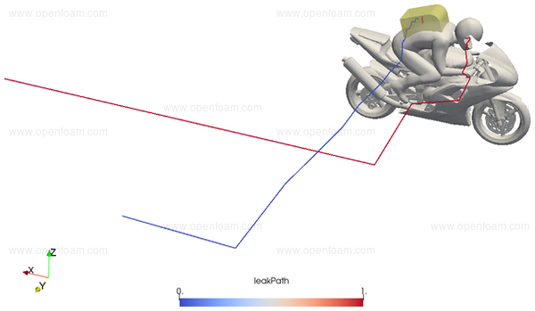

<!-- https://doc.openfoam.com/2606/tools/post-processing/function-objects/sampling/sets/shortestPath -->

# shortestPath

The `shortestPath` set determines the shortest path between a set of inside and
outside points, by walking from cell centre to cell centre.

This is particularly useful to determine holes in surface files used in
meshing processes.

At least one to sample field must be specified

## Usage

Basic operation of the `shortestPath` set comprises:

```
sets1
{
    type            sets;
    libs            (sampling);

    mySet1
    {
        type            shortestPath;
        axis            <axis>;
        insidePoints    (<points>);
        outsidePoints   (<points>);
    }
}

```

## Sample output

The following image is taken from a `motorBike` tutorial case where visor patch
and some patch faces on the back of the motorbike have been removed. During
meshing, these changes allow the mesh to flood into previously closed surfaces.



Application of the `shortestPath` set enables the leak path to be identified
easily.

## Further information

Source code:

* [shortestPath](https://gitlab.com/openfoam/core/openfoam/-/tree/OpenFOAM-v2606/src/sampling/sampledSet/shortestPath)

API:

* [Foam::shortestPathSet](https://api.openfoam.com/2606/Foam_shortestPathSet.html)

Example usage:

* simpleFoam tutorials:
	+ [motorBike\_leakDetection](https://gitlab.com/openfoam/core/openfoam/-/tree/OpenFOAM-v2606/tutorials/mesh/snappyHexMesh/motorBike_leakDetection)

**History:** Introduced in version [v1812](https://www.openfoam.com/news/main-news/openfoam-v1812)
