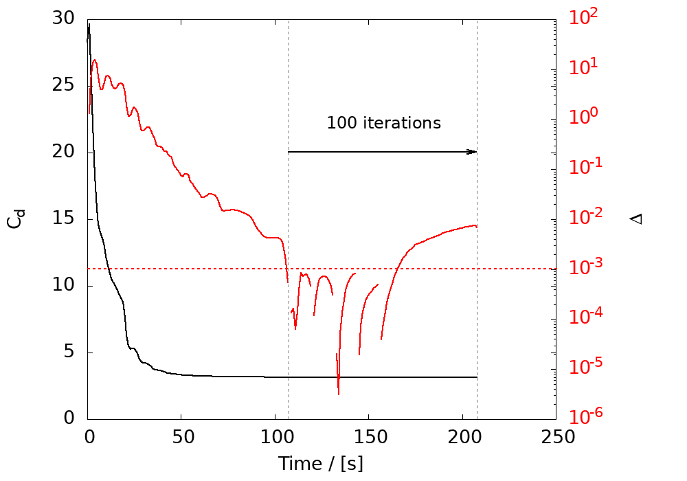

<!-- https://doc.openfoam.com/2606/tools/post-processing/function-objects/utilities/runTimeControl -->

# runTimeControl

The `runTimeControl` function object provides a mechanism to manipulate cases
based on a set of run\-time conditions. On satisfying the condition(s) users
can instruct the case to:

* terminate and write calculation data to disk, or
* start additional function objects by setting *triggers*

The set of run\-time conditions comprise:

* `average`: average value converges to within limits;
* `equationInitialResidual`: equation initial residual exceeds a value;
* `equationMaxIter`: equation number of iterations exceeds a value;
* `maxDuration`: maximum duration;
* `minMax`: minimum/maximum exceeds limits;
* `minTimeStep`: minimum time step exceeds a value;
* `none`: no\-op.

By default, cases will terminate if any condition is satisfied using an OR
condition. Optionally, conditions can be grouped whereby the case will only be terminated if all group member conditions are satisfied using an AND condition.

The optional `nWriteStep` entry can be used to write all field
data each time the conditions are satisfied for a specified number of steps
prior to termination.

## Usage

The function object is specified using:

```
runTimeControl1
{
    type            runTimeControl;
    libs            ("libutilityFunctionObjects.so");
    conditions
    {
        <list of conditions>
    }
}

```

The following example will terminate the calculation if:

* the momentum initial residual exceeds 0\.9 (used as a divergence indicator),
`OR`
* the number of the momentum solver iterations exceeds 100 (used as a divergence
indicator), `OR`
* if the average drag coefficient remains within a 0\.001 range over a window
of 20 steps `AND` the maximum momentum equation residual falls below 1e\-4\.

The grouping is achieved using the `groupID` entry where conditions with the
same group value will be combined using an `AND` operation. Any integer value
can be used.

```
runTimeControl1
{
    type            runTimeControl;
    libs            (utilityFunctionObjects);

    conditions
    {
        condition0
        {
            type            equationInitialResidual;
            fields          (U);
            value           0.7;
            mode            maximum;
        }
        condition1
        {
            type            equationMaxIterCondition;
            fields          (U);
            threshold       100;
        }
        condition2
        {
            type            average;
            functionObject  forceCoeffs1;
            fields          (Cd);
            tolerance       1e-3;
            window          20;

            groupID         1;          // Note grouping
        }
        condition3
        {
            type            equationInitialResidual;
            fields          (U);
            value           1e-04;
            mode            minimum;

            groupID         1;          // Note grouping
        }
    }
}

```

The next example is based on an external aerodynamics case where:

* Using `runTimeControl1`, after the average drag coefficient settles to within
a range of 1e\-3 based on an `exact` window of size 20, trigger 1 is set.
* Trigger 1 activates the `fieldAverage1` and `runTimeControl2`, where the
latter uses a `maxDuration` condition to terminate the run after a further
100 steps.

```
fieldAverage1
{
    type            fieldAverage;
    libs            (fieldFunctionObjects);
    triggerStart    1;
    timeStart       500;
    controlMode     timeOrTrigger;
    writeControl    writeTime;
    fields
    (
        U
        {
            base        iteration;
            mean        on;
            prime2Mean  off;
        }
    );
}

runTimeControl1
{
    type            runTimeControl;
    libs            (utilityFunctionObjects);
    conditions
    {
        condition1
        {
            type            average;
            functionObject  forceCoeffs1;
            fields          (Cd);
            tolerance       1e-3;
            window          20;
            windowType      exact;
        }
    }
    satisfiedAction setTrigger;
    trigger         1;
}

runTimeControl2
{
    type            runTimeControl;
    libs            (utilityFunctionObjects);

    controlMode     trigger;
    triggerStart    1;
    conditions
    {
        condition1
        {
            type            maxDuration;
            duration        100;
        }
    }
    satisfiedAction end;
}

```

## Sample output

The following image shows a time history of the drag coefficient and change in
drag coefficient:



At time\=108 the `runTimeControl1` average condition is satisfied when the change
falls below 0\.001\. This activates `runTimeControl2` that instructs the code to
continue for a further 100 iterations, after which the calculation terminates.

## Further information

Source code:

* [runTimeControl](https://gitlab.com/openfoam/core/openfoam/-/tree/OpenFOAM-v2606/src/functionObjects/utilities/runTimeControl)

API:

* [Foam::functionObjects::runTimeControls::runTimeControl](https://api.openfoam.com/2606/Foam_functionObjects_runTimeControls_runTimeControl.html)
* [Foam::functionObjects::runTimeControls::runTimeCondition](https://api.openfoam.com/2606/Foam_functionObjects_runTimeControls_runTimeCondition.html)

Tutorial

* [simpleCar](https://gitlab.com/openfoam/core/openfoam/-/tree/OpenFOAM-v2606/tutorials/incompressible/simpleFoam/simpleCar)

**History:** Introduced in version [v3\.0\+](https://www.openfoam.com/news/main-news/openfoam-v3.0+)
