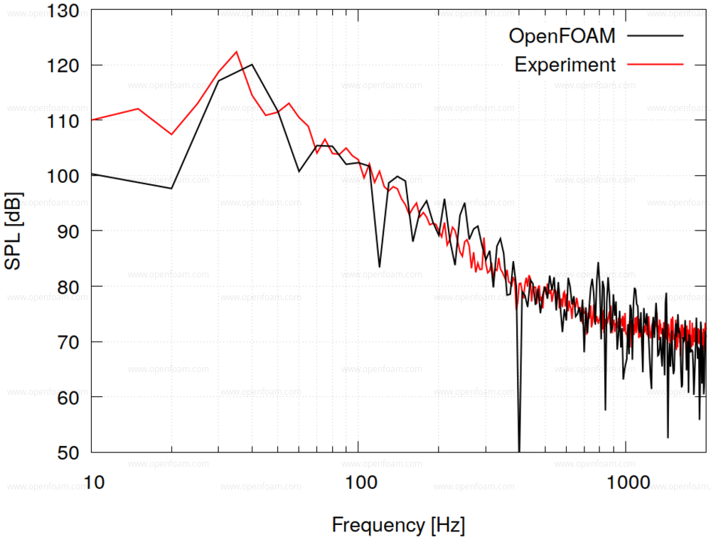

<!-- https://doc.openfoam.com/2606/tools/post-processing/utilities/noise/pointNoise -->

# pointNoise

## Point\-based noise

Example input:

```
noiseModel      pointNoise;

pointNoiseCoeffs
{
    // Common entries (see above)

    // Input files list
    files       (<file-path-1> <file-path-2> <file-path-N>);
}

```

The point noise model can only be run in serial mode.

Pressure data is read in CSV data format

* point data generation: [probes](../../function-objects/sampling/probes.md)

Output:

* Text files
	+ `Prms_f.dat` : frequency vs RMS pressure \[Pa]
	+ `PSD_dB_Hz_f.dat` : frequency vs Power Spectral Density \[dB/Hz]
	+ `PSD_f.dat` : frequency vs Power Spectral Density \[Pa2^22/Hz]
	+ `SPL_dB_f.dat` : frequency vs Sound Pressure Level \[dB]
	+ `SPL13_dB_fm.dat` : centre frequency vs 1/3 octave Sound Pressure

```
Level \[dB\]

```

The example below shows a SPL comparison between OpenFOAM and experimental data
for the signal recorded from a vehicle side window:



## Further information

Source code

* [pointNoise](https://gitlab.com/openfoam/core/openfoam/-/tree/OpenFOAM-v2606/src/randomProcesses/noise/noiseModels/pointNoise)

API:

* [Foam::noiseModels::pointNoise](https://api.openfoam.com/2606/Foam_noiseModels_pointNoise.html)

See also

* [noise](index.md)
* [surfaceNoise](surfaceNoise.md)
* [Curle](../../function-objects/field/Curle.md) function object

Tutorials

* [vortexShed](https://gitlab.com/openfoam/core/openfoam/-/tree/OpenFOAM-v2606/tutorials/incompressible/pimpleFoam/LES/vortexShed)

**History:** Introduced in version [v1606\+](https://www.openfoam.com/news/main-news/openfoam-v1606+)
