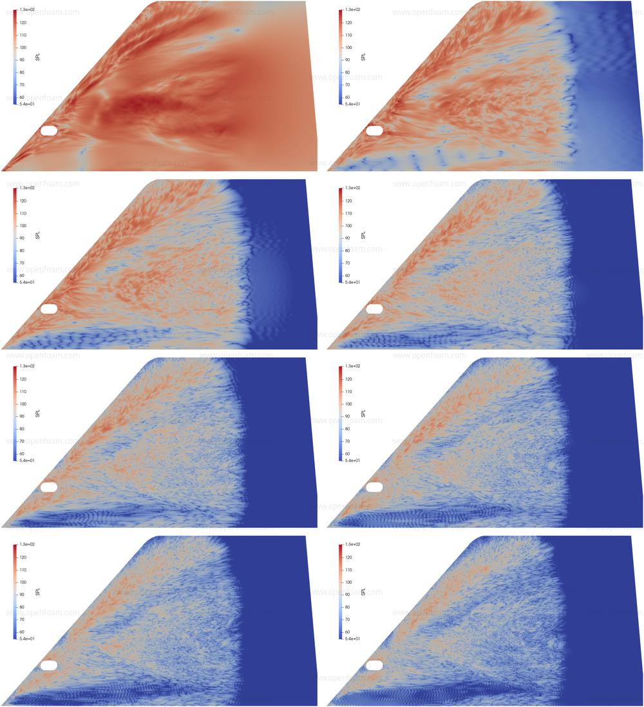

<!-- https://doc.openfoam.com/2606/tools/post-processing/utilities/noise/surfaceNoise -->

# surfaceNoise

## Surface\-based noise

The `surfaceNoise` utility reads data in Ensight format, e.g.

```
noiseModel      surfaceNoise;

surfaceNoiseCoeffs
{
    // Common entries (see above)

    // Input file
    file       "postProcessing/faceSource1/surface/patch/patch.case";

    // Surface reader
    reader          ensight;

    // Surface writer
    writer          ensight;

    // Optional entries

    // Pressure field name; default = p
    p           p;

    // Write interval for FFT data, default = 1
    fftWriteInterval 100;

    // Area-weighted averaging switch, default = no (ensemble) for backwards
    // compatibility
    areaAverage     yes;

    // Collate times for ensight output - ensures geometry is only written once
    writeOptions
    {
        ensight
        {
            collateTimes    true;
        }
    }
}

```

The surface noise model is parallel aware.

Pressure data is read in Ensight format

Input surface data must be provided in Ensight Format, e.g. using the
[surfaceFieldValue](../../function-objects/field/surfaceFieldValue.md) function
object. When specifying the `formatOPtions` the `collatedTimes` option should
be employed, i.e.

```
surfaceFormat   ensight;
formatOptions
{
    ensight
    {
        format          binary;
        collateTimes    true;
    }
}
fields          (p);

```

## Output

Surface data:

* Ensight surface containing SPL, PSD, one\-third octave data
* Instead of time, each snapshot represents a given frequency



Text files:

* Surface average frequency histories:
	+ `Average_Prms_f.dat` : RMS pressure \[Pa]
	+ `Average_PSD_dB_Hz_f.dat` : Power Spectral Density in \[dB/Hz]
	+ `Average_PSD_f_f.dat` : Power Spectral Density in \[Pa2^22/Hz]
	+ `Average_SPL_dB_f.dat` : Sound Pressure Level \[dB]

## Further information

Source code

* [noise](https://gitlab.com/openfoam/core/openfoam/-/tree/OpenFOAM-v2606/$FOAM_UTILITIES/postProcessing/noise)

API:

* [Foam::noiseModels::surfaceNoise](https://api.openfoam.com/2606/Foam_noiseModels_surfaceNoise.html)

See also

* [noise](index.md)
* [pointNoise](pointNoise.md)
* [Curle](../../function-objects/field/Curle.md) function object

Tutorials

* [vortexShed](https://gitlab.com/openfoam/core/openfoam/-/tree/OpenFOAM-v2606/tutorials/incompressible/pimpleFoam/LES/vortexShed)

**History:** Introduced in version [v1606\+](https://www.openfoam.com/news/main-news/openfoam-v1606+)
