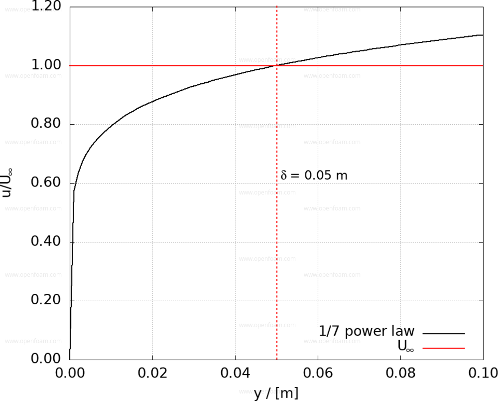

<!-- https://doc.openfoam.com/2606/tools/pre-processing/field/applyBoundaryLayer -->

# applyBoundaryLayer

## Overview

The `applyBoundaryLayer` utility sets the velocity and turbulence\-field profiles
near to wall patches based on the one\-seventh power law.

## Usage

### Synopsis

```
applyBoundaryLayer [OPTIONS]

```

#### Examples

Specify the boundary\-layer thickness of 0\.1 \[m] and write optional turbulence
fields:

```
applyBoundaryLayer -ybl 0.1 -writeTurbulenceFields

```

### Input

#### Arguments

No arguments required.
#### Options

```
-Cbl <scalar>     Boundary-layer thickness as Cbl * mean distance to wall
  -case <dir>       Case directory (instead of current directory)
  -decomposeParDict <file>
                    Alternative decomposePar dictionary file
  -parallel         Run in parallel
  -region <name>    Specify mesh region (default: region0)
  -writeTurbulenceFields
                    Write the turbulence fields
  -ybl <scalar>     Specify the boundary-layer thickness
  -doc              Display documentation in browser
  -help             Display short help and exit
  -help-compat      Display compatibility options and exit
  -help-full        Display full help and exit

```

#### Files

No file input required.

#### Fields

No field input required.

### Output

#### Logs

No log output.

#### Files

No file output.

#### Fields

By default, the path to write the fields is `<case>/<time>/` and the utility
will overwrite the local velocity field. In addition, the
`-writeTurbulenceFields` option can be used to evaluate turbulence fields
using the new velocity profile for:

| Property | Description | Type |
| --- | --- | --- |
| `nut` | Turbulence viscosity | volScalarField |
| `epsilon` | Turbulence kinetic energy dissipation rate | volScalarField |
| `k` | Turbulence kinetic energy | volScalarField |
| `omega` | Specific dissipation rate | volScalarField |
| `nuTilda` | Modified turbulence viscosit | volScalarField |

## Method

uU\=(yδ)17\\frac{u}{U} \= \\left(\\frac{y}{\\delta}\\right)^{\\frac{1}{7}}Uu​\=(δy​)71​
Where

uuu
: boundary layer velocity, \[m/s]

UUU
: freestream velocity, \[m/s]

yyy
: normal wall distance, \[m]

δ\\deltaδ
: boundary layer thickness, \[m]

The boundary layer thickness is user defined as either:

* a fixed height
* proportional to the average wall distance for the entire mesh

For example, the boundary layer profile using a freestream velocity of 1 m/s
and boundary layer height of 0\.05 m is shown below.



## Further information

Tutorial:

* [wallMountedHump](https://gitlab.com/openfoam/core/openfoam/-/tree/OpenFOAM-v2606/tutorials/incompressible/pimpleFoam/LES/wallMountedHump)

Source code:

* [applyBoundaryLayer](https://gitlab.com/openfoam/core/openfoam/-/tree/OpenFOAM-v2606/$FOAM_UTILITIES/preProcessing/applyBoundaryLayer)

**History:** Introduced in version [1\.5](https://www.openfoam.com/news/main-news/openfoam-1.5)
