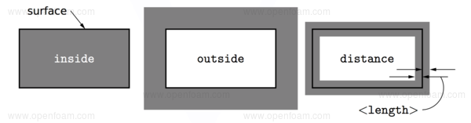
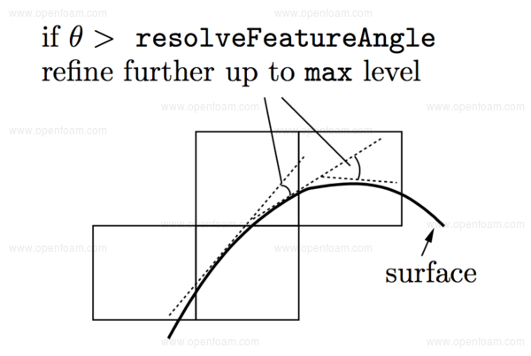
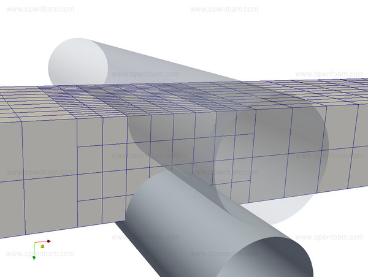
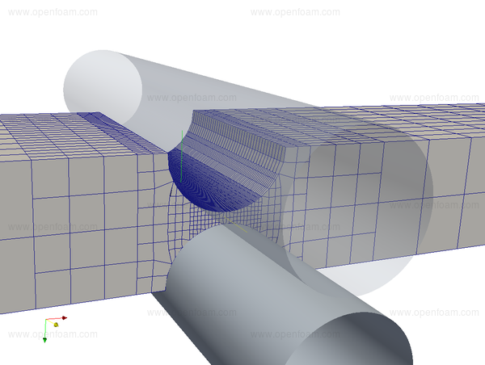

<!-- https://doc.openfoam.com/2606/tools/pre-processing/mesh/generation/snappyhexmesh/castellation -->

# Castellation

Mesh refinement is controlled by settings in the `castellatedMeshControls`
sub\-dictionary.

The background mesh is refined in several steps. The strategy is to
refine the mesh close to the features and the geometry surface to ease
the snapping phase and at the same time allow as little mesh distortion
as possible.

Mesh sizes are defined as relative to the starting background
mesh. For example, if the background mesh size is 0\.2 m, the mesh sizes at
one and two levels of refinement will be 0\.1 m and 0\.05 m respectively.

refinement is performed by cutting cells in half in each
direction, i.e. a 3\-D cell is transformed into 8 cells.

## Castellation parameters

### Top level

* [maxGlobalCells](castellation.md#castellation-maxGlobalCells)
* [minRefinementCells](castellation.md#castellation-minRefinementCells)
* [nCellsBetweenLevels](castellation.md#castellation-nCellsBetweenLevels)
* [gapLevelIncrement](castellation.md#castellation-gapLevelIncrement)
* [planarAngle](castellation.md#castellation-planarAngle)
* [handleSnapProblems](castellation.md#castellation-handleSnapProblems)
* [useTopologicalSnapDetection](castellation.md#castellation-useTopologicalSnapDetection)
* [interfaceRefine](castellation.md#castellation-interfaceRefine)
* [nCellZoneErodeIter](castellation.md#castellation-nCellZoneErodeIter)

### Parallel

* [maxLocalCells](castellation.md#castellation-maxLocalCells)
* [maxLoadUnbalance](castellation.md#castellation-maxLoadUnbalance)

### Refinement

* [features](castellation.md#castellation-features)
* [refinementSurfaces](castellation.md#castellation-refinementSurfaces)
* [refinementRegions](castellation.md#castellation-refinementRegions)

### Defining the mesh region

* [locationInMesh](castellation.md#castellation-locationInMesh)
* [locationsInMesh](castellation.md#castellation-locationsInMesh)
* [locationsOutsideMesh](castellation.md#castellation-locationsOutsideMesh)

### Face zone handling

* [faceZoneControls](castellation.md#castellation-faceZoneControls)
* [allowFreeStandingZoneFaces](castellation.md#castellation-allowFreeStandingZoneFaces)

## Keywords

### maxGlobalCells \[label]

Overall number of cells limit. This includes the mesh *outside the domain*,
i.e. prior to removing the unwanted mesh regions that are not connected to the
reference location given by the `locationInMesh` entry.
Refinement will stop immediately upon reaching this limit.

---

### minRefinementCells \[label]

The refinement along the surfaces may spend many iterations on refinement of
only few cells. Whenever the number of cells to be refined is less than or equal
to the `minRefinementCells` parameter, the refinement will stop.
Unless the parameter is set to zero, at least one refining iteration will be
performed.

---

### nCellsBetweenLevels \[label]

Cell size changes should be smooth as sudden changes are likely to introduce
disturbances to the system. The 2:1 size jump across refinement regions cannot
be avoided but the `nCellsBetweenLevels` avoids having consecutive
refinement level changes close together. A good compromise between limiting the
cell size jump and number of cells is with `nCellsBetweenLevels` 3\.
Note that this parameter is not used
by the mechanism to refine in the narrow gap regions.



---

### gapLevelIncrement \[label] OPTIONAL

Increment (on top of max level) in small gaps.

---

### blockLevel \[label] OPTIONAL

Opposite of the [gapLevelIncrement](castellation.md#gapLevelIncrement) : removes cells in
small gaps. The set of cells selected is extended by filtering to smooth the
selection

---

### planarAngle \[scalar] OPTIONAL

Used to determine if surface normals are roughly the same or opposite. Used

* in proximity refinement
* to decide when to merge free\-standing baffles e.g. if running in
`surfaceSimplify` mode set this to 180 to merge all baffles
* in snapping to avoid snapping to nearest on *wrong* side of thin gap
* If not specified same as `resolveFeatureAngle`

---

### handleSnapProblems \[boolean] OPTIONAL

Do not remove cells likely to give snapping problems

---

### useTopologicalSnapDetection \[boolean] OPTIONAL

Switch off topological test for cells to\-be\-squashed and use geometric test
instead

---

### interfaceRefine \[boolean] OPTIONAL

Do not refine surface cells with opposite faces of differing refinement levels

---

### nCellZoneErodeIter \[label] OPTIONAL

Use an erosion instead of region assignment
to allocate left\-over cells to the background region (i.e. make cellZones
consistent with the intersections of the surface).
Erosion is specified as a number of erosion iterations.
Erosion has less chance of bleeding and changing the zone
for a complete region.

---

### maxLocalCells \[label]

Used for parallel running.
The hint for the maximum number of cells
on each processor. If the local number of cells exceeds this limit the
generation process switches from refinement\-followed\-by balancing to weighted
balancing before further refinement.
This parameter can greatly improve mesh generation performance, aiding to
achieve similar cell counts on each processor. However, note that
re\-balancing too often will slow the mesh generation process.

---

### maxLoadUnbalance \[scalar]

Used for parallel running.
The relative difference in the number of
cells per processor. A low value, e.g. 0\.1 leads to more frequent load
balancing, whereas a high value can disable load balancing completely.

---

### features \[list(dictionary)]

In order to conform to geometric features, the local mesh resolution in the
region of the feature must be sufficient to resolve the local geometry.
Features can be read from any edge\-based format, e.g. `.nas`, `.bdf`, `.obj`,
`.inp`, `.vtk`.

To specify which feature lines are important, explicit features can be extracted
using the `surfaceFeatureExtract` utility. This creates files of the
form `$FOAM_CASE/constant/triSurface/<geometryName>.eMesh` for use in the
`castellatedMeshControls.features` sub\-dictionary, e.g.

```
features
(
    {
        file            "someLine.eMesh";
        level           2;
    }
);

```

This will refine any cells that the edges of the feature 'mesh' pass through
to `level` 2\.
Alternatively the `levels` can be specified to refine the mesh in the
regions close to the edge.

```
features
(
    {
        file                "someLine.eMesh";
        levels              ((0.1 3) (0.55 2));
    }
);

```

Here the first value pair specifies Level 3 refinement within the 0\.1 m from
the edge, while the second pair sets Level 2 in across a wider region. The
latter specification generally gives a better refinement behaviour.

If all features are to be considered, the implicit feature line handling option
can be selected.

---

### refinementSurfaces \[dictionary]

Surface refinement is driven by the `castellatedMeshControls.refinementSurfaces`
dictionary.

A mesh size can be assigned to each region specified in the
[geometry](geometry/index.md) dictionary. Sizes can be
specified for the geometry as a whole, or optionally overridden via an optional
`regions` sub\-dictionary.

Patch types can also be set as part of the meshing process by including the
type information in a `patchInfo` sub\-dictionary.

In the example below the geometry called `facade` is refined to level
2 except for the `window` region which is refined to level 3/4\.
All patches generated for this surface become type
[wall](../../../../processing/boundary-conditions/rtm/derived/wall.md).

```
facade
{
    // Surface-wise min and max refinement level
    level       (2 2);

    regions
    {
        // Region-wise specification
        window
        {
            level       (3 4);
        }
    }

    // Optional specification of patch type (default is wall). No
    // constraint types (cyclic, symmetry) etc. are allowed.
    patchInfo
    {
        type wall;

        // Optional group
        // inGroups (meshedWalls);
    }
    // Optional increment (on top of max level) in small gaps
    // gapLevelIncrement 2;

    // Optional angle to detect small-large cell situation
    // perpendicular to the surface. Is the angle of face w.r.t.
    // the local surface normal. Use on flat(ish) surfaces only.
    // Otherwise leave out or set to negative number.
    // perpendicularAngle 10;

    // Optional faceZone and (for closed surface) cellZone with
    // how to select the cells that are in the cellZone
    // (inside / outside / specified insidePoint)
    // The orientation of the faceZone is
    //  - if on cellZone(s) : point out of (minimum) cellZone
    //  - if freestanding   : oriented according to surface

    // faceZone sphere;
    // cellZone sphere;
    // cellZoneInside inside;    // outside/insidePoint
    // insidePoint    (1 1 1);   // if (cellZoneInside == insidePoint)

    // Optional specification of what to do with faceZone faces:
    //      internal : keep them as internal faces (default)
    //      baffle   : create baffles from them. This gives more
    //                 freedom in mesh motion
    //      boundary : create free-standing boundary faces (baffles
    //                 but without the shared points)
    // faceType baffle;
}

```

Refinement levels are specified as value pairs, where the second number
should be of the same or higher value than the first. The latter is used
to perform automatic feature refinement.

---

### resolveFeatureAngle \[scalar]

When the angle between the local surface normals is larger then the
`resolveFeatureAngle` parameter, specified e.g. as

```
resolveFeatureAngle 60;

```

the mesh is refined to the Level specified by the second digit in the
`level` dyad (see [refinementSurfaces](castellation.md#castellation-refinementSurfaces))



---

### refinementRegions \[dictionary]

Volume refinement is specified in the
`castellatedMeshControls.refinementRegions` dictionary, e.g.:

```
refinementRegions
{
    box
    {
        mode            inside;
        levels          ((1.0 4));

        gapLevel        (4 0 10);
        gapMode         outside;
    }
}

```

These are defined by geometric regions, specified in the [geometry](geometry/index.md)
section as, e.g. closed analytical (`searchableBox`) or triangulated
(`triSurfaceMesh`) surfaces.

---

#### refinementRegions.mode \[option]

There are three modes of volumetric refinement:

* `inside`

```
All cells whose cell centre lies within the *box* are refined.
This *box* geometry must be closed. The first element in levels
(the distance) is ignored; the second is the desired refinement level.

    box
    {
        mode        inside;
        levels      ((1.0 4));
    }

```

* `outside`

```
Same as `inside` but now the cells-to-be-refined are outside of
the closed region.

    box
    {
        mode        outside;
        levels      ((1.0 4));
    }

```

* `distance`

```
All cells whose cell centre lies within a specified *distance*
from the geometry are refined. The first argument in the levels dyad is the
distance:

    box
    {
        mode        distance;
        levels
        (
            (1.0 4) // within first 1.0 m refinement level 4
            (2.0 3) // within 2.0 m refinement level 3.
        );
    }

```


---

#### refinementRegions.levelIncrement \[option]

**History:** Introduced in version [v1806](https://www.openfoam.com/news/main-news/openfoam-v1806)

Directional refinement can be specified in a closed
region. The Following example illustrates the usage:

```
wakeBox
{
    mode        inside;
    // Dummy base level
    levels      ((10000 0));

    // Optional directional refinement (after all other refinement)
    // Directional refinement
    // for all cells according to 'mode' ('inside' or 'outside';
    // 'distance' not supported) and within certain range. E.g.
    //  - for all cells with level 2-5
    //  - do one split in x direction
    levelIncrement  (2 5 (1 0 0));

    // Note
    // - ignores 'levels' and gap* settings.
    // - the cellLevel/pointLevels files are no longer consistent
    //   with the mesh, the resulting mesh is no longer compatible
    //   with e.g. dynamic refinement/unrefinement.
    // - cellLevel will include any directional refinement
    //   (i.e. it will be the maximum of all three directions)
}

```

---

### limitRegions \[dictionary]

Refinement can be restricted to regions via the `limitRegions`
sub\-dictionary

```
limitRegions
{
    boxLimit
    {
        mode        inside;
        levels      ((1.0 2));
    }
}

```

This limits all refinement such as from [features](castellation.md#castellation-features),
`refinementSurfaces` or `refinementRegions`
dictionaries, within a given geometric region. The syntax is the same as
for the `refinementRegions` dictionary; the cell level now specifies the
upper limit for any cell.

* This does not override the refinement constraints given
by the [nCellsBetweenLevels](castellation.md#castellation-nCellsBetweenLevels) setting
* A special case with level specified as \-1 will remove any cell associated with
that region (recommended to use only with inside/outside mode)

---

### gapLevel \[(label label label)]

Activates gap level refinement. Takes three label arguments:

* the minimum number of cells between two surfaces forming the gap. This is
usually greater than 3\. A lower value might not resolve the gap correctly
* the level at which it should start detecting gaps; and
* the maximum allowed level of refinement to avoid excessive refinement of a
single extraneous feature

```
gapLevel    (4 0 10);

```

Used in combination with [gapMode](castellation.md#castellation-gapMode)

---

### gapMode \[option]

Gap refinement can directly remove cells
based on orientation with respect to the gap. This limits the number of cells
before performing the [locationInMesh](castellation.md#castellation-locationInMesh)
cell selection. Default is 'mixed' i.e.
keep cells whilst doing the gap\-level refinement.

```
gapMode     outside; // inside|outside|mixed; default = mixed

```

The `gapMode` entry is applicable if the surface triangles are
consistently oriented, i.e. all pointing out of the surface. This can be
enforced by applying the `surfaceOrient` utility.





Used in combination with [gapLevel](castellation.md#castellation-gapLevel)

---

### locationInMesh \[point]

The `locationInMesh` entry is used to identify a location in the final
mesh, from which `snappyHexMesh` will mark and keep all reachable,
i.e. connected, cells:

```
locationInMesh      (0 0 0);

```

---

### locationsInMesh \[list(point word)]

For cases where a single [locationInMesh](castellation.md#castellation-locationInMesh)
is insufficient, multiple locations can be selected using the
[locationsInMesh](castellation.md#castellation-locationsInMesh) entry. A `cellZone` is
generated for each region, e.g.:

```
locationsInMesh
(
    (( 0.005 0.005  0.005) heater)
    (( 0.05  0.005  0.005) rightSolid)
    ((-0.05  0.005  0.005) leftSolid)
    ((-0.05  0.015  0.005) topAir)
    ((-0.05 -0.015  0.005) bottomAir)
);

```

The special cell zone name `none` can be used to indicate un\-zoned cells.

---

### locationsOutsideMesh \[list(point)]

To avoid ambiguity, the `locationsOutsideMesh` entry can be used to
specify where the mesh should be removed.

```
locationsOutsideMesh ((100 100 100));

```

On mesh completion, a check is performed to ensure that none of these locations
are present in the final mesh.

---

### faceZoneControls \[dictionary]

Faces between different `cellZones` are automatically inserted into a
`faceZone`. The behaviour of these `faceZones` is specified
through the `faceZoneControls` sub\-dictionary. The `faceType`
entry specifies the behaviour of the faces on the `faceZone`. If the
faces are to become boundary faces, the `patchInfo` entry controls the
patch information as for all other generated patches:

```
faceZoneControls
{
    bottomAir_to_heater
    {
        patchInfo
        {
            type patch;
            inGroups (patchPatches);
        }
        faceType baffle;
    }
}

```

Group specification is useful e.g. during post\-processing to address a set of
patches or boundary conditions.

---

### allowFreeStandingZoneFaces \[boolean]

When a `faceZone` is not only a boundary to a `cellZone` but will become e.g.
separate baffle, the following switch must be set to true in the
`castellatedMeshControls` dictionary

```
// Whether any faceZones (as specified in the refinementSurfaces)
// are only on the boundary of corresponding cellZones.
// Not used if there are no faceZones. The behaviour has changed
// with respect to previous versions:
//  true  : all intersections with surface are put in faceZone
//          (same behaviour as before)
//  false : depending on the type of surface intersected:
//      - if intersecting surface has faceZone only (so no cellZone)
//        leave in faceZone (so behave as if set to true) (= changed
//        behaviour)
//      - if intersecting surface has faceZone and cellZone
//        remove if between same cellZone or if on boundary
//        (same behaviour as before)
allowFreeStandingZoneFaces true;

```

---
