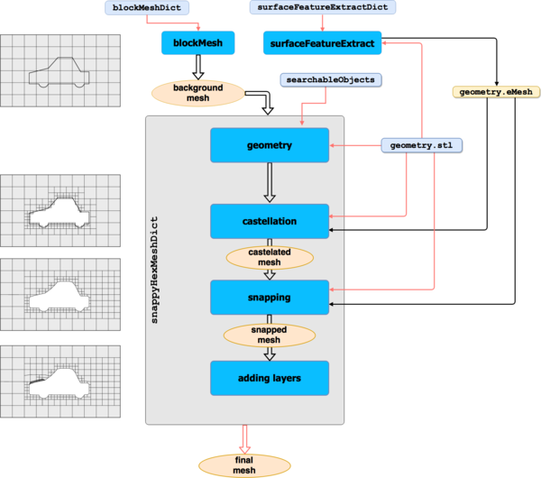

<!-- https://doc.openfoam.com/2606/tools/pre-processing/mesh/generation/snappyhexmesh/ -->

# snappyHexMesh

## Overview

`snappyHexMesh` is a fully parallel, split hex, mesh generator that
guarantees a minimum mesh quality. Controlled using OpenFOAM
dictionaries, it is particularly well suited to batch driven operation.

Key features:

* starts from any pure hex mesh (structured or unstructured)
* reads geometry in triangulated formats, e.g. in `stl`, `obj`, `vtk`
* no limit on the number of input surfaces
* can use simple analytically\-defined geometry, e.g. box, sphere, cone
* generates prismatic layers
* scales well when meshing in parallel
* can work with *dirty surfaces*, i.e. non\-watertight surfaces

[Quick reference](quick-reference.md)

## Meshing process

The overall meshing process is summarised by the figure below:



This includes:

* creation of the background mesh using the [blockMesh](../blockMesh/index.md) utility
(or any other hexahedral mesh generator)
* extraction of features on the surfaces with `surfaceFeatureExtract`
utility
* setting up the `snappyHexMeshDict` input dictionary
* running `snappyHexMesh` in serial or parallel

Evolution of the snappy mesh for the `iglooWithFridges` tutorial is shown below:

## Configuration

Meshing controls are set in the `snappyHexMeshDict` located in the case
`system` directory. This has five main sections, described by the following:

* [Geometry](geometry/index.md): specification of the input surfaces
* [Castellation](castellation.md): starting from any pure hex mesh, refine and
optionally load balance when running in parallel. The refinement is specified
both according to surfaces, volumes and gaps
* [Snapping](snapping.md): guaranteed mesh quality whilst morphing to geometric
surfaces and features
* [Layers](layers.md): prismatic layers are inserted by shrinking an existing
mesh and creating an infill, subject to the same mesh quality constraints
* [Mesh quality](meshquality/index.md): mesh quality settings enforced during the
[snapping](snapping.md) and [layer addition](layers.md) phases
* [Global](global.md)

## Usage

The command `snappyHexMesh` executes the meshing process.

### Synopsis

```
snappyHexMesh [OPTIONS]

```

#### Arguments

No arguments required.
#### Options

```
-case <dir>       Case directory (instead of current directory)
  -checkGeometry    Check all surface geometry for quality
  -decomposeParDict <file>
                    Alternative decomposePar dictionary file
  -dict <file>      Alternative snappyHexMeshDict
  -dry-run          Check case set-up only using a single time step
  -outFile <file>   Name of the file to save the simplified surface to
  -overwrite        Overwrite existing mesh/results files
  -parallel         Run in parallel
  -patches <(patch0 .. patchN)>
                    Only triangulate selected patches (wildcards supported)
  -profiling        Activate application-level profiling
  -region <name>    Specify mesh region (default: region0)
  -surfaceSimplify <boundBox>
                    Simplify the surface using snappyHexMesh starting from a
                    boundBox
  -doc              Display documentation in browser
  -help             Display short help and exit
  -help-compat      Display compatibility options and exit
  -help-full        Display full help and exit

```

By default, each of `snappyHexMesh`'s phases, i.e castellation, snapping and
layer addition will write a complete mesh in time folders. This behaviour can
be suppressed by using the option

```
snappyHexMesh `-overwrite`

```
