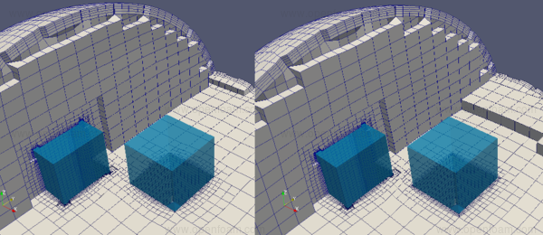
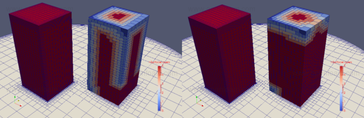

<!-- https://doc.openfoam.com/2606/tools/pre-processing/mesh/generation/snappyhexmesh/layers -->

# Layer addition

In the final stage of the mesh generation process, prismatic cell layers are
inserted into the void formed by shrinking the mesh. These are constructed on
patches according to the specification in the `addLayerControls`
dictionary.

* cells added during this phase can be visualised in ParaView as a `cellSet`.
Refer to the
[writeFlags](global.md#debugging-writeFlags)
* detailed statistics of the layer coverage is written on completion
* the success of the layer growth depends on the mesh quality after the
shrinking. To help the process the mesh quality settings can be relaxed
by setting
[relaxed](meshquality.md#keywords-relaxed)
section in the
[meshQualityControls](meshquality/index.md) dictionary. The
relaxed parameters are then used for iterations controlled by
[nRelaxedIter](layers.md#keywords-nRelaxedIter).

## Global parameters

First the parameters global to all patches are specified
(some can be overwritten locally).
Patches where to grow the layers must be specified together
with number of layers, expansion ratio and the first or final layer thickness.

```
addLayerControls
{
    relativeSizes           yes;
    expansionRatio          1.1;
    finalLayerThickness     0.3;
    firstLayerThickness     0.3; // alternatively to finalLayerThickness
    thickness               0.5; // alternatively to the above
    minThickness            0.1;
    ...
}

```

## Layer Specification

* patches to grow the layers on can be specified in various ways
* each patch can have different set\-up, where unspecified, the global parameters
apply
* to disable the mesh shrinking and layer growth on particular patch, set
[nSurfaceLayers](layers.md#keywords-nSurfaceLayers)
set to zero

## Static mesh parameters

When two surfaces upon which layers are built are connected, the mesh
may or may not be shrunk depending on the settings. When the angle between
the two surfaces is smaller then parameter
[featureAngle](layers.md#keywords-featureAngle) value, the
mesh will shrink in the corner from both surfaces.

## Patch displacement

The mesh shrinking process benefits from smoothed patch\-normals as
the mesh is withdrawn in the patch\-normal direction. Normals are specified
on the mesh vertices, which are moved during the shrinking. When a patch is
non\-planar its normal directions are smoothed to minimise mesh distortion. This
is also important where patches with\- and without layers are in close proximity.
Other parameter requiring smoothing is the overall layer thickness.

## Mesh shrinking set\-up

Two types of mesh shrinking algorithm are available:

* *distance\-to\-medial surface approximation* (default) will evenly distribute
the shrinking, but can result in a local mesh distortion.
* *displacementMotionSolver* *meshShrinker* is a wrapper around the
displacement motion solvers (used for dynamic mesh functionality). The
settings in the `snappyHexMeshDict` dictionary must be complemented by
solver settings in the [fvSolution](../../../../../fundamentals/case-structure/fvsolution.md)
and discretisation settings in the
[fvSchemes](../../../../../fundamentals/case-structure/fvschemes.md)files.
The `displacementLaplacian` or `displacementSBRStress` solvers
target elliptic problems, resulting in a smooth mesh shrinking.

### DisplacementMedialAxis mesh shrinker

The default model for `snappyHexMesh`.
The algorithm is trying to evenly distribute the shrinking following these steps:

* determines the distance of all mesh points in the mesh to the nearest
surface where the layers are to be built
* all edges where the nearest point is different are medial axis edges
* determine for all mesh points the distance to either the nearest point on
a medial axis edge or on a fixed wall to determine the shrink factor
* move the mesh and check the mesh
* apply relaxing iteration

### DisplacementMotionSolver mesh shrinker

The alternative `meshShrinker` can be chosen to avoid local distortion of the mesh
resulting from `displacementMedialAxis` default solver.

Evaluating mesh points movement with a laplacian solver brings very smooth
shrinking. By choosing `inverseDistance` diffusivity parameter the mesh is deformed
away from the surface allowing undistorted mesh to be displaced without
destroying its quality.

```
addLayersControls
{
    ...

    meshShrinker    displacementMotionSolver;

    solver          displacementLaplacian;

    displacementLaplacianCoeffs
    {
        diffusivity     quadratic inverseDistance 1(wall);
    }
    ...
}

```

The solver for `cellDisplacement` field must be specified in the
[fvSolution](../../../../../fundamentals/case-structure/fvsolution.md) file:

```
cellDisplacement
{
    solver          GAMG;
    smoother        GaussSeidel;
    tolerance       1e-7;
    relTol          0.01;
}

```

The laplacian discretisation must be also specified for `cellDisplacement`
in [fvSchemes](../../../../../fundamentals/case-structure/fvschemes.md)file (either by default settings or explicitly)

```
laplacianSchemes
{
    //default         Gauss linear corrected;
    laplacian(diffusivity,cellDisplacement) Gauss linear corrected;
}

```

Following pictures show comparison of two shrinking algorithms applied
to `iglooWithFridges` tutorial. Left picture shows the default algorithm, while
the right picture shows the displacement motion solver.
Each picture shows two boxes. The left one with specified features refinement
and the right box without the feature refinement.
The default algorithm is not very successful
in adding layers at the corners when the mesh is coarser (right box) while
the `displacementMotionSolver` is capable to add layers even on coarser mesh.
The contour in the bottom picture shows the number of layers added. The red
colour represents all five layers requested, while dark blue stands for zero layers.




---

## Keywords

### relativeSizes \[boolean]

When switched to *no*, layer thickness is set in metres, when switched
to *yes* the size is determined from the undistorted cell size outside the
layer. Setting the thickness in absolute scale will result in constant thickness
of the layers ignoring the local refinement along the surface.

---

### expansionRatio \[scalar]

To calculate relative size to the prescribed thickness
of either first or final layer

---

### finalLayerThickness \[scalar]

Given in relative or absolute size; values of 0\.3 \- 0\.5 leads to a
smooth transition to volume mesh

---

### firstLayerThickness \[scalar]

Given in relative or absolute size; values of 0\.3 \- 0\.5

---

### thickness \[scalar]

Overall thickness of the cells (size specification depends
on the [relativeSizes](layers.md#keywords-relativeSizes) parameter).
Ignored if using [finalLayerThickness](layers.md#keywords-finalLayerThickness)
or [firstLayerThickness](layers.md#keywords-firstLayerThickness).

---

### minThickness \[scalar]

Minimum overall thickness of layers. When layer thickness
falls below the layers are not grown at the position. May result in collapsed
layers but will protect the cell shapes and mesh quality.

---

### nSurfaceLayers \[label]

Sets the number of layers per patch

```
addLayerControls
{
    ...
    layers
    {
        // referring to specific patch/region in STL
        sphere.stl_leftHalf
        {
            nSurfaceLayers          3;
        }

        // using regular expression
        "(road|motorBike_.*)"
        {
            nSurfaceLayers          3;
            expansionRatio          1.2;
            finalLayerThickness     0.3;
            minThickness            0.1;
        }
    }
    ...
}

```

---

### nGrow \[label]

Close to the features and patches where the layers are not grown,
the layer growth can be delayed. Value gives number of layers of cells where
point extrusion is cancelled. With default value 0 points are extruded directly
next to the feature.

---

### nBufferCellsNoExtrude \[label]

Create buffer region for new layer terminations, i.e. gradually step down
number of layers. Set to less than 0 to terminate layer in one go

---

### nLayerIter \[label]

Overall max number of layer addition iterations. The mesher will exit if it
reaches this number of iterations; possibly with an illegal mesh.

---

### nRelaxedIter \[label]

Max number of iterations after which relaxed mesh quality controls are used.
Up to `nRelaxedIter` it uses the settings in
[meshQualityControls](meshquality/index.md) after
`nRelaxedIter` it uses the
[relaxed](meshquality.md#keywords-relaxed) values.

---

### additionalReporting \[boolean]

If there are just a few faces where there are mesh errors (after adding the
layers) print their face centres. This helps in tracking down problematic mesh
areas.

---

### featureAngle \[scalar]

When not to extrude the mesh. To extrude, the angle between
surfaces must be smaller then the parameter value.

---

### slipFeatureAngle \[scalar]

Allow the sliding of points on the patch without the
layer grown if angle to the patch extrusion direction is larger.

The default value is one half of the [featureAngle](layers.md#keywords-featureAngle).

---

### mergePatchFacesAngle \[scalar]

If a cell has multiple faces on the same
patch these get merged if they form a single face and the angles between the
individual faces are less than `mergePatchFacesAngle`. Merging multiple
faces into one big face generally helps with layer addition.

The default value is [featureAngle](layers.md#keywords-featureAngle).

---

### maxFaceThicknessRatio \[scalar]

Stop layer growth on highly warped cells

```
addLayerControls
{
    ...
    featureAngle            130;
    mergePatchFacesAngle    45;
    maxFaceThicknessRatio   0.5;
    slipFeatureAngle        30;
    ...
}

```

---

### concaveAngle \[scalar]

Limit for deciding which co\-planar faces become concave after merging where:

* 0: straight
* 180: fully concave

---

### layerTerminationAngle \[scalar] OPTIONAL

Do not extrude around sharp edges if both faces are not fully extruded i.e. if
one of the faces on either side would become a wedge.

Default is 0\.5\*featureAngle. Set to \-180 always attempt extrusion

---

### nSmoothSurfaceNormals \[label]

Number of patch normal smoothing iterations;
typically low number of iterations is required

---

### nSmoothThickness \[label]

Smooth layer thickness over the surface patches;
typically 10 iterations are sufficient

```
addLayerControls
{
    ...
    nSmoothSurfaceNormals   1;
    nSmoothThickness        10;
    ...
}

```

---

### minMedialAxisAngle \[scalar]

Minimum angle to select the medial axis points

---

### maxThicknessToMedialRatio \[scalar]

Will reduce the layer growth where ratio of thickness
to medial distance is large (typically in narrow cavities)

---

### nMedialAxisIter \[label]

Shrinking is driven by distance between two surfaces even when they are far
away. Limiting the number of steps walking away from the surface may help to
minimise distortion of the mesh.

Default is unlimited.

---

### nSmoothDisplacement \[label]

Smooth displacement of the mesh after the medial axis is determined.

Default value is 0 (no smoothing).

---

### detectExtrusionIsland \[boolean]

Flag switched to true to avoid extruding points (hence building layers) where
all surrounding points are not extruded, when false avoid extruding where all
surrounding faces are not fully extruded

---

### nRelaxIter \[label]

Number of relaxation steps (where relaxed mesh quality parameters are used)

```
addLayerControls
{
    ...
    minMedialAxisAngle          90;
    maxThicknessToMedialRatio   0.3;
    nMedialAxisIter             10;
    nSmoothDisplacement         90;
    detectExtrusionIsland       true;
    nRelaxIter                  5;
    ...
}

```

---

### nSmoothNormals \[label]

Number of smoothing iterations of interior mesh movement direction

---
