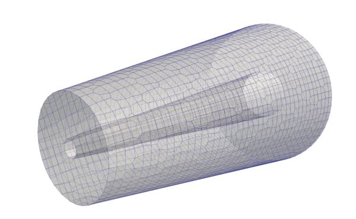

<!-- https://doc.openfoam.com/2606/tools/pre-processing/mesh/generation/snappyhexmesh/searchableObjects/searchablecone -->

# searchableCone



A cone, optionally hollow

## Usage

```
cone
{
    type            searchableCone;
    point1          (0 0 0);
    radius1         1.5;
    innerRadius1    0.25;
    point2          (10 0 0);
    radius2         3.0;
    innerRadius2    1.0;
}

```

Where:

| Property | Description | Required |
| --- | --- | --- |
| `point1` | Axis point at the start | yes |
| `radius1` | Outer radius at the start | yes |
| `innerRadius1` | Inner radius at the start | yes |
| `point2` | Axis point at the end | yes |
| `radius2` | Outer radius at the end | yes |
| `innerRadius2` | Inner radius at the end | yes |
