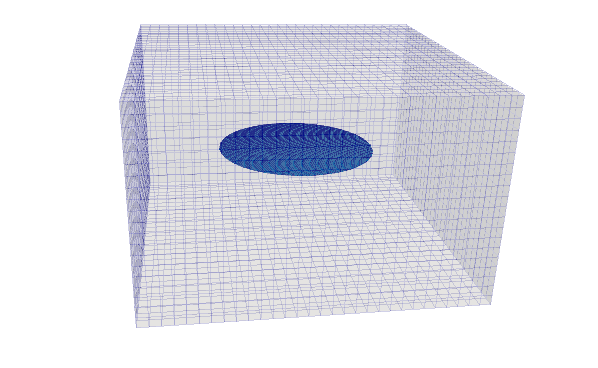

<!-- https://doc.openfoam.com/2606/tools/pre-processing/mesh/generation/snappyhexmesh/searchableObjects/searchabledisk -->

# searchableDisk



A disk with zero thickness based its origin, normal direction and radius.

## Usage

```
disk
{
    type            searchableDisk;
    origin          (0 0 0);
    normal          (0 1 0);
    radius          0.314;
}

```

Where:

| Property | Description | Required |
| --- | --- | --- |
| `origin` | Disk origin | yes |
| `normal` | Normal direction | yes |
| `radius` | Disk radius | yes |
