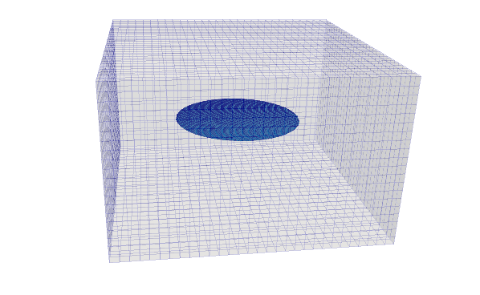

<!-- https://doc.openfoam.com/2606/tools/pre-processing/mesh/generation/snappyhexmesh/searchableObjects/searchableextrudedcircle -->

# searchableExtrudedCircle



A shape defined by inflating a segmented line into a tube with constant radius.

Not applicable to snappyHexMesh: only 'near' queries are implemented, i.e. no
testing for intersections or inside/outside.

## Usage

```
cylinder2
{
    type            searchableExtrudedCircle;
    file            "curve2.vtk";
    radius          0.5;
}

```

## Further information

Tutorial

* [blockMeshDict](https://gitlab.com/openfoam/core/openfoam/-/tree/OpenFOAM-v2606/tutorials/mesh/blockMesh/pipe/system/blockMeshDict)
