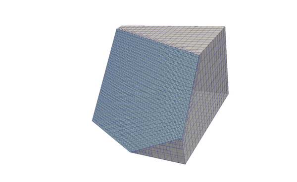

<!-- https://doc.openfoam.com/2606/tools/pre-processing/mesh/generation/snappyhexmesh/searchableObjects/searchableplane -->

# searchablePlane



An infinite plane. The plane can be used to cut\-out part of the domain, where
the mesh in the plane normal direction will be preserved. The plane can be
specified according to:

* **pointAndNormal**

```
Plane is defined by point and normal vector

```

* **embeddedPoints**

```
Plane is defined by 3 points

```

* **planeEquation**

```
Employs the algebraic plane equation:

```

ax\+by\+cz\+d\=0ax \+ by \+ cz \+ d \= 0ax\+by\+cz\+d\=0

## Usage

Plane defined by point and a normal vector:

```
plane
{
    type            searchablePlane;
    planeType       pointAndNormal;

    pointAndNormalDict
    {
        basePoint       (1 1 1);
        normal          (0 1 0);
    }
}

```

Plane defined by 3 points on the plane:

```
plane
{
    type            searchablePlane;
    planeType       embeddedPoints;

    embeddedPointsDict
    {
        point1          (1 1 1);
        point2          (0 1 0);
        point3          (0 0 1)
    }
}

```

Plane defined by plane equation:

```
plane
{
    type            searchablePlane;
    planeType       planeEquation;

    planeEquationDict
    {
        a  0;
        b  0;
        c  1; // to create plane with normal towards +z direction ...
        d  2; // ... at coordinate: z = 2
    }
}

```
