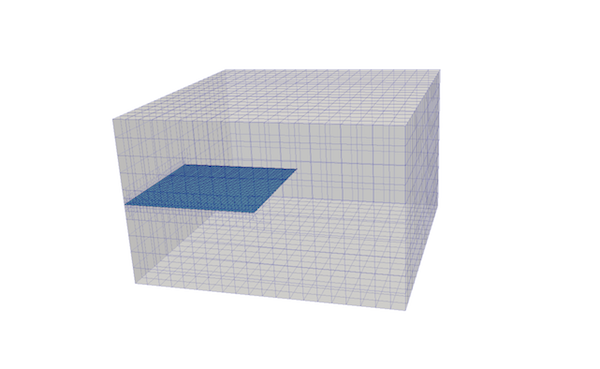

<!-- https://doc.openfoam.com/2606/tools/pre-processing/mesh/generation/snappyhexmesh/searchableObjects/searchableplate -->

# searchablePlate



A finite plate aligned with co\-ordinate system. User must specify span
in two directions, the third must be zero. Plate could be used e.g. to create
a baffle or measuring plane.

## Usage

```
plane
{
    type            searchablePlate;
    origin          (0 0 0);
    span            (2 4 0);
}

```

Where:

| Property | Description | Required |
| --- | --- | --- |
| `origin` | Centre of plate | yes |
| `span` | Span in each direction | yes |

Note that the `span` must have one `0` entry, e.g.

* `(1 1 0)`
* `(1 0 1)`
