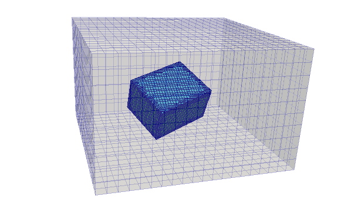

<!-- https://doc.openfoam.com/2606/tools/pre-processing/mesh/generation/snappyhexmesh/searchableObjects/searchablerotatedbox -->

# searchableRotatedBox



A cuboid defined via minimum and maximum co\-ordinates, rotated about its
centre according to a local co\-ordinate system.
The rotation is defined by a combination of vectors (e1/e2\),(e2/e3\) or (e3/e1\)

## Usage

```
boxRotated
{
    type            searchableRotatedBox;
    span            (5 4 3);
    origin          (0 0 0);
    e1              (1 0.5 0);
    e3              (0 0.5 1);
}

```
