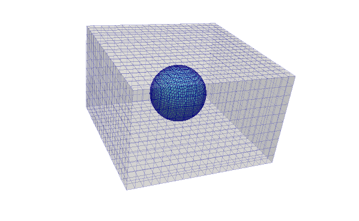

<!-- https://doc.openfoam.com/2606/tools/pre-processing/mesh/generation/snappyhexmesh/searchableObjects/searchablesphere -->

# searchableSphere



A sphere given by its centre radius.

## Usage

```
sphere
{
    type            searchableSphere;
    centre          (0 0 0);
    radius          3;
}

```

Where:

| Property | Description | Required |
| --- | --- | --- |
| `centre` | Centre of sphere | yes |
| `radius` | Radius of sphere | yes |
