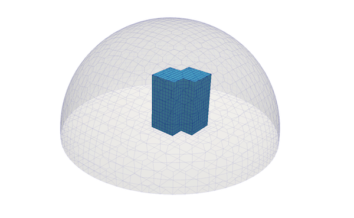
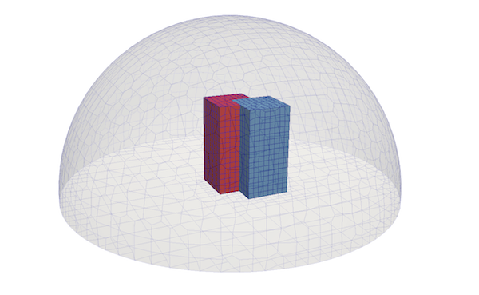

<!-- https://doc.openfoam.com/2606/tools/pre-processing/mesh/generation/snappyhexmesh/searchableObjects/searchablesurfacecollection -->

# searchableSurfaceCollection

A set of transformed *searchableSurfaces*.

After creating the searchable object the *searchableSurfaceCollection* can be
scaled and transformed in the specified local co\-ordinate system.



In the example shown here, the *box1* has two copies called *seal* and *herring*.
The geometries are always merged. Regions are merged when

```
mergeSubRegions true;

```

As it is shown in Figure 1\. Figure 2 shows the situation with regions not
merged.



Boolean operations are not performed, i.e. on meshing, parts may be identified
'inside'.

## Usage

```
box1
{
    type            searchableBox;
    min             (0 0 0);
    max             (1 1 1);
}

twoFridgeFreezers
{
    type            searchableSurfaceCollection;

    mergeSubRegions true; //create single region

    seal
    {
        surface         box1;
        scale           (1.0 1.0 2.1);
        transform
        {
            coordinateSystem
            {
                type            cartesian;
                origin          (3 3 0);
                coordinateRotation
                {
                    type            axesRotation;
                    e1              (1 0 0);
                    e3              (0 0 1);
                }
            }
        }
    }

    herring
    {
        surface         box1;
        scale           (1.0 1.0 2.1);
        transform
        {
            coordinateSystem
            {
                type            cartesian;
                origin          (2.5 2.5 0);
                coordinateRotation
                {
                    type            axesRotation;
                    e1              (1 0 0);
                    e3              (0 0 1);
                }
            }
        }
    }
}

```
