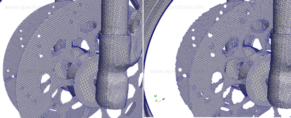
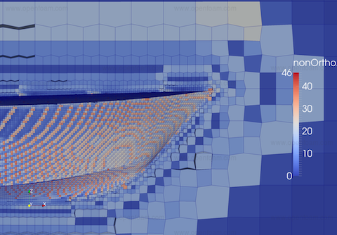

<!-- https://doc.openfoam.com/2606/tools/pre-processing/mesh/generation/snappyhexmesh/snapping -->

# Snapping

The *snapping* phase attempts to adapt the castellated mesh to conform to the
input [geometry](geometry/index.md). These controls are located in the `snapControls`
sub\-dictionary.

Snapping involves projecting and morphing the mesh to, e.g. the surfaces and
features, in an iterative process. If the adaptations invalidate the
[mesh quality](meshquality/index.md) criteria the step is undone and replayed using
modified parameters. The sequence ensures that the resulting mesh achieves a
minimum quality, at the expense of full geometry conformation.

The good practice is to start with the default values and adjust them only
after inspecting the mesh.

The parameters need to be set for snapping onto the surfaces and features
separately.

The algorithm first smooth the mesh on the patches and in the volume.
Then, in the morphing stage displace the vertexes towards the surface.
Only those vertexes are attracted to the surface which are located in the region
defined by the local edge length multiplied by the [tolerance](snapping.md#tolerance)
entry from the `snapControls` dictionary (by default set to 2\).

If the mesh quality is violated, vertices are moved back in a given fraction of
the step (keyword [errorReduction](meshquality/index.md#keywords-errorReduction) in
the `snappyHexMeshDict.meshQualityControls` dictionary). After mesh quality
check the next attempt to move the point towards the geometry takes place. This
process is repeated until the maximum number of iterations is reached. Each step
is reversible.

After the successful snapping or running out of iterations mesh is cleaned from
unnecessary non\-orthogonal planar faces.

```
snapControls
{
    nSmoothPatch    3;
    nSmoothInternal $nSmoothPatch;
    tolerance       2.0;
    nSolveIter      30;
    nRelaxIter      5;

    // Feature snapping

        nFeatureSnapIter 10;
        implicitFeatureSnap false;
        explicitFeatureSnap true;
        multiRegionFeatureSnap false;
}

```

## Snapping on features

The mesh is snapped to the features after the surface snapping step.
While during the surface snapping the points are displaced in the normal
direction to the surface, displacement to the edge is more complicated. Therefore
more iterations are typically needed.

Features may be specified explicitly using `surfaceFeatureExtract` utility
which creates the *eMesh* file (located in `constant/triSurface` directory)
with the feature line specification.
Other option is to use implicit feature definition. In such case `snappyHexMesh`
does not read *eMesh* file and defines the sharp edges itself.
Implicit algorithm behaves correctly on simple meshes
without sharp corners and baffles.



Figure shows the different result with explicit (left) and implicit (right) feature
snapping. Picture shows mesh snapped on the baffle patches representing the
break disks. Implicit snapping does not capture properly smooth edges.

A Practical example of implicit feature snapping is in the tutorial:

* [iglooWithFridges](https://gitlab.com/openfoam/core/openfoam/-/tree/OpenFOAM-v2606/tutorials/heatTransfer/buoyantBoussinesqSimpleFoam/iglooWithFridges)

## Keywords

---

### nSmoothPatch \[label]

Number of smoothing iterations along the surface

---

### nSmoothInternal \[label]

Number of iterations for internal smoothing to reduce non\-orthogonality
at the face of refinement (effectively making the faces non\-planar).
Default value is zero.



---

### tolerance \[scalar]

Multiplied by local cell\-edge length specifies region along the surface
within which the points are attracted by the surface

---

### nSolveIter \[label]

Number of mesh displacement iterations

---

### nRelaxIter \[label]

Number of relaxation iterations during the snapping. If the mesh does not conform
the geometry and all the iterations are spend, user may try to increase the number
of iterations.

---

### nFeatureSnapIter \[label]

Number of relaxation iterations used for snapping onto the features.
If not specified, feature snapping will be disabled.

---

### implicitFeatureSnap \[boolean]

Switch turning on the implicit feature specification.
Default is `false`.

---

### explicitFeatureSnap \[boolean]

Snap mesh onto the feature lines defined in *eMesh* file. Default is `true`.

---

### multiRegionFeatureSnap \[boolean]

When using [explicitFeatureSnap](snapping.md#keywords-explicitFeatureSnap) and this switch is
on, features between multiple surfaces will be captured. This is useful for multi\-region
meshing where the internal mesh must conform the region geometrical boundaries.
Default \= false.

---

### nFaceSplitInterval \[label]

Existing cell edges are aligned with feature lines by default. Unsuccessful
alignment will result in concavity which consequently
will lead to non\-orthogonality on the extruded mesh at the layer adding phase.
Where the mesh quality fails the extrusion is disabled. Resulting in no prismatic
layer coverage in the area. To create an edge on the volumetric mesh aligned
favourably with the features `nFaceSplitInterval` parameter may be used.
The settings is typically followed by the `layerTerminationAngle` and `detectExtrusionIsland`
parameters in `addLayerControls` dictionary.

Sets the interval of iterations. Avoid using the splitting from
the first iteration by setting the parameter to one half of the
[nFeatureSnapIter](snapping.md#keywords-nFeatureSnapIter) parameter
Default \= \-1 (disabled).

---

### detectBaffles \[boolean]

Explicitly turn on/off detecting baffle edges. Default is `true`.

---

### releasePoints \[boolean]

Releasing attraction close to a feature to allow more freedom
for displacement. Default is false.

---

### stringFeatures \[boolean]

Walk along the the feature edges to identify connected feature edges.
Default is `true`.

---

### avoidDiagonal \[boolean]

Avoid attraction of points across the diagonal of the face
which would result in a collapsed face. Default is `false`.

---

### concaveAngle \[scalar]

Angle at which the face is too concave and will be split. Default is 45 deg.

---

### minAreaRatio \[scalar]

Do not split a face if its area ratio is smaller than the given value.
Default is 0\.3\.

---

### detectNearSurfacesSnap \[boolean]

Disable snapping to opposite near surfaces, default `true`.

---

### baffleFeaturePoints

Optionally construct baffle features (110 deg hard\-coded angle) and snap them
in addition to feature edge snapping

---

### strictRegionSnap

Attract points only to the surface they originate from. This can improve
snapping of intersecting surfaces. Default is `false`.

---
