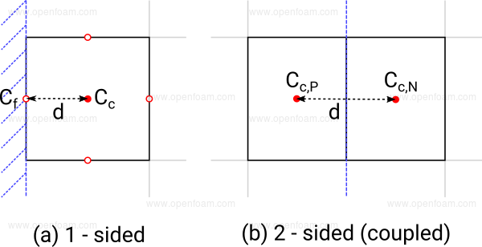

<!-- https://doc.openfoam.com/2606/tools/processing/boundary-conditions -->

# Boundary conditions

In the absence of sources and sinks, system behaviour is driven by its boundary
conditions. These form a critical aspect of case specification where ill\-posed
combinations will lead to physically incorrect predictions, and in many cases,
solver failure.

OpenFOAM offers a wide range of conditions, grouped according to:

* [Constraints](boundary-conditions/rtm/constraint/index.md): geometrical constraints, e.g. for
2\-D, axisymmetric etc.
* [General](boundary-conditions/rtm/derived/general/index.md): available to all patch types and
fields
* [Inlet](boundary-conditions/rtm/derived/inlet/index.md): inlet conditions
* [Outlet](boundary-conditions/rtm/derived/outlet/index.md): outlet conditions
* [Wall](boundary-conditions/rtm/derived/wall/index.md): wall conditions
* [Coupled](boundary-conditions/rtm/derived/coupled/index.md): coupled conditions, e.g. cyclic

## Usage

Boundary conditions are assigned in the `boundaryField` section of the field
files within each time directory for each mesh patch. The format follows:

```
boundaryField
{
    <patch 1>
    {
        type        <patch type>;
        ...
    }
    <patch 2>
    {
        type        <patch type>;
        ...
    }
    ...
    <patch N>
    {
        type        <patch type>;
        ...
    }
}

```

Each condition is set in a dictionary given by the name of the underlying mesh
patch, according to the `type` keyword.

## Details

* For 1\-sided, e.g. external boundaries, the normal vector points out of the
domain
* Non\-orthogonality not included



Used when solving the general transport equation to provide:

* value at boundary
* gradient at boundary

## Further information

Usage

* [Common combinations](boundary-conditions/common-combinations.md)
* Many conditions employ a `Function1` type to describe a property as a function
of another, typically time

Source code:

* [fvPatchFields](https://gitlab.com/openfoam/core/openfoam/-/tree/OpenFOAM-v2606/src/finiteVolume/fields/fvPatchFields)

API:

* [Foam::Function1](https://api.openfoam.com/2606/Foam_Function1.html)

See also:

* [Source documentation](https://api.openfoam.com/2606/grpBoundaryConditions.html)
