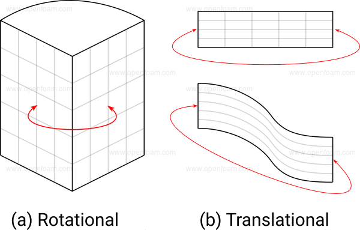

<!-- https://doc.openfoam.com/2606/tools/processing/boundary-conditions/rtm/derived/coupled/cyclic -->

# Cyclic

## Properties

* Coupling condition between a pair of patches
* Faces on each coupled patch must have the same topology, i.e. they must have
collocated points such a one\-to\-one mapping exists between the faces on
each side.
* The coupling is treated implicitly using the cell values adjacent to
each pair of cyclic patches
* The face values are determined using linear interpolation between the cell
values

## Usage

The condition requires entries in both the `boundary` and field files. Mesh
`boundary` file:

```
<patchName>
{
    type            cyclic;
    neighbourPatch  <coupled patch name>;
    transform       <transform type>;
    ...
}

```

Field file:

```
<patchName>
{
    type            cyclic;
}

```

## Details



## Further information

Source code:

* [Foam::cyclicPolyPatch](https://api.openfoam.com/2606/Foam_cyclicPolyPatch.html)
* [Foam::cyclicFvPatch](https://api.openfoam.com/2606/Foam_cyclicFvPatch.html)
* [Foam::cyclicFvPatchField](https://api.openfoam.com/2606/Foam_cyclicFvPatchField.html)

Example usage:

* pimpleFoam `decayIsoTurb` tutorial:
[decayIsoTurb](https://gitlab.com/openfoam/core/openfoam/-/tree/OpenFOAM-v2606/tutorials/incompressible/pimpleFoam/LES/decayIsoTurb)
