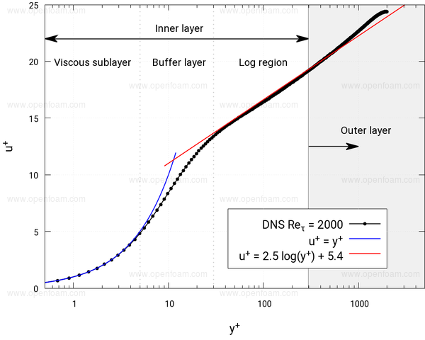

<!-- https://doc.openfoam.com/2606/tools/processing/models/turbulence/ -->

# Turbulence

OpenFOAM includes support for the following types of turbulence modelling:

* [Reynolds Averaged Simulation (RAS)](ras/index.md),
* [Detached Eddy Simulation (DES)](des/index.md), and
* [Large Eddy Simulation (LES)](les/index.md).

## Usage

Turbulence models are specified in the
`$FOAM_CASE/constant/turbulenceProperties`
file, taking the form, e.g. when specifying the [RAS](ras/index.md)
[kOmegaSST](ras/linear-evm/rtm/kOmegaSST.md) model:

```
simulationType      RAS;

RAS
{
    RASModel                kOmegaSST;

    // On/off switch
    turbulence              on

    // Optionally write the model coefficients at run-time
    printCoeffs             no;

    // Optionally override default model coefficients
    kOmegaSSTCoeffs
    {
        ...
    }
}

```

Default coefficients are available for all models, based on their reference
literature. Optionally users may override the default values by specifying
a `<model>Coeffs` sub\-dictionary. Coefficient names can be found by observing
the solver output when setting the `printCoeffs` to `yes`.

## Mesh requirements

Effective use of turbulence models requires close attention to their
respective meshing requirements, particularly in near\-wall regions.



DNS data from Lee and Moser [39](../../../../references.md#lee_direct_2015)

RAS

* high Reynolds number: first cell height should be in the region of
30 \< y\+y^{\+}y\+ \< 200\. Note that the upper limit is imposed by the
location of the outer layer, which depends on the Reynolds number
* low Reynolds number: mesh required to resolve the viscous sub\-layer,
typically using 10\-20 layers

LES

* mesh required to resolve the viscous sub\-layer
* requires high order schemes to adequately resolve the high\-energy containing
eddies
* preferably isotropic mesh

## Numerical settings

Turbulence generation is driven by the velocity gradient. Errors arising from
the [gradient calculation](../../numerics/schemes/gradient/index.md), e.g.
due to poor quality meshes, can lead to spurious turbulence predictions and
solver instability. This effect can be partly compensated by the application of
[limited schemes](../../numerics/schemes/gradient.md#options-gradient-limiters).

## Further information

Source code:

* [TurbulenceModels](https://gitlab.com/openfoam/core/openfoam/-/tree/OpenFOAM-v2606/src/TurbulenceModels)
* [Source documentation](https://api.openfoam.com/2606/grpTurbulence.html)
