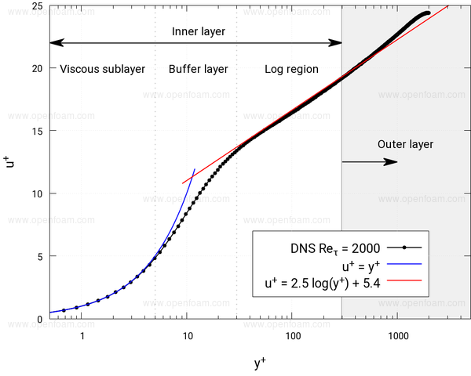

<!-- https://doc.openfoam.com/2606/tools/processing/models/turbulence/ras/wall-functions/ -->

# Wall functions

## Overview

Wall functions allow Reynolds\-averaged simulations at high Reynolds number
without resolving the thin viscous sub\-layer adjacent to solid boundaries.
Instead of placing many mesh layers in the region where molecular viscosity
dominates, the first cell centre is located in the logarithmic layer and
empirical *law\-of\-the\-wall* relations supply the missing near\-wall physics.

Wall functions are implemented as boundary conditions on turbulence fields
(`nut`, `epsilon`, `omega`, etc.) applied to `wall` patches. They work
together with a no\-slip velocity condition on `U` and must be paired with a
mesh whose near\-wall spacing satisfies the intended y\+y^\+y\+ range \- see
[Mesh requirements](../../index.md#mesh-requirements).

## Near\-wall flow

At a solid wall the no\-slip condition forces the mean velocity to zero, so
flow near the surface is dominated by variation in the wall\-normal direction.
Away from corners and separation, the near\-wall mean flow is well
approximated as a one\-dimensional boundary\-layer profile: parallel velocity
uuu varies with distance yyy from the wall, while gradients in the
wall\-parallel directions are small compared with ∂u/∂y\\partial u / \\partial y∂u/∂y.



DNS data from Lee and Moser [39](../../../../../../references.md#lee_direct_2015)

The profile divides naturally into regions:

| Region | Approximate y\+y^\+y\+ | Character |
| --- | --- | --- |
| Viscous sub\-layer | y\+≲5y^\+ \\lesssim 5y\+≲5 | u\+≈y\+u^\+ \\approx y^\+u\+≈y\+; molecular viscosity dominates |
| Buffer layer | 5≲y\+≲305 \\lesssim y^\+ \\lesssim 305≲y\+≲30 | Transition between viscous and turbulent stress |
| Log (inertial) layer | y\+≳30y^\+ \\gtrsim 30y\+≳30 | u\+≈1κln⁡(y\+)\+Bu^\+ \\approx \\frac{1}{\\kappa}\\ln(y^\+) \+ Bu\+≈κ1​ln(y\+)\+B |

Non\-dimensional quantities are defined using the friction velocity
uτu\_\\tauuτ​:

u\+\=uuτ,y\+\=yuτν,uτ\=τwρ u^\+ \= \\frac{u}{u\_\\tau},
 \\qquad
 y^\+ \= \\frac{y u\_\\tau}{\\nu},
 \\qquad
 u\_\\tau \= \\sqrt{\\frac{\\tau\_w}{\\rho}}u\+\=uτ​u​,y\+\=νyuτ​​,uτ​\=ρτw​​​
where τw\\tau\_wτw​ is the wall shear stress, ρ\\rhoρ is density, and ν\\nuν is
kinematic viscosity. In the log layer, turbulent stress dominates and the
velocity profile follows the logarithmic law with von Kármán constant
κ≈0\.41\\kappa \\approx 0\.41κ≈0\.41 and roughness parameter E≈9\.8E \\approx 9\.8E≈9\.8 (giving
B\=ln⁡E/κB \= \\ln E / \\kappaB\=lnE/κ).

Resolving this profile directly requires very fine near\-wall meshing
(y\+∼1y^\+ \\sim 1y\+∼1). Wall functions avoid that cost by assuming the cell
centre adjacent to the wall lies in the log layer and that the profile
between the wall and that point follows the law of the wall.

## Momentum transfer

For incompressible RAS with a linear eddy viscosity closure, the mean
momentum equation uses an effective viscosity
μeff\=μ\+μt\\mu\_\\mathrm{eff} \= \\mu \+ \\mu\_tμeff​\=μ\+μt​ (see
[Linear eddy viscosity models](../linear-evm/index.md#background)). Near a
wall, the wall\-parallel shear stress is related to the velocity gradient in
the wall\-normal direction:

τw\=μ∂u∂y∣w\=ρuτ2 \\tau\_w \= \\mu \\left.\\frac{\\partial u}{\\partial y}\\right\|\_w
 \= \\rho u\_\\tau^2τw​\=μ∂y∂u​​w​\=ρuτ2​
In the finite\-volume discretisation, the velocity gradient between the wall
(no\-slip, uw\=0u\_w \= 0uw​\=0) and the centroid of the first interior cell (distance
yyy, velocity uuu) is approximated using an effective viscosity at the wall
patch:

τw≈(μ\+μt) uy \\tau\_w \\approx (\\mu \+ \\mu\_t)\\,\\frac{u}{y}τw​≈(μ\+μt​)yu​
If the cell\-centre velocity and distance are known, the law of the wall
provides the correct u\+u^\+u\+ for the corresponding y\+y^\+y\+. Combining the
definitions above gives a closure for the turbulent viscosity at the wall
patch:

τw\=μ y\+u\+ uy\=(μ\+μt) uy \\tau\_w
 \= \\mu\\,\\frac{y^\+}{u^\+}\\,\\frac{u}{y}
 \= (\\mu \+ \\mu\_t)\\,\\frac{u}{y}τw​\=μu\+y\+​yu​\=(μ\+μt​)yu​
and therefore

μt\=μ(y\+u\+−1) \\mu\_t \= \\mu\\left(\\frac{y^\+}{u^\+} \- 1\\right)μt​\=μ(u\+y\+​−1)
OpenFOAM momentum wall functions (`nutUWallFunction`, `nutkWallFunction`,
etc.) evaluate y\+y^\+y\+ from the local flow and set νt\=μt/ρ\\nu\_t \= \\mu\_t / \\rhoνt​\=μt​/ρ on
the `nut` patch field accordingly. The velocity field retains
[`noSlip`](../../../../boundary-conditions/rtm/derived/wall/noSlip.md) on
`U`; the wall function modifies only the turbulent viscosity used in the
wall\-adjacent stress calculation, not the wall velocity itself.

### Velocity\-based and kkk\-based formulations

Two common routes to y\+y^\+y\+ are available:

* **Velocity\-based** (`nutUWallFunction`, `nutUBlendedWallFunction`, …):
y\+y^\+y\+ is computed from the magnitude of the tangential velocity at the
first cell centre relative to the wall.
* **kkk\-based** (`nutkWallFunction`, `nutkRoughWallFunction`): uτu\_\\tauuτ​ is
estimated from the turbulent kinetic energy at the cell centre,
uτ\=Cμ1/4k1/2u\_\\tau \= C\_\\mu^{1/4} k^{1/2}uτ​\=Cμ1/4​k1/2, and hence
y\+\=yuτ/νy^\+ \= y u\_\\tau / \\nuy\+\=yuτ​/ν.

Both approaches apply the same log\-layer formula for νt\\nu\_tνt​ in the
inertial region:

νt\=ν y\+κln⁡(Ey\+) \\nu\_t \= \\nu\\, y^\+ \\frac{\\kappa}{\\ln(E y^\+)}νt​\=νy\+ln(Ey\+)κ​
In the viscous sub\-layer limit (y\+→0y^\+ \\to 0y\+→0), the wall function reverts to
νt\=ν\\nu\_t \= \\nuνt​\=ν (i.e. μt\=μ\\mu\_t \= \\muμt​\=μ).

### Blending treatments

When the first cell centre falls in the buffer layer, neither the pure
viscous nor the pure log\-layer estimate is accurate. OpenFOAM wall functions
support blending between the two predictions via the `blending` entry:

| `blending` | Behaviour |
| --- | --- |
| `stepwise` | Viscous below ylam\+y^\+\_\\mathrm{lam}ylam\+​, log\-layer above (high\-Re default) |
| `max` | νt\=max⁡(νt,vis,νt,log)\\nu\_t \= \\max(\\nu\_{t,\\mathrm{vis}}, \\nu\_{t,\\mathrm{log}})νt​\=max(νt,vis​,νt,log​) |
| `binomial` | Smooth blend; used by `nutUBlendedWallFunction` and recommended with `omegaWallFunction` for automatic wall treatment |

The blended friction\-velocity form used by `nutUBlendedWallFunction` is:

uτ\=(uτ,vis n\+uτ,log n)1/n u\_\\tau \= \\left(u\_{\\tau,\\mathrm{vis}}^{\\,n} \+ u\_{\\tau,\\mathrm{log}}^{\\,n}\\right)^{1/n}uτ​\=(uτ,visn​\+uτ,logn​)1/n
with blending exponent n\=4n \= 4n\=4 by default [48](../../../../../../references.md#menter_elements_2001).

## Scalar wall functions

Turbulence model scalars require consistent wall treatment alongside
`nut`:

| Field | Typical wall BC | Role |
| --- | --- | --- |
| `k` | [`kqRWallFunction`](../../../../boundary-conditions/rtm/derived/wall/kqRWallFunction.md) | Zero\-gradient; not a wall function \- assumes kkk at the cell centre is representative in the log layer |
| `epsilon` | [`epsilonWallFunction`](../../../../boundary-conditions/rtm/derived/wall/epsilonWallFunction.md) | Sets ϵ\\epsilonϵ and turbulent production GGG from y\+y^\+y\+ |
| `omega` | `omegaWallFunction` | Sets ω\\omegaω and GGG; use `blending binomial` with `nutUBlendedWallFunction` for full automatic wall treatment |
| `k` (low\-Re) | [`kLowReWallFunction`](../../../../boundary-conditions/rtm/derived/wall/kLowReWallFunction.md) | Analytic sub\-layer profile when resolving y\+∼1y^\+ \\sim 1y\+∼1 |

`kqRWallFunction` is a wrapper around zero\-gradient and does not impose a
value at the wall. In high\-Re wall\-function mode, turbulent kinetic energy
is not forced to zero on the patch; near\-wall damping is handled through
νt\\nu\_tνt​.

## High and low Reynolds number operation

**High Reynolds number** (wall\-function mode) is intended for
30≲y\+≲30030 \\lesssim y^\+ \\lesssim 30030≲y\+≲300 on the first cell centre. The mesh skips the
viscous sub\-layer; `blending stepwise` or `lowReCorrection false` on
`epsilonWallFunction` uses only the log\-layer limit.

**Low Reynolds number** operation resolves the sub\-layer (y\+≲1y^\+ \\lesssim 1y\+≲1,
typically 10–20 wall\-normal layers) and uses laminar viscosity near the
wall. Enable low\-Re corrections (`blending binomial`, `lowReCorrection true`, or dedicated conditions such as `nutLowReWallFunction` and
`kLowReWallFunction`) when the first cell centre lies below the log layer.

Mismatch between the chosen wall treatment and the actual y\+y^\+y\+ distribution
is a common source of inaccurate drag or heat\-transfer predictions and should
be checked with a post\-processing function object such as `yPlus`.

## Usage

Wall functions are specified on `wall` patches in the field files. A typical
high\-Re kkk–ϵ\\epsilonϵ setup:

```
// 0/U
fixedWalls
{
    type            noSlip;
}

// 0/nut
fixedWalls
{
    type            nutkWallFunction;
    value           uniform 0;
}

// 0/k
fixedWalls
{
    type            kqRWallFunction;
    value           uniform 0;
}

// 0/epsilon
fixedWalls
{
    type            epsilonWallFunction;
    value           uniform 0;
}

```

Shared coefficients (`Cmu`, `kappa`, `E`) can be set on any wall\-function
patch; defaults are Cμ\=0\.09C\_\\mu \= 0\.09Cμ​\=0\.09, κ\=0\.41\\kappa \= 0\.41κ\=0\.41, E\=9\.8E \= 9\.8E\=9\.8.

## Model options

OpenFOAM includes several momentum wall\-function variants. The following
summarise the main RAS options documented in this section:

* [Blended turbulence viscosity](rtm/nutUBlended.md)
* [Turbulence viscosity based on turbulence kinetic energy](rtm/nutkWallFunction.md)

Additional conditions, including velocity\-based, rough\-wall, tabulated, and
low\-Re variants, are documented under
[Wall boundary conditions](../../../../boundary-conditions/rtm/derived/wall.md).

## Further information

Source code:

* [wallFunctions](https://gitlab.com/openfoam/core/openfoam/-/tree/OpenFOAM-v2606/src/TurbulenceModels/turbulenceModels/derivedFvPatchFields/wallFunctions)
* [nutWallFunction](https://gitlab.com/openfoam/core/openfoam/-/tree/OpenFOAM-v2606/src/TurbulenceModels/turbulenceModels/derivedFvPatchFields/wallFunctions/nutWallFunctions/nutWallFunction)

Related:

* [RAS overview](../index.md#wall-modelling)
* [Turbulence mesh requirements](../../index.md#mesh-requirements)
* [Source documentation](https://api.openfoam.com/2606/grpWallFunctions.html)
