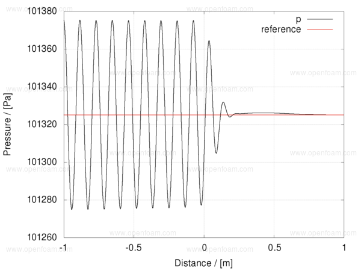

<!-- https://doc.openfoam.com/2606/tools/processing/numerics/fvoptions/sources/rtm/acousticDamping -->

# Acoustic damping

This source can be used to damp spurious pressure waves for acoustic
(compressible) analysis. It behaves like an acoustic sponge\-zone, combining the
theories of acoustic resistivity, porous resistance and inertial
under\-relaxation based on a reference solution taken from the far\-field steady
or mean flow.

## Properties

This source will:

* damp acoustic waves generated from unsteady flow before they propagate to
imperfect non\-reflective inflow/outflow boundaries, and
* damp the generation and propagation of spurious numerical acoustic waves in
low\-quality meshes and severe mesh coarsening/refinement interfaces.

The following image shows how a uniform 1\-D acoustic is damped using a cosine\-ramping function within 2 to 3 wavelengths:


## Usage

The user needs to input both a damping coefficient, targeting a frequency or frequency range, and a ramping distance based on characteristic wavelengths. Damping will be applied increasingly for those cells beyond radius1, and the damping will be maximum for those cells beyond `radius2` (damping will be variable between `radius1` and `radius2`).
Although the user needs to input a target frequency and damping length, damping will be applied to all pressure waves, regardless of frequency. The length required to damp other frequencies will be different to the damping length input by the user.

The option is specified using:

```
acousticDampingSource
{
    type                acousticDampingSource;
    active              yes;

    duration            1000.0;
    selectionMod        cellZone;
    cellZone            selectedCells;
    centre              (0 0 0);
    radius1             0.1;
    radius2             1.2;
    frequency           3000;
    URef                UMean;
}

```

## Further information

Tutorials

* [sineWaveDamping](https://gitlab.com/openfoam/core/openfoam/-/tree/OpenFOAM-v2606/tutorials/compressible/rhoPimpleFoam/laminar/sineWaveDamping)

Source code

* [acousticDampingSource](https://gitlab.com/openfoam/core/openfoam/-/tree/OpenFOAM-v2606/src/fvOptions/sources/derived/acousticDampingSource)
