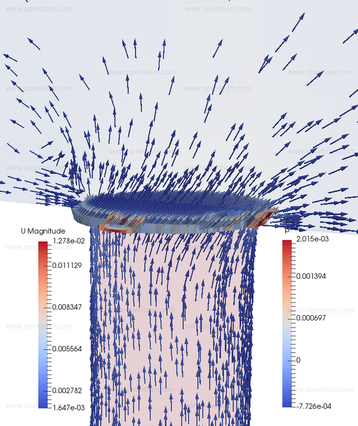

<!-- https://doc.openfoam.com/2606/tools/processing/numerics/fvoptions/sources/rtm/actuationDisk -->

# Actuation disk

## Properties

* The `actuationDiskSource` applies sources on velocity, i.e. `U`,
to enable actuator disk models for aero/hydro thrust loading of
rotary disks (e.g. propellers, horizontal\-axis wind/tidal turbines,
or helicopter rotors) on surrounding flow field in terms of
energy conversion processes.
* The `actuationDiskSource` is applied on the volume cells (not on faces).
This nuance might be important since theoretical actuator disks possess
zero\-thickness.
* The `actuationDiskSource` inherits the traits of the
[fvOption](../../../../../../fundamentals/case-structure/fvoptions.md), and `cellSetOption`.

Corrections applied to:

`U`
: Velocity \[m/s]

Required fields:

`U`
: Velocity \[m/s]

## Model equations

The `actuationDiskSource` possesses two options for force computations:

`Froude`
: Froude's one\-dimensional ideal actuator disk method

`variableScaling`
: Variable\-scaling actuator disk method

### Froude's method

The model expressions for `Froude` method ([8](../../../../../../references.md#burton_atm_2011), Eq. 3\.9\):

T\=2ρrefA∣um⋅n∣2a(1−a) T \= 2 \\rho\_{\\ref} A \| \\u\_m \\cdot \\vec{n} \|^2 a (1\-a)T\=2ρref​A∣um​⋅n∣2a(1−a)
with

a\=1−CpCT a \= 1 \- \\frac{C\_p}{C\_T}a\=1−CT​Cp​​
Where:

TTT
: Thrust magnitude \[N]

ρref\\rho\_{\\ref}ρref​
: Monitored incoming fluid density \[kg/m3^33]

AAA
: Actuator disk planar surface area \[m2^22]

um\\u\_mum​
: Incoming velocity spatial\-averaged on monitored region \[m/s]

n\\vec{n}n
: Surface\-normal vector of the actuator disk pointing upstream \[\-]

aaa
: Axial induction factor \[\-]

CpC\_pCp​
: Power coefficient \[\-]

CTC\_TCT​
: Thrust coefficient \[\-]

### Variable\-scaling method

The model expressions for `variableScaling` method
(([31](../../../../../../references.md#laan_atm_2015), Eqs. 5\-6\), ([30](../../../../../../references.md#laan2_atm_2015))):

T\=0\.5ρrefA∣uo⋅n∣2CT∗ T \= 0\.5 \\rho\_{\\ref} A \| \\u\_o \\cdot \\vec{n} \|^2 C\_T^\*T\=0\.5ρref​A∣uo​⋅n∣2CT∗​
with

CT∗\=CT(∣um∣∣uo∣)2 C\_T^\* \= C\_T \\left( \\frac{ \| \\u\_m \| }{ \| \\u\_o \| } \\right)^2CT∗​\=CT​(∣uo​∣∣um​∣​)2
Where:

TTT
: Thrust magnitude \[N]

ρref\\rho\_{\\ref}ρref​
: Monitored incoming fluid density \[kg/m3^33]

AAA
: Actuator disk planar surface area \[m2^22]

um\\u\_mum​
: Incoming velocity spatial\-averaged on monitored region \[m/s]

uo\\u\_ouo​
: Incoming velocity spatial\-averaged on actuator disk \[m/s]

n\\vec{n}n
: Surface\-normal vector of the actuator disk pointing upstream \[\-]

aaa
: Axial induction factor \[\-]

CpC\_pCp​
: Power coefficient \[\-]

CTC\_TCT​
: Thrust coefficient \[\-]

CT∗C\_T^\*CT∗​
: Calibrated thrust coefficient \[\-]

### Operands

| Operand | Type | Location |
| --- | --- | --- |
| input | \- | \- |
| output file | dat | `$POST=$FOAM_CASE/postProcessing/<FvO>/<time>/<file>` |

## Usage

Example of the fvOptions specification using `constant/fvOptions` file:

```
actuationDiskSource1
{
    // Mandatory entries (unmodifiable)
    type            actuationDiskSource;

    // Mandatory (inherited) entries (unmodifiable)
    selectionMode   <mode>;    // e.g. cellSet as shown below
    cellSet         <cellSetName>;

    // Mandatory entries (runtime modifiable)
    diskArea        40.0;
    diskDir         (1 0 0);
    Cp              <Function1>;
    Ct              <Function1>;

    // Conditional optional entries (unmodifiable)
    monitorMethod   <points|cellSet>;
    monitorCoeffs
    {
        // Option-1
        points
        (
            (p1x p1y p1z)
            (p2x p2y p2z)
            ...
        );

        // Option-2
        cellSet     <monitorCellSet>;
    }

    // Optional entries (unmodifiable)
    variant         <forceMethod>;

    // Optional entries (runtime modifiable)
    sink            true;
    writeFileStart  0;
    writeFileEnd    100;

    // Optional (inherited) entries
    ...
}

```

where the entries mean:

| Property | Description | Type | Required | Default |
| --- | --- | --- | --- | --- |
| type | Type name: actuationDiskSource | word | yes | \- |
| diskArea | Actuator disk planar surface area | scalar | yes | \- |
| diskDir | Surface\-normal vector of the actuator disk pointing upstream | vector | yes | \- |
| Cp | Power coefficient | Function1 | yes | \- |
| Ct | Thrust coefficient | Function1 | yes | \- |
| monitorMethod | Type of incoming velocity monitoring method \- see below | word | no | points |
| variant | Type of the force computation method \- see below | word | no | Froude |
| sink | Flag for body forces to act as a source (`true`) or a sink (`false`) | bool | no | true |
| writeFileStart | Start time for file output | scalar | no | 0 |
| writeFileEnd | End time for file output | scalar | no | VGREAT |

The inherited entries are elaborated in:

* [fvOption](../../../../../../fundamentals/case-structure/fvoptions.md)
	+ `cellSetOption`
* [writeFile](../../../../../post-processing/function-objects/field/writeFile.md)
	+ `Function1`

Options for the `monitorMethod` entry:

```
points  | Monitor incoming velocity field at a given set of points
cellSet | Monitor incoming velocity field at a given cellSet

```

Options for the `variant` entry:

```
Froude          | Froude's one-dimensional ideal actuator disk method
variableScaling | Variable-scaling actuator disk method

```

## Further information

Tutorial:

* [turbineSiting](https://gitlab.com/openfoam/core/openfoam/-/tree/OpenFOAM-v2606/tutorials/incompressible/simpleFoam/turbineSiting)

Sample result



Source code:

* [actuationDiskSource](https://gitlab.com/openfoam/core/openfoam/-/tree/OpenFOAM-v2606/src/fvOptions/sources/derived/actuationDiskSource)

**History:** Introduced in version [2\.2\.0](https://www.openfoam.com/news/main-news/openfoam-2.2.0)
