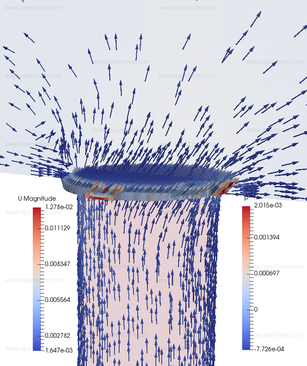

<!-- https://doc.openfoam.com/2606/tools/processing/numerics/fvoptions/sources/rtm/directionalPressureGradient -->

# Change flow direction

This source deflects the flow direction by imposing a variable pressure drop.
This is particularly useful for cases that include louvres, e.g. HVAC registers,
whereby to resolve the louvres using the mesh can lead to excessive cell counts
and excessively restrict the calculation time step.

## Properties

The pressure drop across the `cellZone` is evaluated according to the
options:

* `constant`: user\-specified Δp\\Delta pΔp \[Pa]
* `volumetricFlowRateTable`: Δp\\Delta pΔp is read as a table from file
* `DarcyForchheimer`: Δp\=(D\+0\.5ρ∣U∣I)∣U∣L\\Delta p \= (D \+ 0\.5 \\rho \|U\| I ) \|U\| LΔp\=(D\+0\.5ρ∣U∣I)∣U∣L \[Pa] where
D, I and L are user inputs.
* the `cellZone` should describe a set of cells with a 1\-cell thickness in the
flow direction
* the source requires the set of faces upstream of the `cellZone` to be
specified as a `faceZone`

A sample result is shown below, where the effect of flow deflection across the
cellZone is clearly evident.


## Usage

The option is specified using:

```
registerOrientation
{
    type                directionalPressureGradientExplicitSource;
    active              true;
    selectionMode       cellZone;
    cellZone            c1Zone;
    fieldNames          (U);
    flowDir             (1 2 0);    // new flow direction in the general coordinate system
    relaxationFactor    0.3;        // relax the application of the source term
    faceZone            f1Zone;     // faceZone upstream the cellZone

    // Pressure drop model \[Pa\]
    model               DarcyForchheimer;   // volumetricFlowRateTable | constant

    // DarcyForchheimer
    // deltaP = (D*mu + 0.5*rho*magUn)*magUn*length
    D                   5e7;
    I                   0;
    length              0.01;  // Virtual thickness of the porosity corresponding to the D and I values

    // constant pressure drop model
    // pressureDrop    8;

    // volumetricFlowRateTable pressure drop model
    // outOfBounds     clamp;
    // file            "volFlowRateTable";
}

```

## Further information

Tutorials

* [fvOptions](https://gitlab.com/openfoam/core/openfoam/-/tree/OpenFOAM-v2606/tutorials/heatTransfer/chtMultiRegionFoam/windshieldCondensation/system/cabin/fvOptions)

Source code

* [directionalPressureGradientExplicitSource](https://gitlab.com/openfoam/core/openfoam/-/tree/OpenFOAM-v2606/src/fvOptions/sources/derived/directionalPressureGradientExplicitSource)
