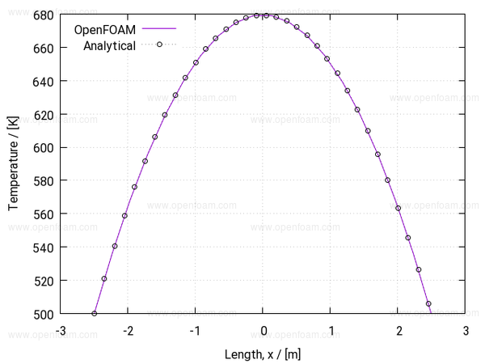

<!-- https://doc.openfoam.com/2606/tools/processing/numerics/fvoptions/sources/rtm/jouleHeating -->

# Joule heating

This source provides users with the ability to add Joule Heating contributions
to any thermal solver.

## Properties

The option solves an equation for the electrical potential, V, of the form

∇ ∙ (σ∇V)\=0 \\div (\\sigma \\grad V) \= 0∇∙(σ∇V)\=0
Where σ\\sigmaσ (`sigma`) is the electrical conductivity. The thermal source is then given by

Q˙\=(σ∇V) ∙ ∇V \\dot{Q} \= (\\sigma \\grad V ) \\dprod \\grad VQ˙​\=(σ∇V)∙∇V
A sample result is shown below


## Usage

The option is specified using:

```
heating
{
    type            jouleHeatingSource;
    active          true;

    jouleHeatingSourceCoeffs
    {
        anisotropicElectricalConductivity no;
    }
}

```

The electrical conductivity can be specified using either (see usage):

* If not present the `sigma` field will be read from file (standard field sigma)
* If the `sigma` entry is present the electrical conductivity is
specified as a (potentially uniform) function of temperature using a
`Function1` type, e.g.

```
heating
{
    type            jouleHeatingSource;
    active          true;

    jouleHeatingSourceCoeffs
    {
        anisotropicElectricalConductivity no;

        // Optionally specify sigma as a function of temperature
        sigma           table
        (
            (0      127599.8469)
            (1000   127599.8469)
        );
    }
}

```

* If the `anisotropicElectricalConductivity` flag is set to 'true', `sigma` should be specified as a vector quantity.

## Further information

Tutorials

* [jouleHeatingSolid](https://gitlab.com/openfoam/core/openfoam/-/tree/OpenFOAM-v2606/tutorials/heatTransfer/chtMultiRegionSimpleFoam/jouleHeatingSolid)

Source code

* [jouleHeatingSource](https://gitlab.com/openfoam/core/openfoam/-/tree/OpenFOAM-v2606/src/fvOptions/sources/derived/jouleHeatingSource)
