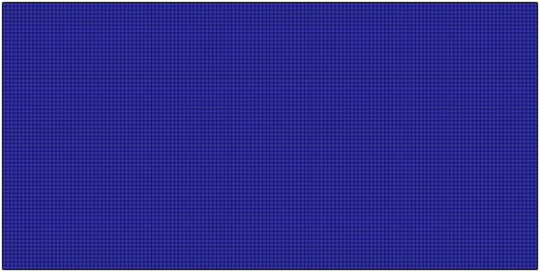
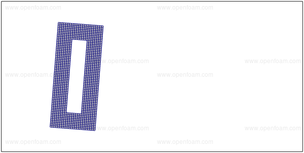
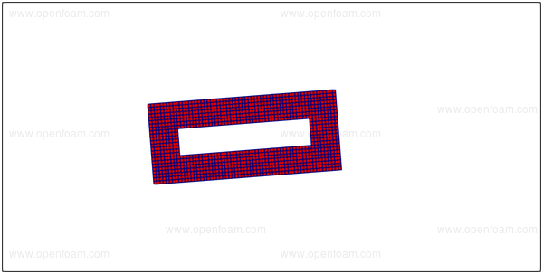
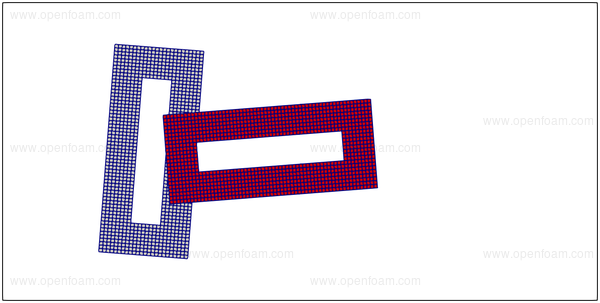
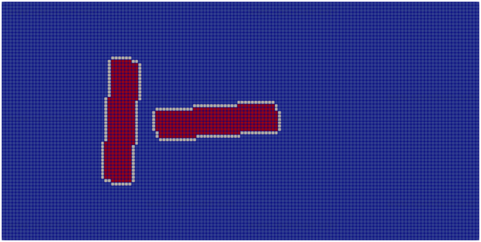

<!-- https://doc.openfoam.com/2606/tools/processing/numerics/overset -->

# Overset

## Overview

The overset framework is a generic implementation of *overset* (also referred to
as *Chimera*) meshes, for both static and dynamic cases. Cell\-to\-cell mappings
between multiple, disconnected mesh regions are employed to generate a
composite domain. This permits complex mesh motions and interactions
without the penalties associated with deforming meshes, for single\- and
multiphase flows.

## How does it work?

Consider the following 2\-D case from the tutorials:

* [twoSimpleRotors](https://gitlab.com/openfoam/core/openfoam/-/tree/OpenFOAM-v2606/tutorials/incompressible/overPimpleDyMFoam/twoSimpleRotors)

The mesh comprises three regions; the background mesh:



and two rotors:





combined to give:



Various concepts are used:

* *Donor cells* : cells that provide values
* *Acceptor cells* : these are the cells whose value gets set from interpolation
* *Hole cells* : unreachable/inactive cells
* *Mesh zone* : indicator field to denote potentially overlapping mesh regions
* *Overset patches* : patch type next to cells that are to be interpolated

The mapping determines which parts of the mesh are:

* solved, *calculated*;
* interpolated from solution cells, *interpolated*; and
* not used, *holes*.

For the `twoSimpleRotors` case, the background mesh yields:



where the colours correspond to:

* blue: calculated
* white: interpolated
* red: blocked (holes)

## Usage

The case must have at least one patch of type `overset`; ideally this is the
first patch. As a [constraint](../boundary-conditions/rtm/constraint.md)
type, it will automatically assume a boundary condition type `overset` when
including the default set\-up file in the `boundaryField` section of the field
files:

```
#includeEtc "caseDicts/setConstraintTypes"

```

Any cells on the outside of the mesh that require interpolation should be on
this patch. Set the mesh type to `dynamicOversetFvMesh` in the
`dynamicMeshDict` file (located in the [constant](../../../fundamentals/case-structure.md)
directory)

```
dynamicFvMesh       dynamicOversetFvMesh;

solver              displacementLaplacian;

displacementLaplacianCoeffs
{
    diffusivity     uniform 1;
}

```

Generate a `0/zoneID` `volScalarField` indicating the mesh zone

not to be confused with `cellZones`

This field can usually be generated using standard OpenFOAM
tools, e.g. [topoSet](../../pre-processing/mesh/manipulation/topoSet.md), *setFields*. It should start at `0`
and be consecutively numbered. There is no limit to the number of zones.

In the [fvSchemes](../../../fundamentals/case-structure/fvschemes.md) dictionary select the
relevant overset interpolation method and which additional variables should be
included. By default, all solved\-for variables and some solver\-specific fields
use overset interpolation.

```
oversetInterpolation
{
    method          inverseDistance;
}

```

If necessary adapt the wall distance calculation to a continuous method,
e.g. `Poisson`, `advectionDiffusion`. The default `meshWave` method does not walk
through the overset interpolation.

Update the solver to an asymmetric variant in the
[fvSolution](../../../fundamentals/case-structure/fvsolution.md) dictionary (the matrix resulting
from interpolation is asymmetric). All asymmetric solvers except from
[GAMG](solvers/multigrid/rtm/GAMG.md) are supported. In practice a good
choice is the [smooth](solvers/smooth.md) solver with
[symGaussSeidel](solvers/smooth/rtm/symGaussSeidel.md)
smoother for transport equations (U, k, etc.) and
[PBiCGStab](solvers/cg/rtm/PBiCGStab.md) with
[DILU](solvers/cg/rtm/preconditioner-DILU.md) preconditioner for elliptic
equations (p, yPsi).

## Further information

Source code:

* [overset](https://gitlab.com/openfoam/core/openfoam/-/tree/OpenFOAM-v2606/src/overset)
* [overLaplacianDyMFoam](https://gitlab.com/openfoam/core/openfoam/-/tree/OpenFOAM-v2606/applications/solvers/basic/laplacianFoam/overLaplacianDyMFoam)
* [overSimpleFoam](https://gitlab.com/openfoam/core/openfoam/-/tree/OpenFOAM-v2606/applications/solvers/incompressible/simpleFoam/overSimpleFoam)
* [overPimpleDyMFoam](https://gitlab.com/openfoam/core/openfoam/-/tree/OpenFOAM-v2606/applications/solvers/incompressible/pimpleFoam/overPimpleDyMFoam)
* [overInterDyMFoam](https://gitlab.com/openfoam/core/openfoam/-/tree/OpenFOAM-v2606/applications/solvers/multiphase/interFoam/overInterDyMFoam)
* [overRhoPimpleDyMFoam](https://gitlab.com/openfoam/core/openfoam/-/tree/OpenFOAM-v2606/applications/solvers/compressible/rhoPimpleFoam/overRhoPimpleDyMFoam)
