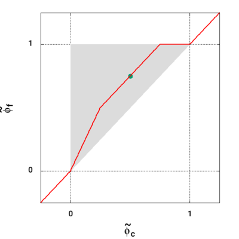

<!-- https://doc.openfoam.com/2606/tools/processing/numerics/schemes/divergence/rtm/MUSCL/ -->

# MUSCL divergence scheme

## Properties

* \<B\>M\</B\>onotone \<B\>U\</B\>pstream\-centered \<B\>S\</B\>chemes for
\<B\>C\</B\>onservation \<B\>L\</B\>aws
* Second order
* Unbounded

## Normalised Variable Diagram



## Usage

The scheme is specified using:

```
divSchemes
{
    default         none;
    div(phi,U)      Gauss MUSCL;
}

```

## Further information

Source code:

* [MUSCL](https://gitlab.com/openfoam/core/openfoam/-/tree/OpenFOAM-v2606/src/finiteVolume/interpolation/surfaceInterpolation/limitedSchemes/MUSCL)

API:

* [Foam::MUSCLLimiter](https://api.openfoam.com/2606/Foam_MUSCLLimiter.html)
