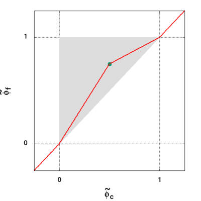

<!-- https://doc.openfoam.com/2606/tools/processing/numerics/schemes/divergence/rtm/Minmod -->

# Minmod divergence scheme

## Properties

* Minimum modulus
* First order
* Unbounded

## Normalised Variable Diagram



## Usage

The scheme is specified using:

```
divSchemes
{
    default         none;
    div(phi,U)      Gauss Minmod;
}

```

## Further information

Source code:

* [Minmod](https://gitlab.com/openfoam/core/openfoam/-/tree/OpenFOAM-v2606/src/finiteVolume/interpolation/surfaceInterpolation/limitedSchemes/Minmod)

API:

* [Foam::MinmodLimiter](https://api.openfoam.com/2606/Foam_MinmodLimiter.html)

Reference:

* *Harten* [23](../../../../../../references.md#harten_high_1983)
