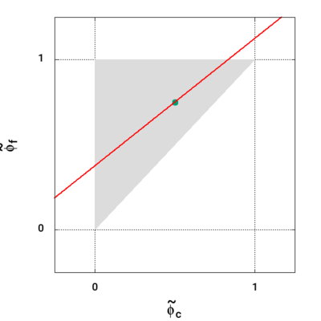

<!-- https://doc.openfoam.com/2606/tools/processing/numerics/schemes/divergence/rtm/QUICK -->

# QUICK divergence scheme

## Properties

* \<B\>Q\</B\>uadratic \<B\>U\</B\>pstream \<B\>I\</B\>nterpolation for \<B\>C\</B\>onvective
\<B\>K\</B\>inematics
* Second order
* Unbounded
* By *Leonard* [41](../../../../../../references.md#leonard_stable_1979)

## Normalised Variable Diagram



## Usage

The scheme is specified using:

```
divSchemes
{
    default         none;
    div(phi,U)      Gauss QUICK;
}

```

## Further information

Source code

* [QUICK](https://gitlab.com/openfoam/core/openfoam/-/tree/OpenFOAM-v2606/src/finiteVolume/interpolation/surfaceInterpolation/limitedSchemes/QUICK)

API:

* [Foam::QUICKLimiter](https://api.openfoam.com/2606/Foam_QUICKLimiter.html)
