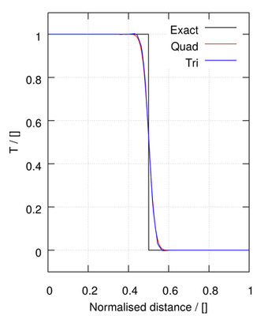

<!-- https://doc.openfoam.com/2606/tools/processing/numerics/schemes/divergence/rtm/UMIST -->

# UMIST divergence scheme

## Properties

* \<B\>U\</B\>pstream \<B\>M\</B\>onotonic \<B\>I\</B\>nterpolation for \<B\>S\</B\>calar
\<B\>T\</B\>ransport
* Second order
* Unbounded
* By *Lien and Leschzinger* [44](../../../../../../references.md#lien_upstream_1994)

## Normalised Variable Diagram



## Usage

The scheme is specified using:

```
divSchemes
{
    default         none;
    div(phi,U)      Gauss UMIST;
}

```

## Further information

Source code:

* [UMIST](https://gitlab.com/openfoam/core/openfoam/-/tree/OpenFOAM-v2606/src/finiteVolume/interpolation/surfaceInterpolation/limitedSchemes/UMIST)

API:

* [Foam::UMISTLimiter](https://api.openfoam.com/2606/Foam_UMISTLimiter.html)
