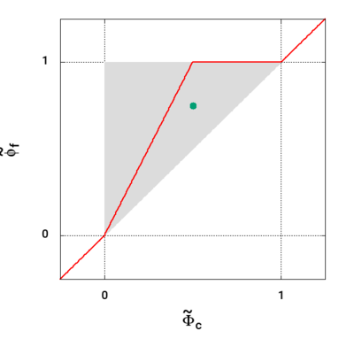

<!-- https://doc.openfoam.com/2606/tools/processing/numerics/schemes/divergence/rtm/limitedLinear -->

# Limited linear divergence scheme

## Properties

* First/second order
* Unbounded

## Normalised Variable Diagram



## Usage

The scheme is specified using:

```
divSchemes
{
    default         none;
    div(phi,U)      Gauss limitedLinear <coeff>;
}

```

## Further information

Source code:

* [limitedLinear](https://gitlab.com/openfoam/core/openfoam/-/tree/OpenFOAM-v2606/src/finiteVolume/interpolation/surfaceInterpolation/limitedSchemes/limitedLinear)

API:

* [Foam::limitedLinearLimiter](https://api.openfoam.com/2606/Foam_limitedLinearLimiter.html)
