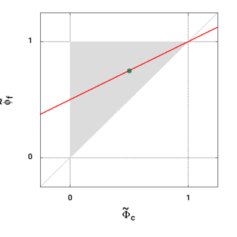

<!-- https://doc.openfoam.com/2606/tools/processing/numerics/schemes/divergence/rtm/linear -->

# Linear divergence scheme

## Properties

* Second order
* Unbounded
* Good choice for LES calculations due to low dissipation
* For isotropic meshes ϕf\=0\.5(ϕc\+ϕd)\\phi\_f \= 0\.5 \\left( \\phi\_c \+ \\phi\_d \\right)ϕf​\=0\.5(ϕc​\+ϕd​)

## Normalised Variable Diagram



## Usage

The scheme is specified using:

```
divSchemes
{
    default         none;
    div(phi,U)      Gauss linear;
}

```

## Further information

Source code:

* [linear](https://gitlab.com/openfoam/core/openfoam/-/tree/OpenFOAM-v2606/src/finiteVolume/interpolation/surfaceInterpolation/schemes/linear)

API:

* [Foam::linear](https://api.openfoam.com/2606/Foam_linear.html)
