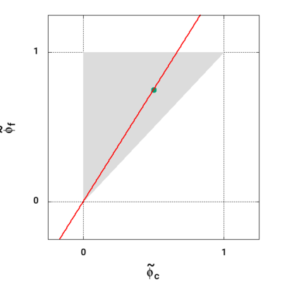

<!-- https://doc.openfoam.com/2606/tools/processing/numerics/schemes/divergence/rtm/linearUpwind -->

# Linear\-upwind divergence scheme

## Properties

* Employs [upwind](upwind.md) interpolation weights,
with an explicit correction based on the local cell gradient
* Second order
* Unbounded
* As shown by *Warming and beam* [86](../../../../../../references.md#warming_upwind_1976)

## Normalised Variable Diagram



## Usage

The scheme is specified using:

```
divSchemes
{
    default         none;
    div(phi,U)      Gauss linearUpwind grad(U);
}

```

## Further information

Source code:

* [linearUpwind](https://gitlab.com/openfoam/core/openfoam/-/tree/OpenFOAM-v2606/src/finiteVolume/interpolation/surfaceInterpolation/schemes/linearUpwind)

API:

* [Foam::linearUpwind](https://api.openfoam.com/2606/Foam_linearUpwind.html)
