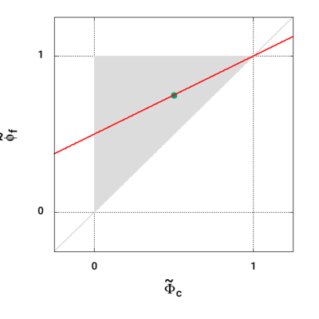

<!-- https://doc.openfoam.com/2606/tools/processing/numerics/schemes/divergence/rtm/midPoint/ -->

# Mid\-point divergence scheme

## Properties

* First/second order
* Unbounded
* Equivalent to [linear](../linear.md) for isotropic meshes
* Face flux computed using
ϕf\=0\.5(ϕc\+ϕd)\\phi\_f \= 0\.5 \\left( \\phi\_c \+ \\phi\_d \\right)ϕf​\=0\.5(ϕc​\+ϕd​)

## Normalised Variable Diagram



## Usage

The scheme is specified using:

```
divSchemes
{
    default         none;
    div(phi,U)      Gauss midPoint;
}

```

## Further information

Source code:

* [midPoint](https://gitlab.com/openfoam/core/openfoam/-/tree/OpenFOAM-v2606/src/finiteVolume/interpolation/surfaceInterpolation/schemes/midPoint)

API:

* [Foam::midPoint](https://api.openfoam.com/2606/Foam_midPoint.html)
