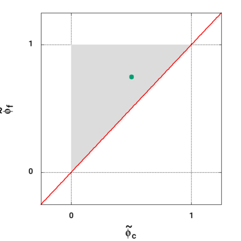

<!-- https://doc.openfoam.com/2606/tools/processing/numerics/schemes/divergence/rtm/upwind -->

# Upwind divergence scheme

## Properties

* First order
* Bounded
* Face value set according to the upstream value
* Equivalent to assuming that the cell values are isotropic with a value that
represents the average value

ϕf\=ϕc\\phi\_f \= \\phi\_cϕf​\=ϕc​

## Normalised Variable Diagram



## Usage

The scheme is specified using:

```
divSchemes
{
    default         none;
    div(phi,U)      Gauss upwind;
}

```

## Further information

Source code:

* [upwind](https://gitlab.com/openfoam/core/openfoam/-/tree/OpenFOAM-v2606/src/finiteVolume/interpolation/surfaceInterpolation/limitedSchemes/upwind)

API:

* [Foam::upwind](https://api.openfoam.com/2606/Foam_upwind.html)

Reference:

* *Spalding* [72](../../../../../../references.md#spalding_novel_1972)
