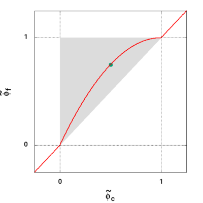

<!-- https://doc.openfoam.com/2606/tools/processing/numerics/schemes/divergence/rtm/vanLeer/ -->

# Van Leer divergence scheme

## Properties

* Second order
* Unbounded
* By *Van Leer* [83](../../../../../../../references.md#van_leer_towards_1974)

## Normalised Variable Diagram



## Usage

The scheme is specified using:

```
divSchemes
{
    default         none;
    div(phi,U)      Gauss vanLeer;
}

```

## Further information

Source code

* [vanLeer](https://gitlab.com/openfoam/core/openfoam/-/tree/OpenFOAM-v2606/src/finiteVolume/interpolation/surfaceInterpolation/limitedSchemes/vanLeer)

API:

* [Foam::vanLeerLimiter](https://api.openfoam.com/2606/Foam_vanLeerLimiter.html)
